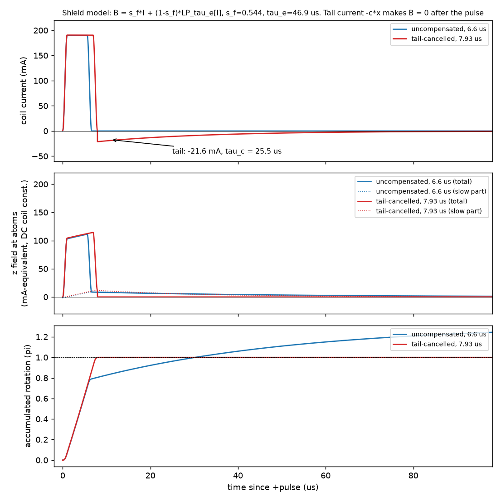
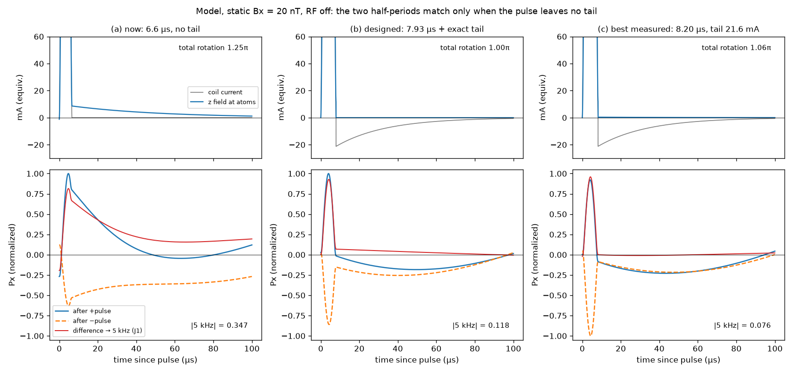
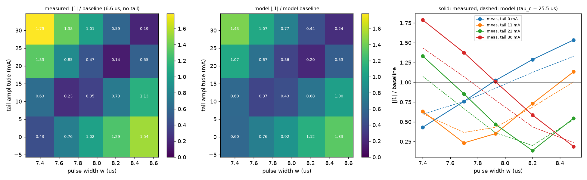
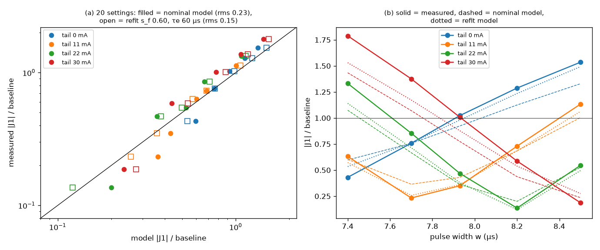
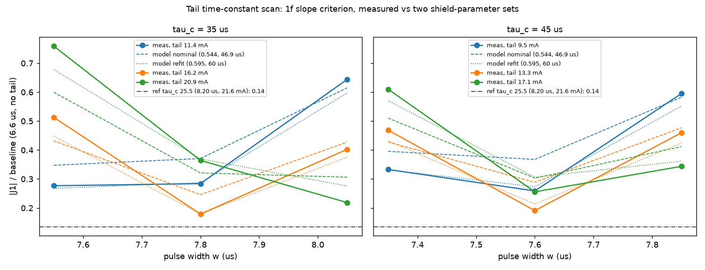
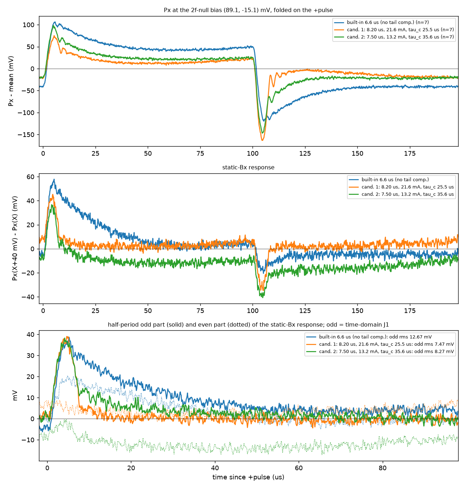
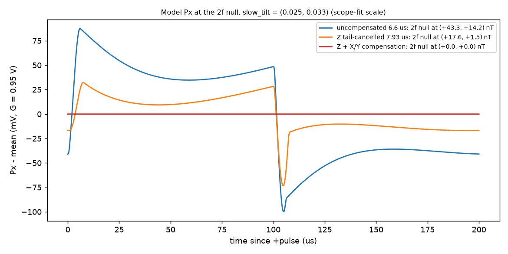

# 用驱动波形消除 Z 脉冲慢拖尾：原理、上机结果与下一步（2026-11-18）

改写前的完整版本保存在 `outputs/结论_改写前.md`，内容没有删减，只是重新组织。

## 先看结论

| 状态 | 结论 | 依据 |
|---|---|---|
| 【已确认】 | 只改 Z 驱动波形就能消掉大部分拖尾：主脉冲后接一段约 −22 mA、按 25 µs 衰减的反向电流，峰值仍是 190 mA | 上机 20 组，最好的一组 \|J1\| 降到基线的 0.14（§4） |
| 【已确认】 | 模型能定量预言实验：20 组实测与模拟形状一致 | 对数偏差 rms 0.23；把屏蔽参数改为 s_f = 0.60、τe = 60 µs 后降到 0.15（图 4） |
| 【已确认】 | 工作波形定为 w = 8.20 µs、尾 21.6 mA（A = 0.114）、τc = 25.5 µs：示波器上脉冲后的慢拖尾消失，残余不到原来的 7%，10 µs 后在噪声内 | 示波器时域快照（§4.3，图 7） |
| 【已确认】 | 给 GS200 加 −0.40 mA 后，补偿波形下 2f 判据恢复：较弱方向灵敏度从 0.027 升到 0.244（9 倍），以零点为中心复测得 2f 零点 (−14.37, −30.57) mV，不确定度 ±0.03 / ±0.01 mV；+0.40 mA 一侧接近 5 kHz 共振，不能用 | §4.4 |
| 【待结论】 | 这个 2f 零点仍含横向拖尾（slow_tilt）造成的偏移（模型约 18 nT ≈ 24 mV），还不是 B⊥ = 0 | 需做 X/Y 横向补偿（附录 A） |
| 【修正】 | 尾时间常数取 τc = 25.5 µs（名义参数 s_f 0.544、τe 46.9 µs）。反拟合参数（s_f ≈ 0.6、τe ≈ 60 µs）能更好地预言 J1 比值，但按它设计的 τc 35.6 µs 尾在示波器上补不干净，残余约 1/3 | §4.2、§4.3 |
| 【已确认】 | J1 最低的波形就是拖尾为零的波形：τc = 25.5 µs 的尾 J1 最低（0.135；τc 35、45 µs 为 0.18、0.19），示波器上也最干净 | §4.2 τc 扫描与 §4.3 时域对照 |
| 【待结论】 | 横向拖尾（slow_tilt）的补偿还没做；反拟合参数为何能改善 J1 比值的预言但不描述拖尾本身 | §5、附录 A |

## 1. 问题：拖尾是什么

线圈装在坡莫合金屏蔽筒里。线圈电流一变，屏蔽筒里的涡流和磁化要几十微秒才跟上，所以原子感受到的场分两部分：

| 部分 | 占比 | 时间特性 |
|---|---|---|
| 快分量 | s_f ≈ 54% | 随电流瞬时出现 |
| 慢分量（拖尾） | 1 − s_f ≈ 46% | 以 τe ≈ 47 µs 慢慢出现、慢慢消失 |

用公式写：原子处的 z 场 = K·[s_f·I + (1 − s_f)·x]。其中 x 是电流经过时间常数 τe 的一阶低通后的值，可以理解为屏蔽筒"记住"的那部分电流。

后果：脉冲结束后 x 还没回零，原子继续被慢场转动。图 1 下图中，不补偿时（蓝线）转角在脉冲内只有 0.8π，之后一路漂到 1.25π。正是这段"脉冲后的转动"破坏了半周期对称性，让静态横场漏进 5 kHz，也把 2f 零点带偏。

图 1（模型）：上为线圈电流，中为原子处 z 场（点线是慢分量），下为累计转角。蓝线是现在的 6.6 µs 脉冲，红线是补偿波形 7.93 µs 加反向尾。补偿后，转角在 8 µs 内到达 π 并停住。

## 2. 方法：脉冲后加一段反向电流

- **思路**：脉冲结束后，让线圈电流反向，取 I = −(1 − s_f)/s_f·x。线圈自己的瞬时场正好抵消屏蔽筒的慢场，原子处的总 z 场等于 0。
- **形状**：在这个电流下，x 以 τc = s_f·τe ≈ 25.5 µs 衰减，所以所需电流正好是一段单指数尾 −A·exp(−(t − w)/τc)。这是精确解，模型中脉冲后的残余约 2×10⁻⁶。
- **不需要 350 mA**：只要求"脉冲之后场为零"，脉冲期间允许场缓慢上升。z 向转动只看总转角，所以峰值不用抬高。代价是脉宽要从 6.6 µs 拉长到约 8 µs：补偿之后没有慢场在脉冲后补转角，要靠主脉冲自己转满 π。

| 设计（190 mA） | w (µs) | 尾起始电流 | τc | 总转角 |
|---|---|---|---|---|
| 模型精确解 | 7.93 | −21.6 mA（A = 0.114） | 25.5 µs | 1.00π |
| 实测最好 | 8.20 | −21.6 mA（A = 0.114） | 25.5 µs | 1.06π（名义模型） |
| 反拟合参数下的精确解 | 7.50 | −13.2 mA（A = 0.069） | 35.7 µs | 1.00π |

## 3. 怎么判断消得干不干净：看 1f 对横场的斜率 J1

**物理图像。** 关射频，只加一个静态横场 Bx。如果每个脉冲都是干净的 π 转动、脉冲后没有残余转动，正脉冲后和负脉冲后两个半周期的 P_x 完全相同，信号只含 10 kHz（2f）。只要还有拖尾或转角不等于 π，两个半周期就不同，差值落在 5 kHz（1f）。

所以 1f 随横场的斜率 J1 量的就是"脉冲不干净"的程度：J1 越小，脉冲越接近理想 π。测 J1 不需要新的实验：bperp_null 本来就在 3×3 的 X/Y 偏置网格上同时读 1f 和 2f，对偏置做线性拟合就得到 J1。

图 2（模型，Bx = 20 nT）：上排是线圈电流（灰）与原子处 z 场（蓝），纵轴截在 60 mA，以便看清拖尾；下排是正脉冲后（蓝）与负脉冲后（橙虚，已取反）的 P_x，红线是两者之差，也就是进入 5 kHz 的部分。
- （a）现在的 6.6 µs：z 场在脉冲后还有约 9 mA 当量的拖尾，两个半周期差得很多，5 kHz = 0.35。
- （b）设计值 7.93 µs 加精确尾：拖尾消失，差值降到 0.12。剩下的来自有限脉宽：脉冲期间横场也在起作用。
- （c）实测最好的 8.20 µs：转角略大于 π，正好抵消一部分有限脉宽项，差值降到 0.08。这也是实测极小落在 8.2 µs、而不是 7.93 µs 的原因。

模型中 J1 在 (A, w) 平面上只有一个极小，转角定在 π ± 0.1%。尾幅 A 只能定到约 10%（附录 B）。τc 不能和 A、w 一起自由搜索：三个参数都放开时，J1 会落到 τc ≈ 12 µs、转角 1.07π 的错误极小，所以上机时固定 τc = 25.5 µs，只扫 A 和 w。

## 4. 上机结果：实验与模拟对照

条件：2026-11-18 15:06–15:36，bperp_null，190 mA，偏置中心 (89.1, −15.1) mV，3×3 网格 ±20 mV，每点 2 次，τc 固定 25.5 µs。共 21 次运行：基线（内置 6.6 µs 波形）加 20 组 (w, A) 波形文件。每次运行的目录记在 `outputs/scan_results.json`，表在 `outputs/scan_results.txt`；最好的一组是 `<数据根>/bperp_null/1118_153016_bperp_null/`。

基线复现：2f 零点 (89.7, −15.5) mV，\|J1\| = 0.54 mV/mV，零点处 c1 = −29.0 + 35.0i mV，与上午三次运行相差几个百分点。

图 3：左为实测 \|J1\|/基线，中为模型（名义参数 s_f = 0.544、τe = 46.9 µs，未做任何调整），右为沿脉宽的切片（实线实测，虚线模型）。两边的暗谷都从左下斜向右上：尾越大，需要的脉宽越长。实测和模型的谷底都在 (8.20 µs, 22 mA) 这一格。

| 尾＼w (µs) | 7.40 | 7.70 | 7.93 | 8.20 | 8.50 |
|---|---|---|---|---|---|
| 0 mA | 0.43 (0.60) | 0.76 (0.76) | 1.02 (0.92) | 1.29 (1.12) | 1.54 (1.33) |
| 11 mA | 0.63 (0.60) | 0.23 (0.37) | 0.35 (0.43) | 0.73 (0.68) | 1.13 (1.00) |
| 22 mA | 1.33 (1.08) | 0.85 (0.67) | 0.47 (0.36) | **0.14 (0.20)** | 0.55 (0.53) |
| 30 mA | 1.79 (1.43) | 1.38 (1.07) | 1.01 (0.77) | 0.59 (0.44) | 0.19 (0.24) |

表中为 \|J1\|/基线，括号内是名义模型的值。

图 4：（a）20 组的实测值与模型值，对数坐标，黑线为相等。实心点用名义参数，空心方块用反拟合参数（s_f = 0.60、τe = 60 µs）。（b）同一组数据按脉宽展开：实线实测，虚线名义模型，点线反拟合模型。
- 名义模型已经抓住了谷的位置和走向。它的系统偏差是对比度偏低：远离谷底时实测更大，谷底处实测更小。
- 反拟合后偏差从 0.23 降到 0.15，30 mA 和 0 mA 两条线贴合得明显更好。
- 反拟合结果随单个点移动明显（只用 20 组时得 τe = 72 µs），说明只靠 \|J1\| 约束不住两个参数。可以确定的只有倾向：τe 比 47 µs 长，对应 τc ≈ 36–44 µs。

**零点处 c1**：越靠近谷底，2f 零点处的 1f 越小，从基线的 45 mV 降到最好一组的 16 mV。但补偿组的 2f 零点外推不准（见 §5），这一项只能定性参考。

### 4.2 第二轮：τc 扫描

条件：2026-11-18 15:56–16:26，条件同第一轮，20 次全部完成。
- 基线和第一轮最好点各复测一次；
- τc = 35 µs：w ∈ {7.55, 7.80, 8.05} × A ∈ {0.060, 0.085, 0.110}；
- τc = 45 µs：w ∈ {7.35, 7.60, 7.85} × A ∈ {0.050, 0.070, 0.090}。

复现：基线 \|J1\| = 0.551 mV/mV（第一轮 0.540），参照点的比值 0.135（第一轮 0.136），一小时内漂移约 2%。数值在 `outputs/scan2_results.txt`，小结在 `outputs/tauc_scan_summary.md`。

图 6：τc = 35 µs（左）与 45 µs（右）下 \|J1\|/基线随脉宽的变化。实线实测，虚线名义模型，点线反拟合模型（s_f = 0.595、τe = 60 µs）。点划线是 τc = 25.5 µs 参照点的 0.14。

| τc | 最好的一组 | 实测 | 名义模型 | 反拟合模型 |
|---|---|---|---|---|
| 25.5 µs（参照） | 8.20 µs，21.6 mA | **0.135** | 0.199 | 0.121 |
| 35 µs | 7.80 µs，16.2 mA | 0.179 | 0.246 | 0.179 |
| 45 µs | 7.60 µs，13.3 mA | 0.191 | 0.289 | 0.213 |

- **反拟合参数更好地预言了 J1 比值。** s_f = 0.595、τe = 60 µs 只用第一轮的数据拟合得到，对第二轮 18 组新数据的对数偏差为 0.098，名义参数为 0.232，图 6 里点线几乎压在实线上。但 §4.3 的示波器快照表明，按它设计的尾（τc 35.6 µs）补不干净。所以它只是更好的 J1 经验描述，并不代表屏蔽筒的真实时间响应。（此条已修正：示波器验证之前，这里曾写作"屏蔽响应更接近 τe ≈ 60 µs"。）
- **J1 最低的仍是 τc = 25.5 µs。** τc 越长，谷越浅：0.135 → 0.179 → 0.191，两组模型都预言了这个顺序。示波器（§4.3）显示，这个波形同时也是脉冲后拖尾最干净的波形。
- **选定**：τc = 25.5 µs、8.20 µs、21.6 mA（§4.3 示波器确认）。
- 2f 较弱方向的灵敏度在第二轮仍偏低（0.003–0.051），w ≥ 7.8 µs 时多在 0.01 以下。
- **联合反拟合**（两轮 38 组，`scan_fit_all.py` → `outputs/scan_fit_all.txt`）：s_f = 0.594 ± 0.005，τe = 59.9 ± 1.8 µs（两者相关 +0.97），对数偏差 0.125，名义参数为 0.225。对应 190 mA 下脉冲后 z 场为零的波形：w = 7.505 µs，尾 13.2 mA（A = 0.0696），τc = 35.6 µs。按 §4.3 的时域结果，这组参数推出的"z 场为零"波形并不成立，见上文。

### 4.3 示波器时域确认（16:35–16:43）

做法：
- 由 GUI 的 bperp_null 会话驱动脉冲：A01–A03，1 个网格点，结束后脉冲保持输出。
- 会话等待期间，在关温控约 0.31 s 的窗口内冻结 DHO924 画面（CH1 = P_x，CH2 = 10 Ω 采样电阻），恢复温控后读出，再执行 A04 收尾。
- 3 种波形 × 2 个 X 偏置（89.1 和 129.1 mV，Y = −15.1 mV），共 6 张。每张 1 ms，折叠 7 个周期。
- 两张相减得到静态 Bx 响应 d(t)。理想 π 脉冲下 d 的两个半周期相同，所以奇部 [d(t) − d(t + 100 µs)]/2 就是时域版的 J1。脉冲结束后奇部还有多少，就是拖尾还剩多少。
- 数据：`<数据根>/scope_px_snapshot/1118_163546_tail_comp/`；分析：`scope_analysis.py` → `outputs/scope_px_summary.txt`、`outputs/scope_px_windows.txt`。

图 7：上为 2f 零点偏置下的 P_x，中为静态 Bx 响应（X + 40 mV 减去 X），下为它的半周期奇部（实线，时域 J1）和偶部（点线）。

| 波形 | 脉冲内峰值 | 脉冲后 2–10 µs | 10–30 µs | 30–60 µs |
|---|---|---|---|---|
| 内置 6.6 µs（不补偿） | 38.7 mV | 23.3 mV | 13.1 mV | 5.1 mV |
| 候选一：8.20 µs、21.6 mA、τc 25.5 µs | 39.0 mV | **1.6 mV（7%）** | **0.25 mV** | **−0.45 mV** |
| 候选二：7.50 µs、13.2 mA、τc 35.6 µs | 38.2 mV | 8.4 mV（36%） | 4.2 mV（32%） | 2.0 mV（39%） |

表中为静态 Bx 响应奇部在各时间窗内的平均值；每个窗的噪声约 0.4 mV。
- **不补偿**：脉冲后奇部以约 20 µs 的时间常数慢慢回零，这就是拖尾。
- **候选一**：脉冲一结束奇部就回到零附近，10 µs 后已在噪声内，拖尾消掉 93% 以上。
- **候选二**：仍有约 1/3 的残余，尾偏小、偏慢，补偿不足。
- 三者在脉冲内的峰值相同（约 38 mV）。这部分来自脉冲期间横场的作用，即有限脉宽项，不是拖尾。
- 2f 零点偏置下的 P_x（上图）峰峰值为 226 / 238 / 245 mV。三种波形的 2f 零点不同，这一组不直接比较。

### 4.4 提高残余 Bz 恢复 2f 判据（19:05–19:14）

代码：bperp_null 新增 `MAIN_FIELD_ENABLED` / `MAIN_FIELD_CURRENT_MA`（提交 f27a984，发布 lab-20261118-15）。A02 按设定给 GS200 设直流电流并回读，A04 复原。

条件：工作波形（8.20 µs、21.6 mA、τc 25.5 µs），偏置中心 (89.1, −15.1) mV，5×5 网格 ±60 mV、步进 30，每点 2 次。
- GS200 约 11 kHz/mA（8.07 mA ≈ 90 kHz，用户给出），±0.40 mA 约 ±4.5 kHz。
- 残余 Bz ≈ 1.4 kHz 的方向未知，所以两种符号各测一次。
- 分析：`bz_analysis.py` → `outputs/bz_results.{txt,json}`。

| 主磁场 | 运行目录 | \|J1\| | 2f 强/弱方向灵敏度 | 2f 零点 (mV) | 不确定度 (mV) | 拟合残差 |
|---|---|---|---|---|---|---|
| 关（对照） | 1118_190503 | 0.076 | 0.597 / 0.027 | (+135.9, −11.7) | ±2.7 / ±0.15 | 0.34 mV |
| +0.40 mA | 1118_190810 | 0.151 | 1.49 / 0.148 | 网格内无零点，\|c2\| ≥ 90 mV | — | 22 mV |
| −0.40 mA | 1118_191117 | 0.107 | 1.10 / 0.244 | (−23.4, −31.8)，网格外外推 | ±2.2 / ±0.6 | 1.4 mV |
| **−0.40 mA，以零点为中心 ±20 mV、步进 10** | 1118_191524 | 0.121 | **1.16 / 0.289** | **(−14.37, −30.57)** | **±0.03 / ±0.01** | 0.044 mV |

- **对照可复现**：主磁场关闭时 \|J1\| 和 2f 零点与 15:57 的参照点一致（0.075，(135.7, −11.7) mV），三个多小时内几乎没有漂移。
- **−0.40 mA 让 2f 判据恢复**：较弱方向灵敏度提高到 9 倍，比内置 6.6 µs 基线（0.081）还高 3 倍。
- **居中复测**：以外推零点为中心复测（±20 mV），零点落在网格内，为 (−14.37, −30.57) mV。±20 mV 内线性很好，残差 0.044 mV，零点不确定度约 0.03 mV。外推值在 X 方向偏了 9 mV，所以补偿波形下的 2f 零点必须居中复测确认。
- **+0.40 mA 不能用**：整张网格上 \|c2\| 都在 90–234 mV，线性拟合残差 22 mV，找不到零点。推测这一符号与残余 Bz 同向，合成后接近 5 kHz 的脉冲重复频率，共振放大了脉冲同步的小横场（如横向拖尾）。这一点只是推测，没有测拉莫尔频率核实。
- 实测提升（9 倍）比模型对 3 kHz 的预言（2.9 倍）大，说明合成后的 |Bz| 可能不是 3 kHz，或模型在这一区间不准。真实 |Bz| 需要另测拉莫尔频率。
- 零点处 c1 为 12 mV（关闭时 16 mV），主要来自横向拖尾。这个 2f 零点仍被 slow_tilt 带偏，模型估计约 18 nT ≈ 24 mV，要做 X/Y 横向补偿后才是 B⊥ = 0。

## 5. 还没解决的问题

| 问题 | 现象 | 原因或判断 | 对策 |
|---|---|---|---|
| 2f 判据变弱 | 已解决：GS200 −0.40 mA 后较弱方向灵敏度 0.244（§4.4） | 较弱方向灵敏度来自 z 向场，拖尾消除后只剩残余 Bz | 在零点 (−23.4, −31.8) mV 附近用 ±20 mV 网格复测；+0.40 mA 一侧避开 |
| 反拟合参数的含义 | s_f ≈ 0.6、τe ≈ 60 µs 更好地预言 J1 比值，但按它设计的尾在示波器上补不干净 | J1 对比度的偏差可能来自模型的其他简化（Γ、残余 Bz、检测带宽或第二个时间常数），不是屏蔽时间常数本身 | 低优先级；工作波形已由时域确认（§4.3） |
| 横向拖尾未补 | 补 Z 之后，2f 零点仍会被 slow_tilt 带偏约 18 nT（模型） | 屏蔽筒的慢场带有 2–3% 横向分量，Z 线圈管不了 | X/Y 叠加与 Z 同步的补偿波形 κ·x(t)，调到 2f 零点处 c1 = 0（附录 A）；需要 X/Y 改任意波并接同一外触发 |
| 时域验证 | 已完成（§4.3） | — | — |
| MFLI 间歇被"占用" | 两次连接被拒、一次读到 NaN | 占用方 192.168.150.245 是本机 USB 网卡地址，来自本机的另一个会话（例如浏览器里开着的 LabOne 页面） | 上机前关闭本机 LabOne 网页；原因见附录 D 第 6 条 |

## 6. 下一步

1. （已完成）示波器时域确认：工作波形定为 8.20 µs、21.6 mA、τc 25.5 µs（§4.3）。
2. （已完成）τc 扫描（§4.2）。
3. （已完成）提高残余 Bz（§4.4）：用 GS200 −0.40 mA，居中复测得 2f 零点 (−14.37, −30.57) mV。还需测一次拉莫尔频率，核实合成后的 |Bz|。
4. 做 X/Y 横向补偿（附录 A），再用 2f 判据正式补平 XY。

---

## 附录 A：横向补偿判据 D（原 §4）

**原理**：静态横场只进 2f，所以 2f 零点处剩下的 c1 主要来自横向拖尾。在 X/Y 线圈上叠加补偿波形 κ·x(t)，其中 x(t) 是 Z 驱动经 τe 低通的结果，与 Z 同步输出；把 κx、κy 调到 2f 零点处 c1 = 0，此时 2f 零点就是真正的 B⊥ = 0。

**为什么补偿形状是 x(t)**：横向拖尾可能 ∝ 慢分量 x（A 型，磁化方向偏离 z），也可能 ∝ 涡流 I − x（B 型）。示波器 P_x 分不出这两种：线性拟合 R² 都是 0.9888（`outputs/transverse.txt`）。但 Z 补偿后，脉冲后 I = −(1 − s_f)/s_f·x，于是 I − x ∝ x，线圈轴倾斜（∝ I）在脉冲后也 ∝ x。所以无论哪种来源，脉冲后的横向场都 ∝ x(t)。

模型验证（`check_d.py` → `outputs/check_d.txt`，Z 精确补偿 7.93 µs）：

| 横向拖尾来源 | 不补 X/Y 时 2f 零点 (nT) | 解 c1=0 得 κ | 补后 2f 零点 (nT) | 补后 \|c1\| |
|---|---|---|---|---|
| A 型 slow_tilt (0.025, 0.033) | (+17.6, +1.5) | (−0.025, −0.033)，即 −slow_tilt | (0.00, 0.00) | 5×10⁻¹⁵ |
| B 型涡流 ε = 0.03 | (−23.2, +0.7) | (+0.055, +0.055) = ε/s_f | (+7.1, +3.2) | 2×10⁻¹⁶ |
| 线圈轴倾斜 0.02（只 ∝ I） | (+2.4, −1.6) | (+0.020, 0) | (+4.1, −1.6) | 2×10⁻¹⁶ |
| A 型 + 线圈轴倾斜 0.02 y | (+9.8, +4.7) | (−0.025, −0.013) | (+1.6, +4.1) | 3×10⁻¹⁶ |
| 泵浦倾斜 0.02 x | (0, +1.6) | (0, 0) | (0, +1.6) | 9×10⁻¹⁶ |

对照：不补偿 6.6 µs、A 型 (0.025, 0.033) 时，2f 零点在 (+43.3, +14.2) nT。

- κ 有唯一解，并且正好是"脉冲后横向场抵消"的那个值。
- 补后剩余的零点误差，只来自脉冲期间横向分量造成的转轴倾斜（每 2% 约 4 nT），以及泵浦倾斜（每 2% 约 1.6 nT）。这几项不进入 c1，任何 1f/2f 判据都看不见。
- 与 Z 尾幅误差无关（`outputs/check_bias.txt`）：在精确点、J1 极小点和尾幅偏 ±20% 处，D 之后的 2f 零点都是 (0.00, 0.00) nT，因为 x(t) 由实际的 Z 驱动算出，自动跟随。

图 5（模型，G 取 0.95 V）：2f 零点处的 P_x。不补偿时峰峰约 190 mV；只补 Z 时约 105 mV，零点在 (+17.6, +1.5) nT；Z 与 X/Y 都补后 P_x ≡ 0。

## 附录 B：J1 判据的模型检验与稳健性（原 §3、§5）

模型中 J1 在 (A, w) 平面上的极小（`scan_j1.py` → `outputs/j1_map.txt`；`figures/fig2_j1_map.png`）：

| 状态 | \|J1\|（P/nT） | 相对不补偿 |
|---|---|---|
| 不补偿，6.6 µs（现状） | 1.12×10⁻³ | 1 |
| 精确补偿，7.93 µs、A = 0.114 | 3.8×10⁻⁴ | 0.34 |
| J1 极小：8.22 µs、A = 0.128 | 1.9×10⁻⁴ | 0.17 |
| 参照：无拖尾（s_f = 1）的 π 脉冲 | 2.2×10⁻⁴ | 0.20 |

- 5 个起点都收敛到同一个极小，转角 1.001π。
- 极小点的 A 比精确值偏大 8%：有限脉宽本身留下约 2×10⁻⁴ 的 J1 底，适度过补偿会抵消一部分。可以把测得的极小 A 乘 0.93 修正。

稳健性（`robust_j1.py` → `outputs/robust_j1.txt`，τc 固定 25.5 µs）：

| 情况 | J1 极小 A / w (µs) | 极小处转角 | 脉冲后残余拖尾 |
|---|---|---|---|
| 基准 | 0.128 / 8.22 | 1.001π | 7.8% |
| 工作点偏离零场 (45, 14) nT | 0.128 / 8.22 | — | 同上 |
| 存在 slow_tilt (0.025, 0.033) | 0.128 / 8.22 | — | 同上 |
| 真 s_f = 0.63（+15%） | 0.095 / 7.52 | 1.009π | 13% |
| 真 τe = 54 µs（+15%） | 0.130 / 8.46 | 1.016π | 10% |
| 真 τe = 40 µs（−15%） | 0.123 / 7.94 | 0.983π | 5.4% |

工作点偏离和 slow_tilt 都不移动 J1 极小。拖尾参数偏 15% 时，转角仍定在 π ± 2%，原拖尾的 87% 以上仍被消掉。τc 放开后，每种情况都落到 τc ≈ 11–15 µs 的错误极小。

## 附录 C：补偿波形参数与 GUI 接口（原 §2、§7）

190 mA、升余弦沿 1 µs、名义参数下：

| w (µs) | A | 尾起始电流 (mA) | τc (µs) | 补偿后转角 |
|---|---|---|---|---|
| 6.6 | 0.0933 | −17.7 | 25.5 | 0.80π |
| 7.5 | 0.1073 | −20.4 | 25.5 | 0.93π |
| 7.93 | 0.1139 | −21.6 | 25.5 | 1.00π |
| 8.5 | 0.1225 | −23.3 | 25.5 | 1.09π |

- 每个脉冲的尾延续到下一个半周期，100 µs 后剩约 2.7%，`drive()` 已按周期叠加。平均功耗增加不到 1%。
- GUI 接口已在开发目录实现、尚未发布：开关 `Z_WAVEFORM_FROM_FILE` 加下拉 `Z_WAVEFORM_FILE`，列出运行目录 `data/z_waveforms/*.csv`。
  - 文件格式：一个周期，16384 行，单列归一化电流，最大绝对值为 1，对应 `Z_PEAK_CURRENT_MA`；`#` 注释行记录生成参数。
  - 预检：点数、数值有限、最大值等于 1、首尾连续；电阻功耗按 mean(v²) 计算。
  - 记录：文件复制到运行目录 `raw/z_waveform.csv`，文件名、SHA-256 与注释头写进 `experiment_config.yaml`。
  - 生成工具：`tools/make_z_waveform.py --width 7.93 --tail-a 0.114 --tau-c 25.5`。
  - 说明见开发目录 `docs/experiments/bperp_null.md`「Z 波形文件」。

## 附录 D：待查

1. s_f、τe 来自单时间常数拟合，实际可能有第二个时间常数；上机反拟合倾向 τe ≈ 60 µs，但约束不足。
2. 横向拖尾的绝对大小依赖检测增益 G（0.9–1.0 V/单位极化）。Y 方向 1f、2f 两条路径推出的 G·k 相差 1.8 倍，Y 线圈轴可能不正。
3. 1200B 在小电流下的偏置/交越误差未测，可用示波器 CH2 直接看尾电流。
4. X/Y 补偿需要 X/Y 通道改为任意波并与 Z 同步触发。X/Y 在 DG4E261300664，Z 与 Time_sequence_2 在 DG4E261300744，需要把外触发同时接到 X/Y 那台，接线由用户确认。
5. τc 的独立标定：已由示波器时域完成（§4.3），τc = 25.5 µs 正确。反拟合参数（τe ≈ 60 µs）推出的 35.6 µs 不对。
6. MFLI 间歇被"占用"：占用方 192.168.150.245 是本机 USB RNDIS 网卡地址（MFLI 为 192.168.150.246），说明占用连接来自本机，经 USB 直连仪器。LabOne 网页服务日志显示 15:12:34–15:13:03 有网页会话把 dev30661 接回 127.0.0.1:8004；Windows 系统日志里没有网卡掉线记录；MFLI 端日志未读取。

## 文件

| 文件 | 内容 |
|---|---|
| `tailcomp.py` | 补偿模型：`exact_tail`、`drive`、`fields`、`simulate`、`response`、`rotation` |
| `make_compare_figs.py` | 图 2（`fig_j1_physics.png`）与图 4（`fig_meas_vs_model.png`）；逐点数值在 `outputs/meas_vs_model.npz` |
| `make_figs.py` | 图 1、图 5 与 `fig2_j1_map.png` |
| `scan_analysis.py` | 第一轮 (A, w) 上机结果整理 → `outputs/scan_results.{json,txt}`、图 3（`fig4_scan_j1.png`） |
| `scan2_analysis.py` | 第二轮 τc 扫描（35、45 µs）分析 → `outputs/scan2_results.*`、图 6（`fig5_tauc_scan.png`）；小结 `outputs/tauc_scan_summary.md` |
| `scan_fit_all.py` | 两轮 38 组联合反拟合 s_f、τe → `outputs/scan_fit_all.txt` |
| `scope_analysis.py` | 示波器快照折叠与奇偶分解 → 图 7（`fig7_scope_px.png`）、`outputs/scope_px_summary.txt`、`outputs/scope_px_windows.txt`；采集脚本副本 `scope_capture.py`（经 GUI 会话驱动脉冲，直连示波器与温控开关） |
| `scan_fit.py` | 用实测 \|J1\| 反拟合 s_f、τe → `outputs/scan_fit.txt` |
| `scan_j1.py`、`robust_j1.py` | J1 极小搜索与稳健性 |
| `transverse.py`、`check_d.py`、`check_bias.py` | 横向拖尾形状与 D 判据 |
| `j2_condition.py`、`plan_tauc.py` | 2f 灵敏度、τc 扫描计划 |
| `make_waveform.py` → `waveforms/*.csv` | 样例波形文件 |
| `compmodel.py` | 初版模型（尾为低通近似），保留不用 |
