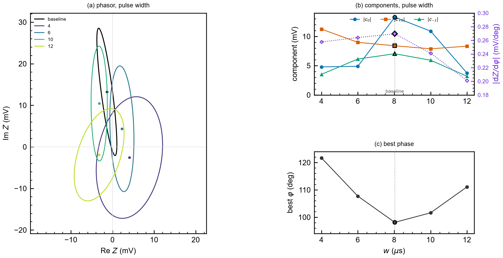
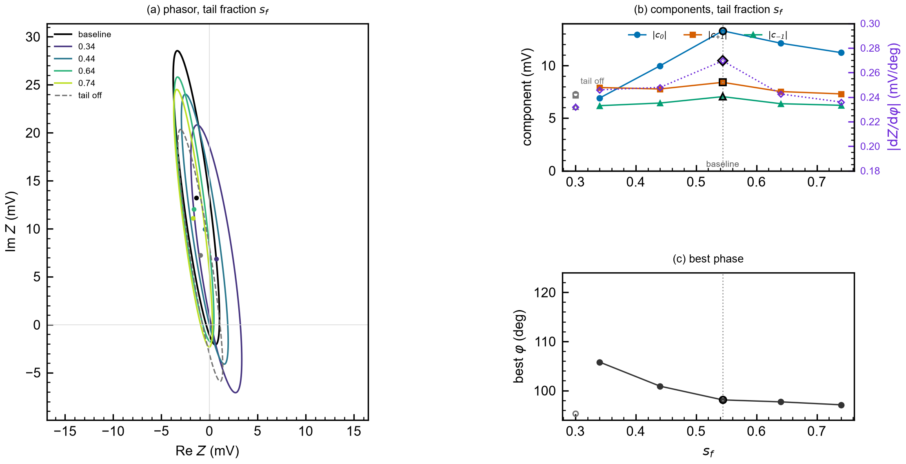
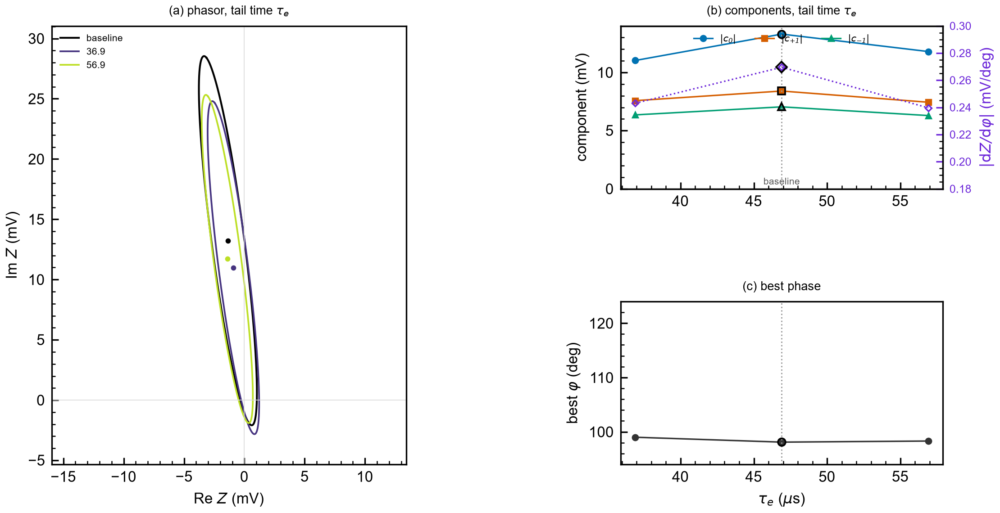
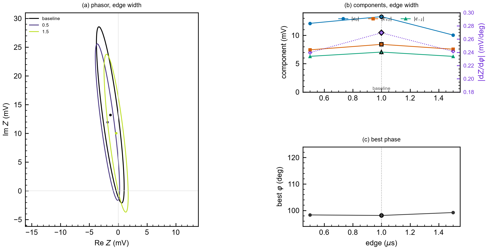
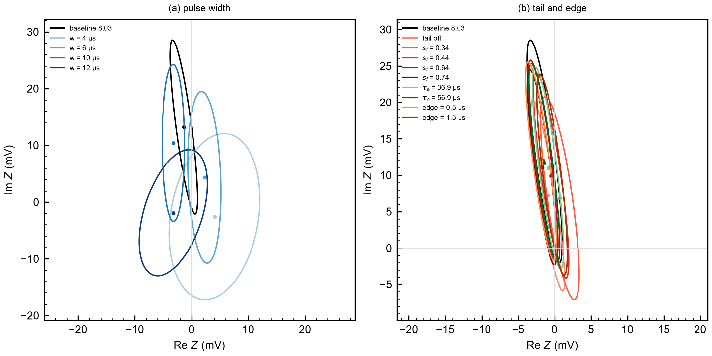
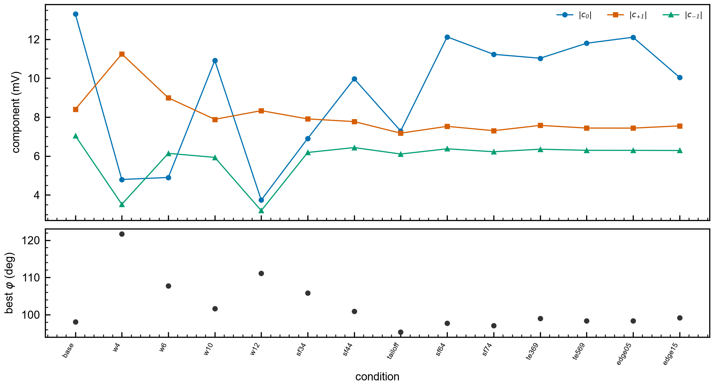
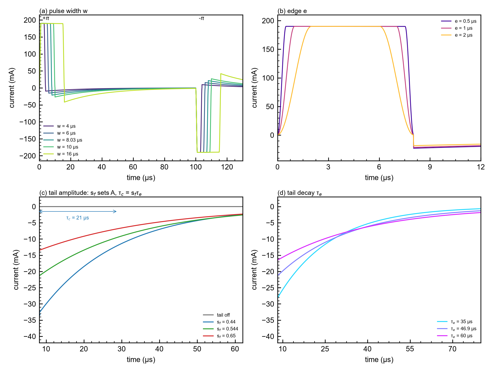

# 脉冲参数扫描（零场，2026-11-19）

问：Z=0 时，脉宽 $w$、拖尾比例 $s_f$、拖尾时间 $\tau_e$、沿宽如何各自影响响应？答案：宽度定翻转角（最强），$s_f$ 主要动 $c_0$，$\tau_e$ 与沿宽是弱参数。

## 运行条件

固定 5 kHz、50 mVpp、190 mA，相位 0–360°/10°（36 点）、`N_REPEAT=1`、单点 0.2 s、稳定 0.1 s、温控分组 2、组末等待 2.0 s；主磁场为 0。

| 标签 | 条件 | 运行目录 |
| --- | --- | --- |
| baseline | w=8.03 µs，s_f=0.544，τe=46.9 µs，edge=1.0 µs | `1119_092825_rf_phase_response` |
| w4 | w=4 µs | `1119_103941_w4` |
| w6 | w=6 µs | `1119_104134_w6` |
| w10 | w=10 µs | `1119_104327_w10` |
| w12 | w=12 µs | `1119_104537_w12` |
| tailoff | 关闭拖尾补偿 | `1119_104734_tailoff` |
| sf34 | s_f=0.34 | `1119_104933_sf34` |
| sf44 | s_f=0.44 | `1119_105143_sf44` |
| sf64 | s_f=0.64 | `1119_105354_sf64` |
| sf74 | s_f=0.74 | `1119_105605_sf74` |
| te369 | τe=36.9 µs | `1119_105819_te369` |
| te569 | τe=56.9 µs | `1119_110030_te569` |
| edge05 | edge=0.5 µs | `1119_110248_edge05` |
| edge15 | edge=1.5 µs | `1119_110459_edge15` |

## 结果

| 标签 | \|c0\| (mV) | \|c+1\| (mV) | \|c−1\| (mV) | 最佳 φ |
|---|---|---|---|---|
| w=4 µs | 4.80 | 11.24 | 3.52 | 121.7° |
| w=6 µs | 4.90 | 8.99 | 6.14 | 107.7° |
| w=8.03 µs | 13.29 | 8.40 | 7.04 | 98.1° |
| w=10 µs | 10.91 | 7.89 | 5.93 | 101.6° |
| w=12 µs | 3.74 | 8.33 | 3.19 | 111.1° |
| tail off | 7.29 | 7.17 | 6.10 | 95.3° |
| s_f=0.34 | 6.91 | 7.91 | 6.18 | 105.8° |
| s_f=0.44 | 9.97 | 7.77 | 6.43 | 100.9° |
| s_f=0.64 | 12.12 | 7.52 | 6.37 | 97.7° |
| s_f=0.74 | 11.23 | 7.30 | 6.22 | 97.1° |
| τe=36.9 µs | 11.02 | 7.57 | 6.35 | 99.0° |
| τe=56.9 µs | 11.79 | 7.44 | 6.29 | 98.3° |
| edge=0.5 µs | 12.10 | 7.43 | 6.29 | 98.3° |
| edge=1.5 µs | 10.04 | 7.55 | 6.28 | 99.2° |

**宽度**：8.03 µs 是 π 脉宽，$|c_{+1}|+|c_{-1}|$ 最大；4 µs 只有一半翻转，旋转项不对称（11.2 vs 3.5 mV）；12 µs 越过 π，反旋项掉到 3.2 mV。**拖尾**：$s_f$ 从 0.34 到 0.74，`|c0|` 从 6.9 单调升到 12.1 mV，`|c±1|` 只降 6–8%。**τe 与沿宽**：在扫描范围内分量变化 ≤4%，属弱参数。

## 图



图 P1：宽度 4/6/8.03/10/12 µs（基线参与连线，用黑色空心标记 + 竖点线标出）。左为相量椭圆，右上为三分量与切线斜率（右轴 mV/deg），右下为最佳相位。



图 P2：s_f = off/0.34/0.44/0.544/0.64/0.74，版式同 P1。



图 P3：τe = 36.9/46.9/56.9 µs，版式同 P1。



图 P4：edge = 0.5/1.0/1.5 µs，版式同 P1。



图 P5：宽度组与拖尾/沿宽组的相量叠加，看椭圆形状与朝向如何随参数变化。



图 P6：全部 14 个条件的 $|c_0|$、$|c_{\pm1}|$、切线斜率与最佳相位一次看全。



图 P7：教学图——斜率脉冲的驱动波形随宽度、沿宽、拖尾 $s_f$、$\tau_e$ 的变化（不含实测）。

## 关键关系

椭圆半长轴 $A=|c_{+1}|+|c_{-1}|$，最大切线斜率

```
max |dZ/dφ| = A × π/180   （mV/deg）
```

最快点在短轴端点，而不是长轴端点。

## 宽度复跑

w=6、w=10 各多测一次（`1119_125110_w6r`、`1119_125305_w10r`），用来验证 w10 的 `|c0|` 偏高不是瞬时异常：

| 量 | w6 | w6r | w10 | w10r |
| --- | --- | --- | --- | --- |
| \|c0\| (mV) | 4.90 | 4.68 | 10.91 | 10.88 |
| \|c+1\| (mV) | 8.99 | 9.32 | 7.89 | 8.38 |
| \|c−1\| (mV) | 6.14 | 6.40 | 5.93 | 6.43 |
| 最佳 φ | 107.7° | 107.4° | 101.6° | 99.8°（等价点 279.8°） |

w10 的 `|c0|≈10.9 mV` 复现（10.91 → 10.88），确认不是瞬时异常；其余分量在 4–8% 内。

## 结论

- **【已确认】** 宽度决定翻转角，8.03 µs（≈π）附近 $|c_{-1}|$ 最大；宽度偏离 π 会同时破坏两臂对称性。
- **【已确认】** 零场下拖尾幅度主要移动 $|c_0|$，对 $|c_{\pm1}|$ 与最佳相位影响小。
- **【待查】** 零场最大斜率只有约 1.29 mV/deg（w=4 的 11.24+3.52 反而更大是因为两臂不对称，见 P1），真正的高响应在 Z 共振上（见 `../20261119_z_field_scan/`）。

## 复现

```powershell
$env:LAB_DATA_ROOT = "D:\Code\exp_agent_run\data"
agent_exp_env\Scripts\python.exe scripts\rf_phase_response\20261119_pulse_params\scripts\compare_per_param.py
agent_exp_env\Scripts\python.exe scripts\rf_phase_response\20261119_pulse_params\scripts\compare_phase_runs.py
```

- `scripts/compare_per_param.py`：生成 P1–P4（经 `data_root()` 读 `rf_phase_response/` 下各运行），输出到本目录 `figures/`。
- `scripts/compare_phase_runs.py`：生成 P5、P6 与 `figures/components.csv`。
- `scripts/plot_waveform_params.py`：生成 P7（只依赖波形模型，不读运行数据）。
- 单次运行自带的相量图在各自 `results/phase_response_phasor.png`。

## 注意

- `N_REPEAT=1`，没有逐点标准误，`fit_quality` 不具判别力。
- TEC（COM13）缺失，运行中 `temp_c` 为空。
- `compare_per_param.py` 在当前数据上报 `KeyError: 'components'`：19 个后续运行的摘要缺该字段（原脚本代码相同、同样失败），重跑前需按标签白名单筛选运行。

## 与 Z 的关系

本批在 Z=0；同样的参数在 Z=−0.06 mA 上重测过一遍，结论并不完全一样（拖尾在那里主要压 $c_0$、对斜率几乎无影响，且叠加后 $c_0$ 可压到 3 mV 量级），见 `../20261119_pulse_params_at_z06/`。
