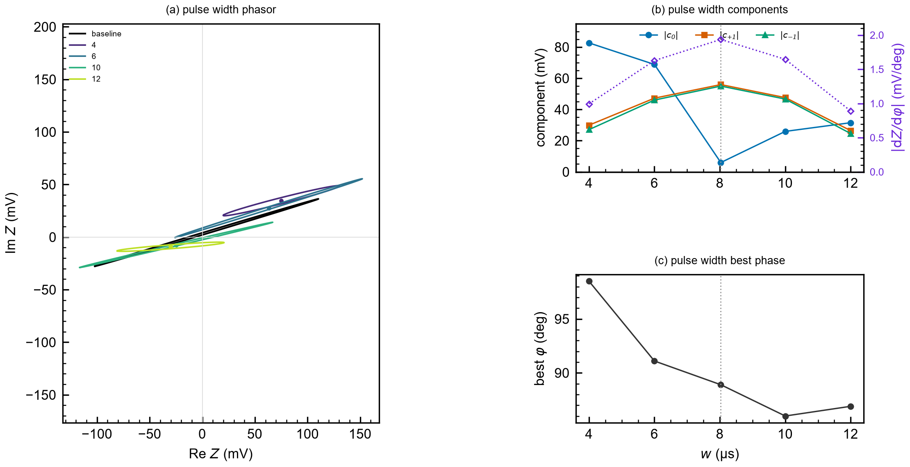
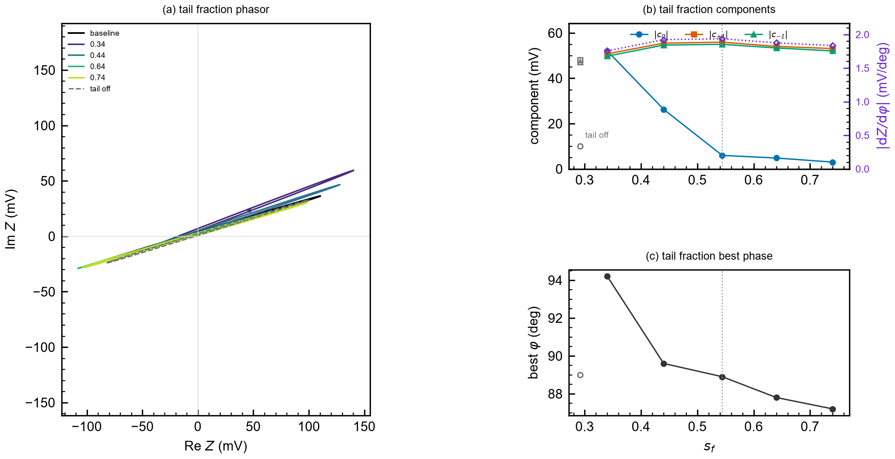
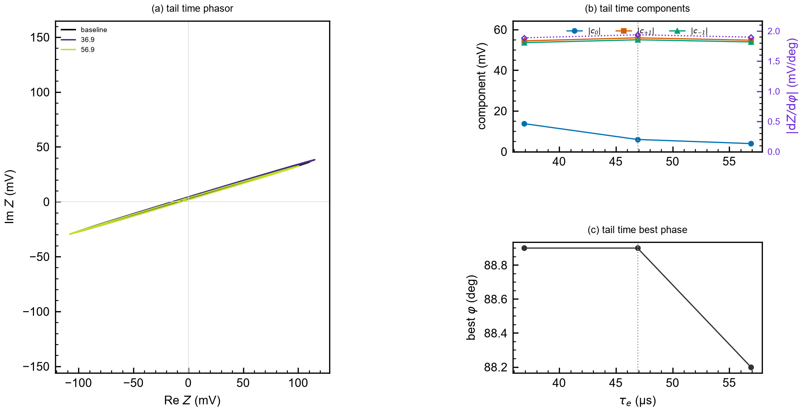
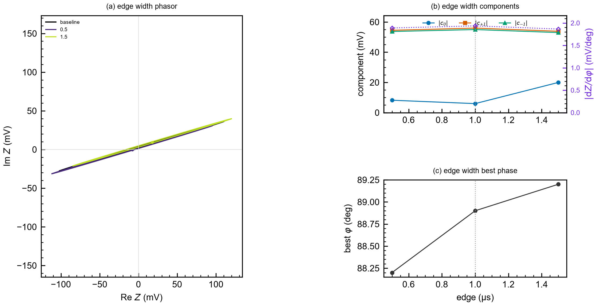
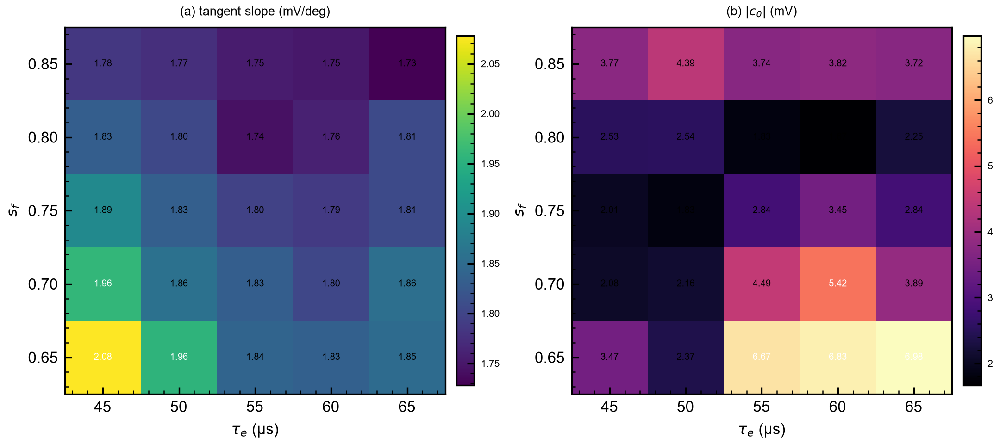
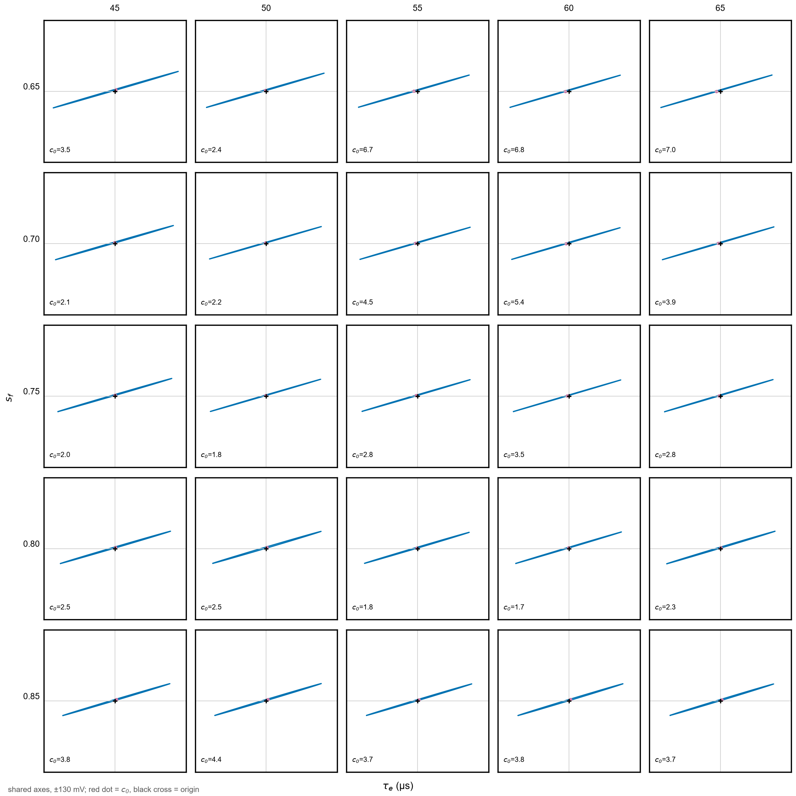
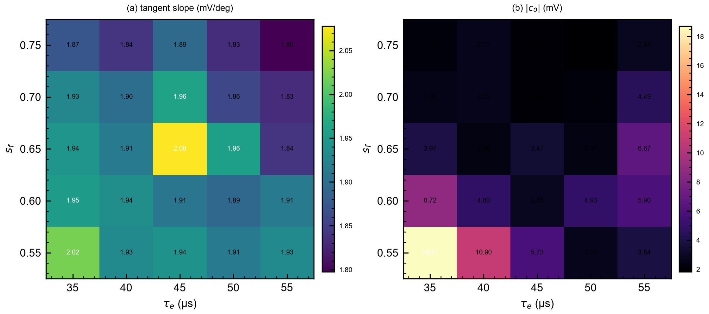
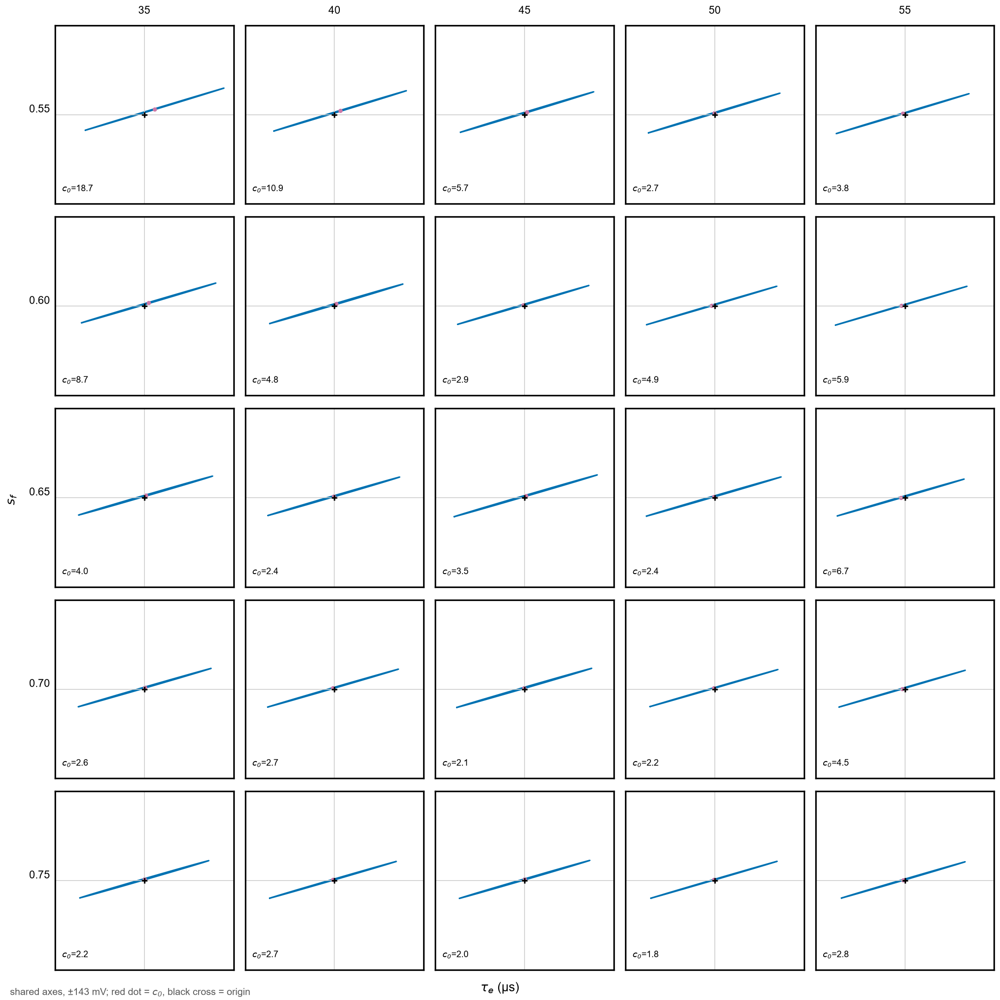

# 脉冲参数在 Z 共振点上的依赖（2026-11-19）

问：零场得到的"宽度定翻转角、拖尾主要动 $c_0$"这套结论，在 Z 共振点上还成立吗？答案：**宽度成立，拖尾的作用变了**——共振点上拖尾主要压 $c_0$、几乎不动斜率，因此可以把 $c_0$ 压到 3–4 mV 而不损失响应。

三批实验：① 14 条件单参数复扫；② 以 $s_f$=0.65–0.85、$\tau_e$=45–65 µs 的 5×5 网格；③ 以 (0.65, 45) 为中心的局部 5×5 网格。

固定条件：`MAIN_FIELD_CURRENT_MA=−0.06`、$w$=8.03 µs、edge 1.0 µs、5 kHz、50 mVpp、190 mA、相位 0–360°/10°（36 点）、`N_REPEAT=1`、单点 0.2 s。全部运行核验 `raw/phase_response.csv` 为 36 行。

## 一、14 条件单参数复扫

| 标签 | 条件 | 运行目录 |
| --- | --- | --- |
| z06w4 | w=4 µs | `1119_152139_z06w4` |
| z06w6 | w=6 µs | `1119_152332_z06w6` |
| z06w803 | w=8.03 µs（基线） | `1119_152525_z06w803` |
| z06w10 | w=10 µs | `1119_152720_z06w10` |
| z06w12 | w=12 µs | `1119_152913_z06w12` |
| z06tailoff | 关闭拖尾 | `1119_153106_z06tailoff` |
| z06sf34 | s_f=0.34 | `1119_153259_z06sf34` |
| z06sf44 | s_f=0.44 | `1119_153453_z06sf44` |
| z06sf64 | s_f=0.64 | `1119_153646_z06sf64` |
| z06sf74 | s_f=0.74 | `1119_153839_z06sf74` |
| z06te369 | τe=36.9 µs | `1119_154032_z06te369` |
| z06te569 | τe=56.9 µs | `1119_154231_z06te569` |
| z06e05 | edge=0.5 µs | `1119_154426_z06e05` |
| z06e15 | edge=1.5 µs | `1119_154621_z06e15` |

| 标签 | w (µs) | edge (µs) | 尾 | s_f | τe (µs) | \|c0\| (mV) | \|c+1\| (mV) | \|c−1\| (mV) | 斜率 (mV/deg) | 最佳 φ |
|---|---|---|---|---|---|---|---|---|---|---|
| z06w4 | 4 | 1.0 | on | .544 | 46.9 | 82.67 | 29.92 | 27.06 | 0.994 | 98.5° |
| z06w6 | 6 | 1.0 | on | .544 | 46.9 | 68.86 | 47.23 | 46.02 | 1.627 | 91.1° |
| **z06w803** | 8.03 | 1.0 | on | .544 | 46.9 | **5.96** | 55.95 | 54.99 | **1.936** | 88.9° |
| z06w10 | 10 | 1.0 | on | .544 | 46.9 | 25.94 | 47.61 | 46.66 | 1.645 | 86.0° |
| z06w12 | 12 | 1.0 | on | .544 | 46.9 | 31.51 | 26.43 | 24.56 | 0.890 | 86.9° |
| z06tailoff | 8.03 | 1.0 | off | — | — | 10.03 | 48.00 | 47.17 | 1.661 | 89.0° |
| z06sf34 | 8.03 | 1.0 | on | .34 | 46.9 | 52.06 | 50.81 | 49.78 | 1.756 | 94.2° |
| z06sf44 | 8.03 | 1.0 | on | .44 | 46.9 | 26.30 | 55.50 | 54.66 | 1.923 | 89.6° |
| z06sf64 | 8.03 | 1.0 | on | .64 | 46.9 | 4.81 | 54.09 | 53.39 | 1.876 | 87.8° |
| **z06sf74** | 8.03 | 1.0 | on | .74 | 46.9 | **3.01** | 53.12 | 52.08 | 1.836 | 87.2° |
| z06te369 | 8.03 | 1.0 | on | .544 | 36.9 | 13.75 | 54.46 | 53.60 | 1.886 | 88.9° |
| **z06te569** | 8.03 | 1.0 | on | .544 | 56.9 | **3.95** | 54.79 | 53.95 | 1.898 | 88.2° |
| z06e05 | 8.03 | 0.5 | on | .544 | 46.9 | 8.18 | 54.50 | 53.70 | 1.888 | 88.2° |
| z06e15 | 8.03 | 1.5 | on | .544 | 46.9 | 19.97 | 53.85 | 53.00 | 1.865 | 89.2° |

- **宽度**：8.03 µs 仍是唯一同时满足 `|c0|` 最小（5.96 mV）与斜率最大（1.936 mV/deg）的点；4/12 µs 的 `|c0|` 升到 83/32 mV，斜率降到 0.99/0.89。
- **拖尾**：与零场相反，它主要压低 `c0`（tail off 10.0 → s_f=0.74 时 3.0 mV），而 `|c±1|` 和斜率基本不变（1.66→1.84）。
- **τe**：56.9 µs 使 `c0` 从 5.96 降到 3.95 mV，斜率几乎不变（1.936→1.898）。
- **沿宽**：0.5 µs 使 `c0` 从 5.96 升到 8.18，1.5 µs 升到 20.0 mV；斜率略降。窄沿更有利。
- **单参数结论**：`c0` 可以在保持斜率 ≈1.9 mV/deg 的同时压到 3–4 mV（s_f=0.74 或 τe=56.9）；两者叠加未在本批测。

图 Z6-1：Z=−0.06 mA 下的宽度扫描（4/6/8.03/10/12 µs）。左相量、右上三分量与切线斜率、右下最佳相位。8.03 µs 处斜率最高、中心最小。

图 Z6-2：s_f = off/0.34/0.44/0.544/0.64/0.74。中心随 s_f 单调下降，斜率基本持平——与零场行为相反。

图 Z6-3：τe = 36.9/46.9/56.9 µs，版式同上。

图 Z6-4：edge = 0.5/1.0/1.5 µs，版式同上；沿宽越窄中心越小。

## 二、5×5 网格：s_f 0.65–0.85 × τe 45–65 µs

| 目标 | s_f | τe (µs) | 斜率 (mV/deg) | \|c0\| (mV) |
| --- | --- | --- | --- | --- |
| 最大响应 | 0.65 | 45 | 2.078 | 3.47 |
| 折中（推荐） | 0.70 | 45 | 1.959 | 2.08 |
| 最小 \|c0\| | 0.80 | 60 | 1.760 | 1.67 |
| 中心点 | 0.75 | 55 | 1.798 | 2.84 |

- 响应随 $s_f$ 增大、$\tau_e$ 减小而升高：最大 2.078（0.65, 45），最小 1.728（0.85, 65），全网格变化约 20%。
- `|c0|` 不单调：最小 1.67（0.80, 60），最大 6.98（0.65, 65）；(0.65, 55) 从 (0.65, 50) 的 2.38 跳到 6.67，说明改参数会移动有效失谐，扫过共振时中心项突变。
- 相量形状几乎不变：$|c_{+1}|\approx|c_{-1}|$ 始终成立，椭圆退化为细线；参数主要改变幅值与中心。

图 G1：左为切线斜率（响应），右为 `|c0|`；每个单元格标注数值，横轴 $\tau_e$、纵轴 $s_f$。

图 G2：每个网格点的绝对相量 $Z(\varphi)$（mV），共享同一对称坐标；红点为 $c_0$，黑十字为原点，角标给出该点的 `|c0|`。线段长度即响应大小。

## 三、局部 5×5 网格：(0.65, 45) 为中心

$s_f$ 0.55–0.75、$\tau_e$ 35–55 µs。16 个新运行（`1119_172258_h055t35` … `1119_175128_h075t55`），9 个与前一轮重叠的点直接复用（`g065t45`、`g070t45`、`g075t45`、`g065t50`、`g070t50`、`g075t50`、`g065t55`、`g070t55`、`g075t55`）。全部 36 行数据。

| 目标 | s_f | τe (µs) | 斜率 (mV/deg) | \|c0\| (mV) |
| --- | --- | --- | --- | --- |
| 最大响应 | 0.65 | 45 | 2.078 | 3.47 |
| 次高 | 0.55 | 35 | 2.020 | 18.71 |
| 折中 | 0.70 | 45 | 1.959 | 2.08 |
| 最小 \|c0\| | 0.75 | 50 | 1.834 | 1.83 |

- 峰在网格内部 (0.65, 45)，四周下降；低 $s_f$、短 $\tau_e$ 一侧响应仍高，但 `|c0|` 迅速增大（(0.55,35) 达 18.7 mV）。
- 二次响应面拟合不可靠：Hessian 特征值 −6.7 与 −0.001，驻点 (0.584, 38.7) 的预测值 1.967 低于实测 2.078，说明峰比二次面更尖，不能外推。
- `|c0|` 的可归零范围受 X/Y 偏置限制：X ±50 mV 约 1.6 mV、Y ±50 mV 约 7 mV，因此 `|c0|` 大于约 7 mV 的点无法用现有偏置归零——(0.55,35) 因此不可用。

图 G3：左为切线斜率、右为 `|c0|`；白色格为全网格最大值。

图 G4：25 个绝对相量，共享坐标；红点为 $c_0$，黑十字为原点。峰附近线段最长，低 $s_f$ 侧中心偏离原点最远。

## 结论

- **【已确认】** 峰在网格内部 (0.65, 45)，斜率 2.078 mV/deg；四周 8 个邻点都低于它。
- **【已确认】** 响应高的一侧（低 $s_f$、短 $\tau_e$）`|c0|` 也高，二者在这片区域同向变化，不能同时取极值。
- **【待查】** 峰是否在更低的 $s_f$（<0.55）或更短的 $\tau_e$（<35）继续升高；需要沿峰脊向边界外补点，同时用 `|c0|` ≤7 mV 约束筛选。

## 与零场对比

| 参数 | 零场（`../20261119_pulse_params/`） | Z=−0.06 mA（本目录） |
| --- | --- | --- |
| 宽度 | 8.03 µs 时 \|c±1\| 最大 | 8.03 µs 时斜率最大且 \|c0\| 最小 |
| 拖尾 s_f | 主要抬 \|c0\|（6.9→12.1），\|c±1\| 降 6–8% | 主要压 \|c0\|（10.0→3.0），斜率几乎不变 |
| τe / 沿宽 | 变化 ≤4%，弱 | τe 长、沿宽窄各降 \|c0\| 约 2 mV，斜率略降 |

## 脚本

- `scripts/compare_z06_param.py`：重建 Z6-1…Z6-4 与 `figures/z06_components.csv`。
- `scripts/compare_z06_grid.py`：重建 G1、G2 与 `figures/z06_grid.csv`。
- `scripts/compare_z06_grid2.py`：重建 G3、G4 与 `figures/z06_grid2.csv`；输入为 `data/rf_phase_response` 下的 `g*`/`h*` 运行。

每个运行的单次图在各自 `results/phase_response.png` 与 `phase_response_phasor.png`。

## 注意

- 共振点对主磁场敏感：−0.06 mA 处斜率约 1.9 mV/deg，是零场的 7 倍；场漂移会直接改变工作点，实际使用需要闭环或回读。后续优化就是在这一点上继续做的（`../20261119_response_optimization/`）。
- `N_REPEAT=1`，无逐点误差；TEC（COM13）缺失。
