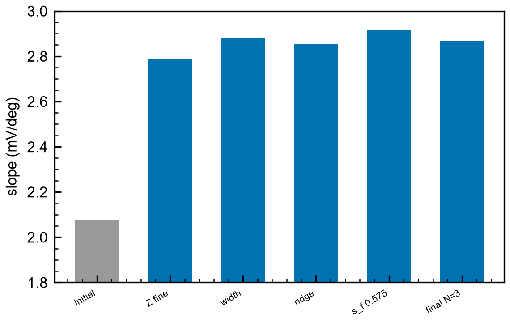
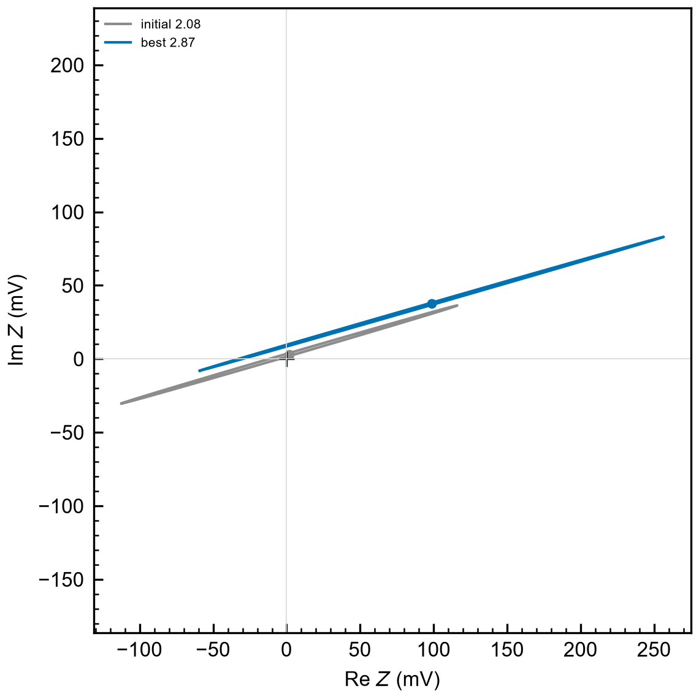
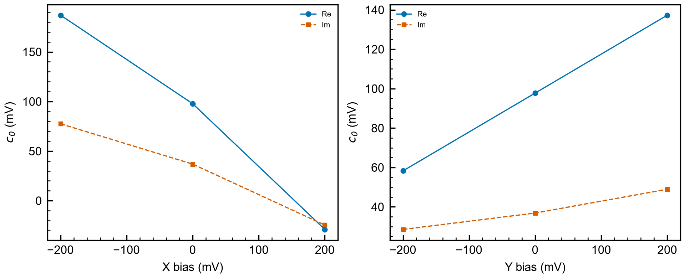
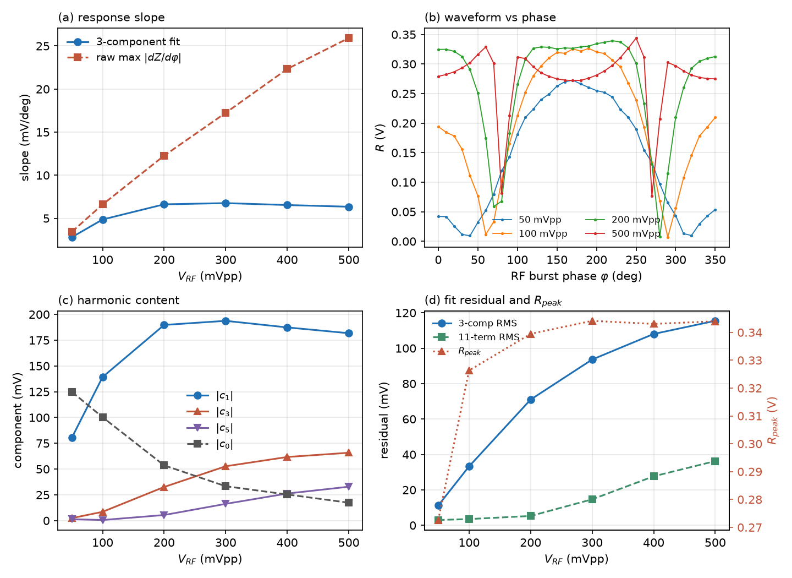

# 最大响应优化：阶段执行记录（2026-11-19）

逐图运行目录见 [数据来源.md](数据来源.md)；分步图解见 [优化历程_图解.md](优化历程_图解.md)。

目标：先把斜率 $S=|c_{+1}|+|c_{-1}|$ 做到最大，再在最大点用 X/Y 平衡 $c_0$。除阶段 G 外，所有运行固定 5 kHz、50 mVpp、190 mA、相位 36 点（0–360°/10°）；除注明外 `N_REPEAT=1`。

## 进展总览

| 阶段 | 参数 | 斜率 (mV/deg) | 说明 |
| --- | --- | --- | --- |
| 初始 | Z=−0.060，w=8.03，0.65/45 | 2.078 | 优化前的最好点 |
| A：Z 细扫 | Z=−0.0681 | 2.787 | 步长 0.002 mA |
| B：宽度 | w=8.03 | 2.880 | 7.5–8.03 平台 |
| C：拖尾峰脊 | 0.60/38.3 | 2.854 | 局部峰 |
| D：重定位 Z | Z=−0.068，0.60/38.3 | 2.847 | 峰位未移动 |
| E：s_f 下探 | 0.575/38.3 | 2.918 | 峰值记录 |
| 最终 | 0.575/38.3 | **2.869 ± 0.005** | `N_REPEAT=3` |

图 O1：各阶段斜率；灰色为优化前，蓝色为各阶段最好值。阶段之间的绝对值受约 0.1–0.3%/min 的漂移影响。

## 最佳点

$Z=-0.068$ mA、$w=8.03$ µs、$s_f=0.575$、$\tau_e=38.3$ µs；三次重复 2.874 / 2.867 / 2.865，σ=0.0048。对应 $|c_0|\approx99$ mV（尚未平衡）。

图 O2：灰线为初始 2.08 的点，蓝线为最佳 2.87 的点；两者都退化为细椭圆，蓝线更长、中心更远。

## 阶段 A：Z 峰位

−0.090…−0.050 mA、步长 0.002：峰 −0.0681 mA，洛伦兹半宽 0.0103 mA（FWHM 0.0205）。8 点验证峰位不变，−0.068 处 2.812；−0.060 在 13 min 内从 1.977 降到 1.897。

- 图：`figures/z2_fine.png`、`figures/z2_phasors.png`、`figures/z2_peak_verify.png`
- 数据：`tables/z2_fine.csv`、`tables/z2_verify.csv`

## 阶段 B：脉宽

宽度 5–12 µs：7.5 为 2.865、8.03 为 2.861（两次平均）、8.5 为 2.617、9 为 2.446；取 8.03 µs。

- 图：`figures/slope_vs_width.png`；数据：`tables/width.csv`

## 阶段 C：拖尾峰脊

沿 (0.55,35)→(0.70,45) 扫 7 点：0.575/36.7 为 2.840、0.60/38.3 为 2.854、0.625/40 为 2.795、0.68/43 为 2.729、0.70/45 为 2.757。

- 图：`figures/slope_vs_ridge.png`；数据：`tables/ridge.csv`

## 阶段 D：重定位 Z

(0.60,38.3) 下 −0.074…−0.062 mA，峰仍在 −0.068，$S=2.847$。

- 图：`figures/slope_vs_z_round2.png`；数据：`tables/z3_relocate.csv`

## 阶段 E：四参数扰动与 s_f 下探

扰动：w 7.5/8.5 为 −0.037/−0.014，s_f 0.575/0.625 为 +0.072/+0.003，τ_e 35.8/40.8 为 +0.003/−0.001，Z 0.070/0.066 由阶段 D 覆盖。据此把 s_f 从 0.60 降到 0.575，得 2.918；再降到 0.55 为 2.900、0.50 为 2.849。最终 0.575。

- 图：`figures/phase_e_perturbations.png`；数据：`tables/phase_e.csv`、`tables/sf_scan.csv`

## 阶段 F：X/Y 平衡 c0

±20 mV 的 4 点矩阵病态（X 约 800 mV/V、Y 约 41 mV/V，复平面上近同向），解出 ΔY=−364 mV、残差仍 37 mV，且被 90–107 mV 的漂移污染。改用 ±200 mV 大激励 + 首尾基线：c0 随 X、Y 近似线性，解出所需偏置 **X≈+60 mV、Y≈−226 mV**。

图 O3：±200 mV 下 c0 的实部、虚部随 X、Y 的变化；X 的斜率远大于 Y。

验证运行 `1119_211035_f2_null` 在 A02 失败：`Heat_Control` 与 `Temp_Switch` 同时 `VI_ERROR_CONN_LOST`，归零未验证。失败目录保留。

- 数据：`tables/xy_matrix.csv`

## 阶段 G：射频幅度

`Y_RF_VPP` 100…500 mVpp 五点加 50 mVpp 基线，其余参数冻结在 (0.575,38.3)/−0.068 mA/8.03 µs。三分量 S 从 2.81 涨到 4.86（100）、6.76（300）后回落，但残差从 3 mV 涨到 36 mV、三次谐波从 2.4 涨到 66 mV，`R` 峰钉在 0.344 V 不再上升——读出链路在 100 mVpp 就已削顶，表观 6.76 是拟合假象。可用区为 50–100 mVpp。

图 O4：幅度扫描；蓝色为三分量模型斜率，红色为原始最大 $|dZ/d\\varphi|$，波形在 0.344 V 处平顶。

- 数据：`tables/rf_amplitude_scan.csv`；脚本：`scripts/analyze_rf_vpp.py`

## 数据与脚本

- `figures/`：本目录全部图；
- `tables/`：各阶段 CSV；
- `scripts/`：生成图与 CSV 的脚本；
- 原始运行目录仍在 `tables/rf_phase_response/`，本目录只存分析产物。

## 状态与下一步

- 【已确认】最大响应点：Z=−0.068 mA、w=8.03 µs、s_f=0.575、τ_e=38.3 µs，斜率 2.87（重复性 0.17%）。
- 【未完成】X/Y 归零验证被硬件连接中断；恢复后按 X≈+60 mV、Y≈−226 mV 设定并验证 |c0|，残差大则用新基线重解矩阵。
- 【待查】最佳点 |c0|≈99 mV，X/Y 在峰顶的可控性（矩阵条件数）尚未在稳定连接下确认。
