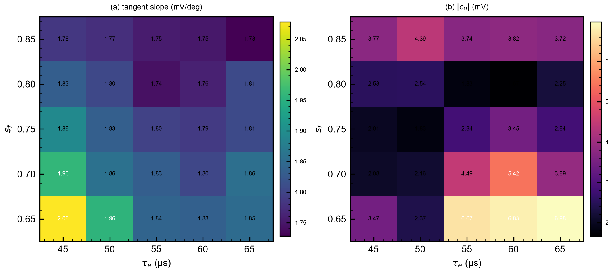
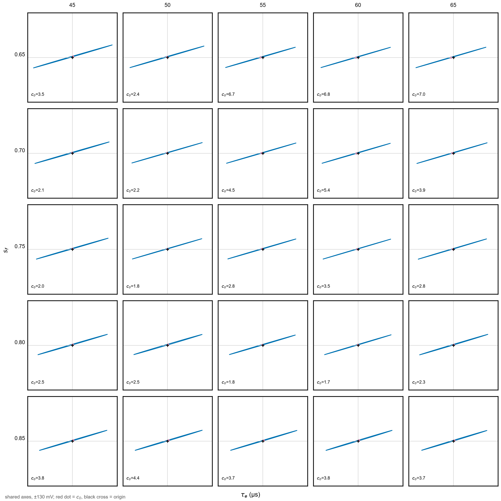

# s_f × τe 二维扫描（Z = −0.06 mA）

固定 `w=8.03 µs`、`edge=1.0 µs`、`MAIN_FIELD_CURRENT_MA=-0.06`，对拖尾参数做 5×5 网格：

- $s_f$ = 0.65、0.70、0.75、0.80、0.85（步进 0.05）
- $\tau_e$ = 45、50、55、60、65 µs（步进 5）

其余参数同 `SUMMARY.md` 第 2 节：5 kHz、50 mVpp、190 mA、相位 0–360°/10°（36 点）、`N_REPEAT=1`、单点 0.2 s。

## 运行清单

| 标签 | $s_f$ | $\tau_e$ (µs) | 运行目录 |
| --- | --- | --- | --- |
| g065t45 | 0.65 | 45 | `1119_161429_g065t45` |
| g065t50 | 0.65 | 50 | `1119_162410_g065t50` |
| g065t55 | 0.65 | 55 | `1119_163343_g065t55` |
| g065t60 | 0.65 | 60 | `1119_164316_g065t60` |
| g065t65 | 0.65 | 65 | `1119_165245_g065t65` |
| g070t45 | 0.70 | 45 | `1119_161624_g070t45` |
| g070t50 | 0.70 | 50 | `1119_162604_g070t50` |
| g070t55 | 0.70 | 55 | `1119_163540_g070t55` |
| g070t60 | 0.70 | 60 | `1119_164511_g070t60` |
| g070t65 | 0.70 | 65 | `1119_165439_g070t65` |
| g075t45 | 0.75 | 45 | `1119_161821_g075t45` |
| g075t50 | 0.75 | 50 | `1119_162759_g075t50` |
| g075t55 | 0.75 | 55 | `1119_163733_g075t55` |
| g075t60 | 0.75 | 60 | `1119_164704_g075t60` |
| g075t65 | 0.75 | 65 | `1119_165632_g075t65` |
| g080t45 | 0.80 | 45 | `1119_162012_g080t45` |
| g080t50 | 0.80 | 50 | `1119_162954_g080t50` |
| g080t55 | 0.80 | 55 | `1119_163928_g080t55` |
| g080t60 | 0.80 | 60 | `1119_164857_g080t60` |
| g080t65 | 0.80 | 65 | `1119_165825_g080t65` |
| g085t45 | 0.85 | 45 | `1119_162207_g085t45` |
| g085t50 | 0.85 | 50 | `1119_163148_g085t50` |
| g085t55 | 0.85 | 55 | `1119_164123_g085t55` |
| g085t60 | 0.85 | 60 | `1119_165052_g085t60` |
| g085t65 | 0.85 | 65 | `1119_170020_g085t65` |

25 个运行均核验 `raw/phase_response.csv` 为 36 行数据。

## 结果

图 G1：左为切线斜率（响应），右为 `|c0|`；每个单元格标注数值，横轴 $\tau_e$、纵轴 $s_f$。

图 G2：每个网格点的绝对相量 $Z(\varphi)$（mV），共享同一对称坐标；红点为 $c_0$，黑十字为原点，角标给出该点的 `|c0|`。线段长度即响应大小。

| 目标 | $s_f$ | $\tau_e$ (µs) | 斜率 (mV/deg) | `|c0|` (mV) |
| --- | --- | --- | --- | --- |
| 最大响应 | 0.65 | 45 | 2.078 | 3.47 |
| 折中（推荐） | 0.70 | 45 | 1.959 | 2.08 |
| 最小 `|c0|` | 0.80 | 60 | 1.760 | 1.67 |
| 中心点 | 0.75 | 55 | 1.798 | 2.84 |

- 响应随 $s_f$ 增大、$\tau_e$ 减小而升高：最大 2.078（0.65, 45），最小 1.728（0.85, 65），全网格变化约 20%。
- `|c0|` 并不单调：最小 1.67（0.80, 60），最大 6.98（0.65, 65）；(0.65, 55) 处从 (0.65, 50) 的 2.38 跳到 6.67，说明参数改变会移动有效失谐，扫过共振时中心项突变。
- 相量形状几乎不变：$|c_{+1}|\approx|c_{-1}|$ 始终成立，椭圆退化为细线；参数主要改变幅值与中心。

## 复现

`figures/` 中图与 `z06_grid.csv` 由 `scripts/compare_z06_grid.py` 生成；每个运行的单次图在各自 `results/phase_response.png` 与 `phase_response_phasor.png`。
