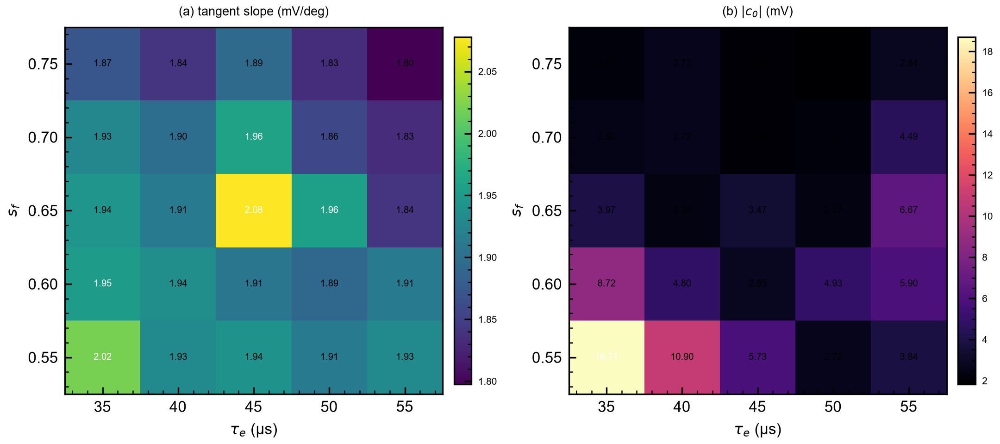
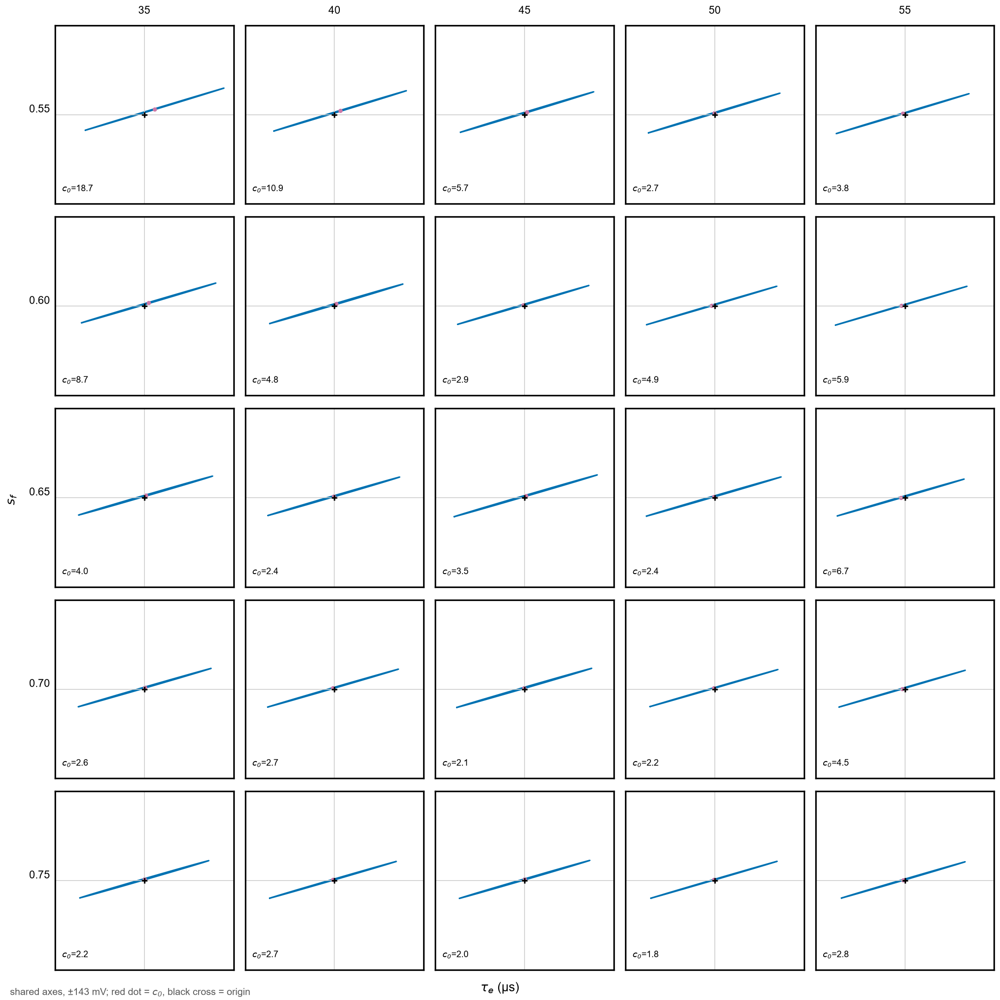

# 以 (s_f=0.65, τe=45) 为中心的局部网格

25 个条件，固定 Z=−0.06 mA、w=8.03 µs、edge=1.0 µs；$s_f$ 0.55–0.75（步进 0.05）、$\tau_e$ 35–55 µs（步进 5）。16 个新运行（`1119_172258_h055t35` … `1119_175128_h075t55`），9 个与前一轮网格重叠的点直接复用（`g065t45`、`g070t45`、`g075t45`、`g065t50`、`g070t50`、`g075t50`、`g065t55`、`g070t55`、`g075t55`）。所有运行均为 36 行数据。

## 结果

| 目标 | $s_f$ | $\tau_e$ (µs) | 斜率 (mV/deg) | `|c0|` (mV) |
| --- | --- | --- | --- | --- |
| 最大响应 | 0.65 | 45 | 2.078 | 3.47 |
| 次高 | 0.55 | 35 | 2.020 | 18.71 |
| 折中 | 0.70 | 45 | 1.959 | 2.08 |
| 最小 `|c0|` | 0.75 | 50 | 1.834 | 1.83 |

- 峰在网格内部 (0.65, 45)，四周下降；低 $s_f$、短 $\tau_e$ 一侧响应仍高，但 `|c0|` 迅速增大（(0.55,35) 达 18.7 mV）。
- 二次响应面拟合不可靠：Hessian 有一个特征值接近 0（−6.7 与 −0.001），驻点 (0.584, 38.7) 的预测值 1.967 mV/deg 低于实测 2.078，说明峰比二次面更尖，不能用二次面外推。
- `|c0|` 的可归零范围受 X/Y 偏置限制：X ±50 mV 约 1.6 mV、Y ±50 mV 约 7 mV，因此 `|c0|` 大于约 7 mV 的点无法用现有偏置归零。(0.55,35) 因此不可用。

图 G3：左为切线斜率、右为 `|c0|`；白色格为全网格最大值。

图 G4：25 个绝对相量，共享坐标；红点为 $c_0$，黑十字为原点。峰附近线段最长，低 $s_f$ 侧中心偏离原点最远。

## 结论

- **【已确认】** 局部峰在 (0.65, 45)，斜率 2.078 mV/deg；网格四周 8 个邻点都低于它，峰在内部。
- **【已确认】** 响应高的一侧（低 $s_f$、短 $\tau_e$）`|c0|` 也高，二者在这片区域同向变化，不能同时取极值。
- **【待查】** 峰是否在更低的 $s_f$（<0.55）或更短的 $\tau_e$（<35）仍继续升高；需要沿峰脊向边界外补点，同时用 `|c0|` ≤7 mV 约束筛选。

## 脚本

`scripts/compare_z06_grid2.py`，输入为 `data/rf_phase_response` 下的 `g*`/`h*` 运行。
