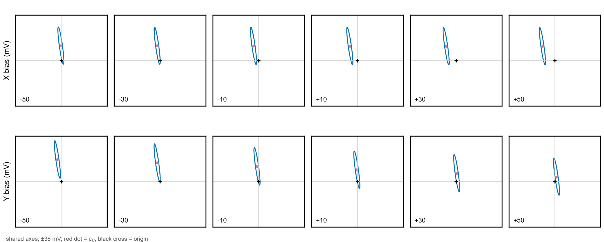
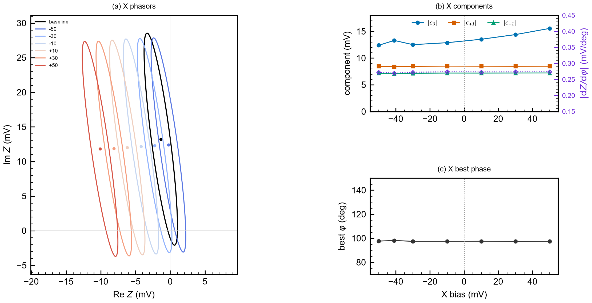
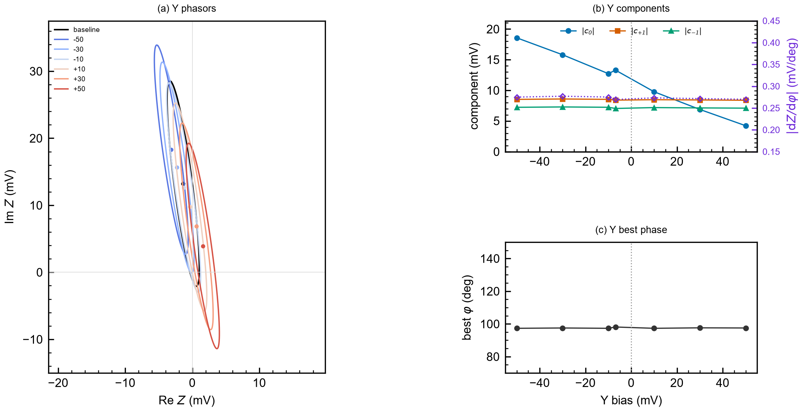

# X/Y 偏置扫描（2026-11-19）

问：改变 X、Y 静态偏置，是移动相量中心还是改变椭圆本身？答案：**只平移中心**，椭圆大小与朝向不动。

## 运行条件

固定 5 kHz、50 mVpp、190 mA、8.03 µs、edge 1.0 µs、拖尾补偿开（s_f=0.544、τe=46.9 µs）、相位 0–360°/10°（36 点）、`N_REPEAT=1`、单点 0.2 s。基线 `1119_092825_rf_phase_response`（X=−40.9 mV、Y=−6.9 mV、Z=0）。

| 标签 | 条件 | 运行目录 |
| --- | --- | --- |
| xm005 | X=−50 mV | `1119_125458_xm005` |
| xm003 | X=−30 mV | `1119_125651_xm003` |
| xm001 | X=−10 mV | `1119_125844_xm001` |
| x001 | X=+10 mV | `1119_130037_x001` |
| x003 | X=+30 mV | `1119_130230_x003` |
| x005 | X=+50 mV | `1119_130423_x005` |
| ym005 | Y=−50 mV | `1119_130616_ym005` |
| ym003 | Y=−30 mV | `1119_130921_ym003`（首次 `1119_130809_ym003` 在 A02 遇到 MFLI 瞬时不可见，已安全收尾并重试） |
| ym001 | Y=−10 mV | `1119_131116_ym001` |
| y001 | Y=+10 mV | `1119_131311_y001` |
| y003 | Y=+30 mV | `1119_131504_y003` |
| y005 | Y=+50 mV | `1119_131657_y005` |

## 结果

| X (mV) | \|c0\| (mV) | \|c+1\| (mV) | \|c−1\| (mV) | 最佳 φ |
|---|---|---|---|---|
| −50 | 12.39 | 8.46 | 7.16 | 97.6° |
| −30 | 12.50 | 8.45 | 7.16 | 97.4° |
| −10 | 12.87 | 8.49 | 7.20 | 97.4° |
| +10 | 13.52 | 8.48 | 7.19 | 97.5° |
| +30 | 14.39 | 8.47 | 7.20 | 97.3° |
| +50 | 15.54 | 8.48 | 7.21 | 97.4° |

| Y (mV) | \|c0\| (mV) | \|c+1\| (mV) | \|c−1\| (mV) | 最佳 φ |
|---|---|---|---|---|
| −50 | 18.56 | 8.52 | 7.23 | 97.3°（等价点 277.3°） |
| −30 | 15.80 | 8.59 | 7.29 | 97.5° |
| −10 | 12.72 | 8.53 | 7.23 | 97.3° |
| +10 | 9.76 | 8.47 | 7.18 | 97.3° |
| +30 | 6.87 | 8.43 | 7.13 | 97.6° |
| +50 | 4.22 | 8.38 | 7.09 | 97.5° |

`|c0|` 随 X 近似线性上升（≈+31.5 mV/V），随 Y 近似线性下降（≈−143.4 mV/V）；`|c±1|` 稳定在 8.4–8.6 / 7.1–7.3 mV，最佳相位 97.3–97.6° 不动。Y 的斜率约为 X 的 4.6 倍，说明 Y 线圈到探测轴的耦合更强。

## 图

图 F1：X、Y 各六个偏置点，共用同一对称坐标（±38 mV）；蓝线为绝对相量 $Z(\varphi)=c_0+c_{+1}e^{i\varphi}+c_{-1}e^{-i\varphi}$，红点为 $c_0$，黑十字为原点。X 偏置把中心沿一个方向平移，Y 偏置沿相反方向平移；椭圆大小与朝向基本不变。

图 F2：X 偏置 6 点（含基线）。左为相量椭圆，右上为三分量与切线斜率（右轴 mV/deg），右下为最佳相位（取离基线最近的等价点）。

图 F3：Y 偏置 6 点（含基线），版式同 F2。

## 数值表与脚本

- `figures/field_components.csv`：上两表的数值汇总（含基线）。
- `scripts/compare_field_scan.py`：生成 F2、F3 与 `field_components.csv`。该脚本同时产出 Z 粗扫图（见 `../20261119_z_field_scan/`），重跑会并入 11-19 之后的同标签运行。
- `scripts/compare_field_xy_array.py`：生成 F1（2×6 相量阵列，2026-11-20 从 `.cache/` 收入）。

## 注意

- `N_REPEAT=1`，无逐点标准误，`fit_quality` 不具判别力。
- TEC（COM13）缺失，运行中 `temp_c` 为空。
- X 的两个端点（−50、−30）`|c0|` 只差 0.1 mV，小于批次间的漂移量级，这两个点的斜率不宜单独解读。
