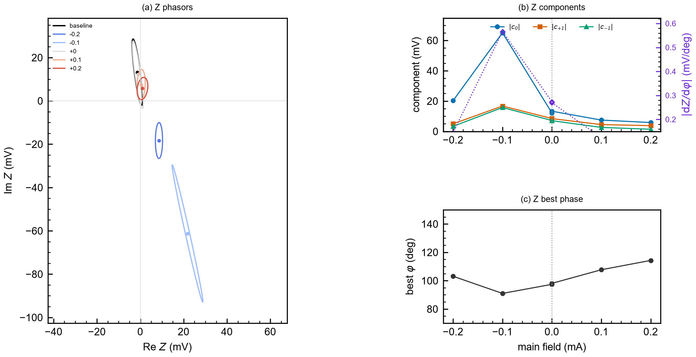
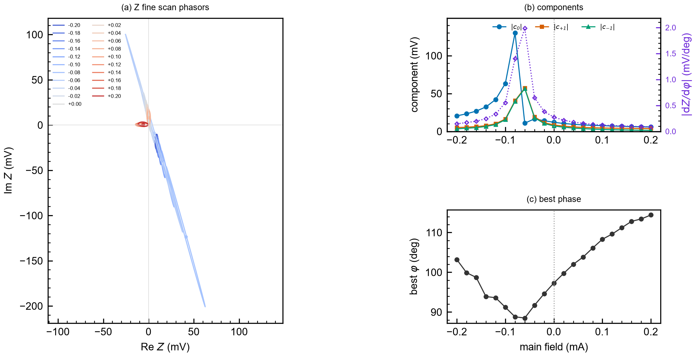

# Z 主磁场扫描（2026-11-19）

问：Z 主磁场失谐到 5 kHz 线宽附近会发生什么？答案：三个分量与切线斜率一起共振放大，峰宽约 0.04 mA，峰位约 −0.07 mA。

这一批分两步：先 5 点粗扫（0.1 mA 步长）发现强共振，再 21 点细扫（0.02 mA 步长）定位峰。后续所有优化都围绕这个峰展开（见 `../20261119_response_optimization/`）。

## 一、粗扫（5 点，0.1 mA 步长）

条件：5 kHz、50 mVpp、190 mA、8.03 µs、edge 1.0 µs、默认拖尾补偿、相位 0–360°/10°（36 点）、`N_REPEAT=1`。

| 标签 | 场 (mA) | 运行目录 | 结果 |
| --- | --- | --- | --- |
| zm02 | −0.2 | `1119_131850_zm02` | 响应明显变小，最佳相位 103° |
| zm01 | −0.1 | `1119_132045_zm01` | \|c0\|=65 mV、\|c+1\|=16.7 mV、\|c−1\|=15.7 mV，共振最强 |
| z000 | 0 | `1119_132238_z000` | 零场基线 |
| z01 | +0.1 | `1119_132431_z01` | 响应小，最佳相位向 114° 移动 |
| z02 | +0.2 | `1119_132624_z02` | 响应继续变小 |

每次非零主磁场运行在 A04 都恢复运行前状态。

图 Z1：5 点粗扫（含基线）。左为相量椭圆，右上为三分量与切线斜率（右轴 mV/deg），右下为最佳相位。**相量坐标被 −0.1 mA 的大响应主导**，其余点看起来很小，定量要看右上。

## 二、细扫（21 点，0.02 mA 步长）

条件同上，拖尾补偿 s_f=0.544、τe=46.9 µs，单点 0.2 s。21 个运行 `zm020`…`zp020e`，逐条见下表的运行目录。

| 场 (mA) | \|c0\| (mV) | \|c+1\| (mV) | \|c−1\| (mV) | 斜率 (mV/deg) | 最佳 φ |
| --- | --- | --- | --- | --- | --- |
| −0.10 | 63.30 | 16.34 | 15.36 | 0.553 | 91.2° |
| **−0.08** | **130.25** | 40.55 | 39.69 | 1.401 | 88.8° |
| **−0.06** | 10.86 | **57.28** | **56.46** | **1.985** | 88.5° |
| 0.00 | 12.00 | 8.48 | 7.20 | 0.274 | 97.3° |
| +0.10 | 7.59 | 4.46 | 2.55 | 0.122 | 108.3° |
| +0.20 | 5.81 | 3.73 | 1.35 | 0.089 | 114.4° |

完整 21 点见 `figures/z_fine_components.csv`（斜率与峰位另存 `figures/z_fine_peak.json`）。共振中心约 **−0.07 mA**；`|c0|` 的峰落在 −0.08、`|c±1|` 的峰落在 −0.06，两个峰错开，说明真实峰位在这两点之间，0.02 mA 网格只把它夹住。

图 Z2：21 点细扫。左为相量随场变化，右为三分量与切线斜率（右轴 mV/deg），右下为最佳相位：共振区内相位下移约 10°。

## 重试记录

14:03 起 MFLI 的 DAQ 模块卡死，`+0.10`…`+0.20` 的首次尝试全部失败（A03 `progress=0`，`raw/phase_response.csv` 只有表头）。断电重启 MFLI 后依次用 `zp010e`…`zp020e` 重跑成功；失败目录保留在 `data/rf_phase_response`，未删除。

## 结论

- **【已确认】** Z 场失谐到 5 kHz 线宽附近时，中心项、反旋项与切线斜率同步放大；峰宽约 0.04 mA，零场斜率 0.274 mV/deg，峰顶约 1.99 mV/deg（7 倍）。
- **【初步判断，待验证】** 共振来自 Larmor 频率对 5 kHz 的失谐，失谐接近线宽时射频相位到横向幅度的传递被放大；`|c0|` 峰与 `|c±1|` 峰错开，提示两者对失谐的响应曲线不同。
- **【待查】** GS200 电流到 $B_z$ 的换算尚未标定；峰顶与峰宽只由 0.02 mA 网格约束（后续 `../20261119_response_optimization/` 把步长缩到 0.002 mA，定位到 −0.0681 mA）。

## 脚本

- `scripts/compare_z_fine.py`：从运行目录重建 Z2 与两张数值表（经 `data_root()` 读 `rf_phase_response/`）。
- Z1 由 `../20261119_xy_field_scan/scripts/compare_field_scan.py` 一起生成（同一批运行、同一脚本处理 X/Y/Z 三个方向）。

## 注意

- `N_REPEAT=1`，无逐点标准误。
- TEC（COM13）缺失，运行中 `temp_c` 为空。
- 粗扫的 0.1 mA 步长把峰夹得很松，只用来发现共振；定量结论一律取细扫。
