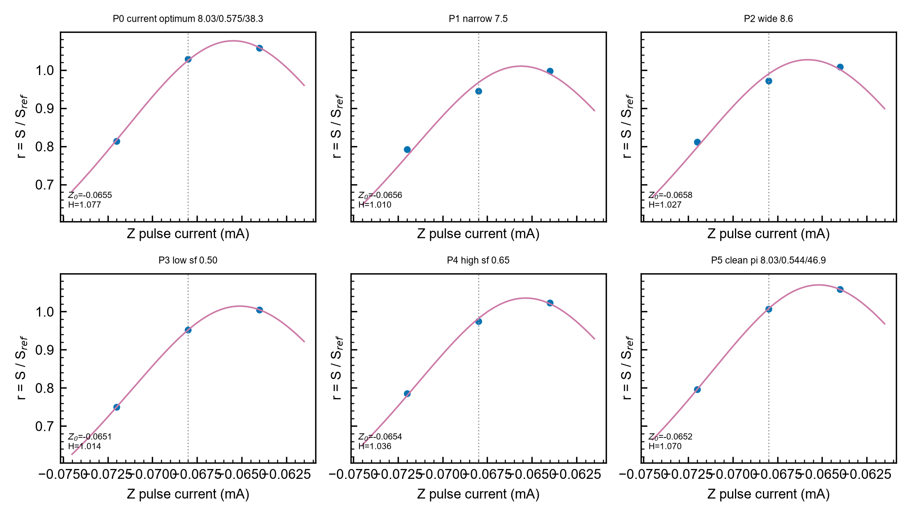
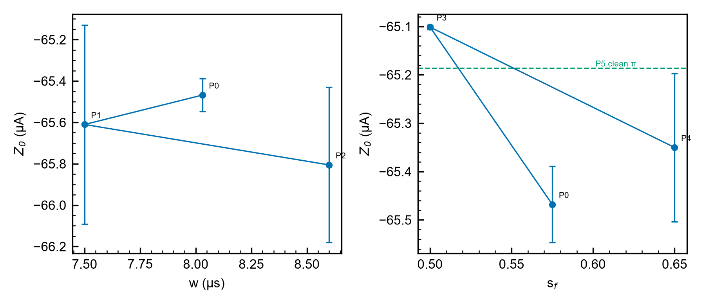
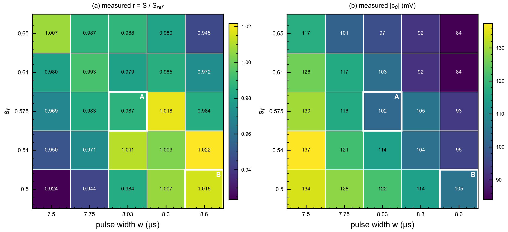
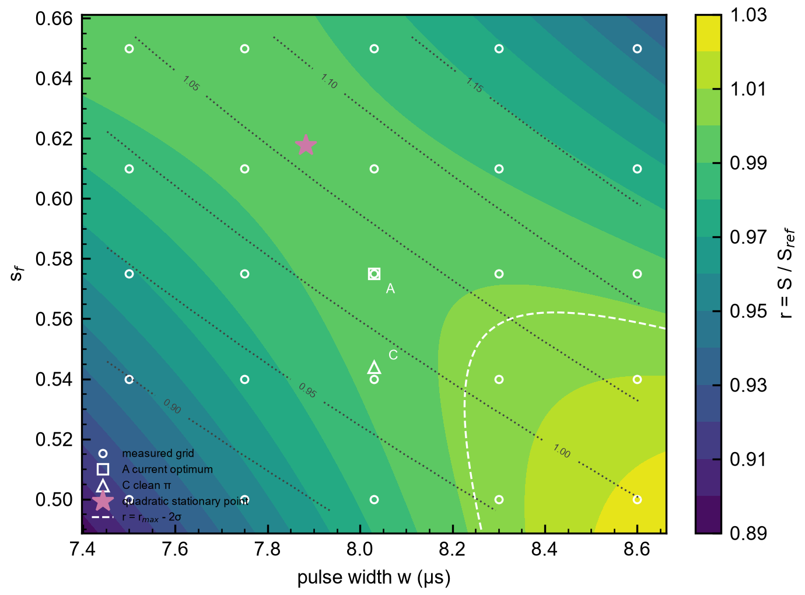
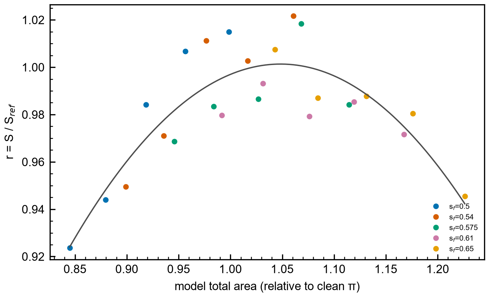
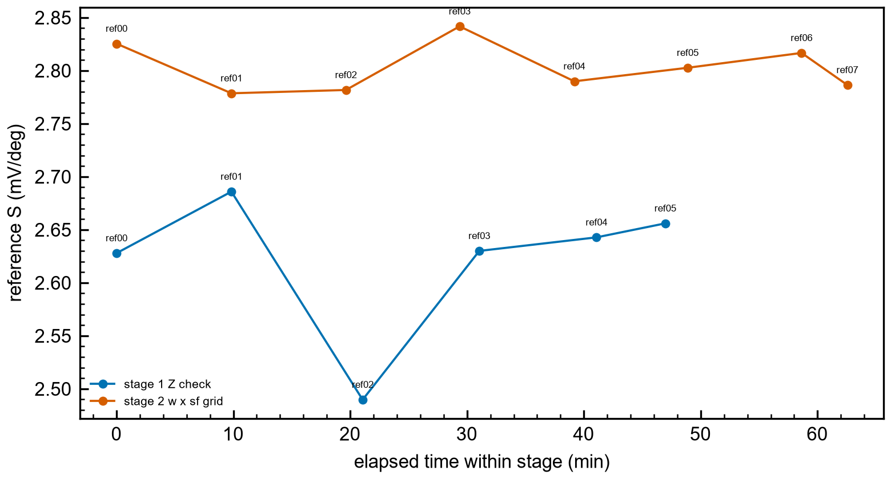
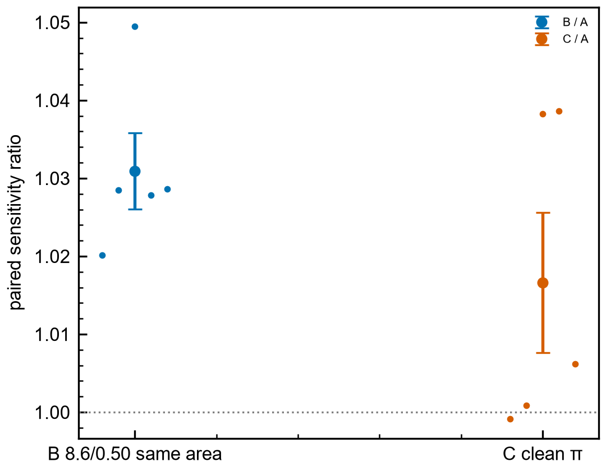

# Z 峰与 (w, s_f) 的耦合检查（2026-11-20）

三个问题：**Q1** 最优 Z 是否随脉宽 $w$ 或拖尾 $s_f$ 移动；**Q2** 每个 $(w,s_f)$ 配上各自最优 Z 之后，斜率的最大值是一个闭合峰还是一条等转角脊；**Q3** 当前点、网格最优点、干净 π 三者的斜率差多少。

结论（详细推导见 [结论.md](结论.md)，过程与异常见 [实验记录.md](实验记录.md)，方案见 [交接方案.md](交接方案.md)）：

| 问题 | 结论 | 关键数值 |
|---|---|---|
| Q1 | **不耦合** | 6 个位置 Z₀ 最大偏移 0.00037 mA；$a_w$=(−0.19±4.4)×10⁻³ mA/µs、$a_s$=(−1.7±3.2)×10⁻³ mA/单位 s_f |
| Q2 | **等转角脊** | Hessian 强 −0.064（95% −0.080…−0.050）、弱 +0.014（95% −0.0005…+0.029）；弱方向与等转角线差 14.2°；一维转角拟合残差 1.33% vs 二维 0.96%（F=7.9，p=0.0013） |
| Q3 | **B 优于 A，C 与 A 无显著差别** | B/A = 1.0309±0.0049（p=0.003）；C/A = 1.0166±0.0090（p=0.14）；B/C = 1.0143±0.0067（p=0.10） |

## 三个阶段

| 阶段 | 做了什么 | 次数 | 产物 |
|---|---|---|---|
| 1 | 6 个波形位置 × 3 个 Z（−0.072/−0.068/−0.064）+ 6 次参考点，拟合各位置的 Z 峰 | 24 | `tables/stage1.csv`、`tables/stage1_fit.json` |
| 2 | 5×5 网格 $w$∈{7.5…8.6} × $s_f$∈{0.50…0.65}，Z 统一用 −0.0655，另插 8 次参考点 | 33 | `tables/stage2.csv`、`tables/stage2_fit.json` |
| 3 | A/B/C 三波形交替 5 轮（A=8.03/0.575、B=8.60/0.50、C=8.03/0.544，各用自己的最优 Z） | 15 | `tables/stage3.csv`、`tables/stage3_pairs.json` |

每天/每阶段的参考点漂移见 `tables/drift_summary.json`（阶段 1 最大相邻变化 7.3%，阶段 2 为 2.16%）。

## 图



图 C1：6 个位置的 $r(Z)$（漂移归一后）与固定形状洛伦兹拟合，标出 $Z_0$ 与峰高 $H$。它们回答 Q1——峰位几乎重合。



图 C2：左 $Z_0$ 随脉宽、右 $Z_0$ 随 $s_f$，误差棒来自拟合；绿虚线是干净 π 的峰位。三点基本水平，最大偏移 0.37 µA。



图 C3：**先看这张**——25 个网格点的 $r$（左）与 $|c_0|$（右）实测值直画，格内标数值，白框标 A、B。可以看到中间是一块 0.98–1.02 的平台，只有低转角角（7.50/0.50）与高转角角（8.60/0.65）塌下去；$|c_0|$ 随总转角单调下降（相关 −0.92）。



图 C4：同一批数据的二次曲面拟合（6 参数）。底色是拟合曲面的 $r$，白圈是实测点，粉星是驻点 (7.88 µs, 0.618)，白虚线是近最优边界 $r_{max}-2\sigma$，黑点线是 `model_area` 算的等转角线。**它只用于算判据量**（Hessian 本征值/方向、驻点），底色在网格四角是外推，读图以白圈为准。



图 C5：把同一批点按脉冲总转角（相对干净 π，由屏蔽模型积分得到）重排。所有点大体落在一条抛物线上（顶点 1.048），同转角不同 $s_f$ 仍散开 ±1–2%——这就是"主要靠转角、但不是纯转角"的证据。



图 C6：阶段 1、2 的参考点 $S$ 随时间。阶段 1 有一次 7.3% 的相邻变化（ref01→ref02），阶段 2 都在 2.2% 内。



图 C7：5 轮 ABC 交替的配对比值。大点+误差棒是均值±标准误，小点是每轮值，虚线是比值 1。B/A 明显在 1 上方且误差棒短；C/A 中心略高于 1 但跨过 1。

## 关键结论

- **【已确认】** 当天 Z 峰在 −0.0655 mA（11-19 是 −0.068），6 个波形位置一致，偏移与 $w$、$s_f$ 无关。
- **【已确认】** 响应主要由脉冲总转角决定；等转角方向上响应几乎平坦（弱本征值 +0.014，95% 区间跨 0），垂直方向下降快（−0.064）。
- **【已确认】** 网格最优 B(8.60/0.50) 比 A 高 3.1%±0.5%（5 轮配对），该波形已设为 `rf-phase-response` 的默认参数。
- **【待查】** ① 脊向网格外延伸（实测最大在边界上，更大的脉宽/更低的 $s_f$ 未测）；② B/A 的 +3.1% 可能含"每轮第一点偏低"的顺序效应，未做 BCA/CAB 轮换；③ 约 1% 的二维残差是真实依赖还是参考点插值残余，未区分。

## 目录内容

| 路径 | 内容 |
|---|---|
| `结论.md` | Q1–Q3 结论表、各阶段数值、与交接方案的偏差、待查项 |
| `实验记录.md` | 每个阶段做了什么/得到什么图/异常，含默认参数更新记录 |
| `交接方案.md` | 实验前写下的方案（含参数、判据、失败处理） |
| `tables/` | `stage*.csv`、`*_fit.json`、`stage3_pairs.json`、`drift_summary.json`、`grid_maps.json` |
| `figures/` | 上面 7 张图（各 png+pdf） |
| `runlists/` | 三阶段的运行清单（重跑输入），`stage2_filled.csv` 是填好 Z 的版本 |
| `scripts/` | 采集驱动 `run_stage.py` + 分析脚本（`cc_common`、`analyze_*`、`make_*`、`model_area`、`plot_grid_maps`） |

逐点 JSONL 与采集日志不放这里，按约定在运行目录 `data/rf_phase_response/_studies/20261119_rf_phase_scan/coupling_check/`（目录名沿用 11-19 的研究目录名，早于本目录改名为 20261120；`cc_common.PROCESS_DIR` 指向那里）。

## 复现

```powershell
$env:LAB_DATA_ROOT = "D:\Code\exp_agent_run\data"
# 离线分析（不需要授权）
agent_exp_env\Scripts\python.exe scripts\rf_phase_response\20261120_coupling_check\scripts\analyze_stage1.py
agent_exp_env\Scripts\python.exe scripts\rf_phase_response\20261120_coupling_check\scripts\analyze_stage2.py
agent_exp_env\Scripts\python.exe scripts\rf_phase_response\20261120_coupling_check\scripts\analyze_stage3.py
agent_exp_env\Scripts\python.exe scripts\rf_phase_response\20261120_coupling_check\scripts\analyze_drift.py
# 采集（每次都要单独授权）
agent_exp_env\Scripts\python.exe scripts\rf_phase_response\20261120_coupling_check\scripts\run_stage.py stage3
```

## 注意

- 阶段 2 的参考点按用户指示改到 Z=−0.0655（交接方案原写 −0.068），因此跨阶段的绝对 $S$ 不能直接比，只能比 $r$。
- 阶段 1 有一次 7% 量级的漂移，漂移归一用参考点之间线性插值，端点处是外推。
- 三个阶段的参考点表在 `tables/drift_summary.json`，想看原始运行目录见 `tables/stage*.csv` 的 `run_dir` 列。
