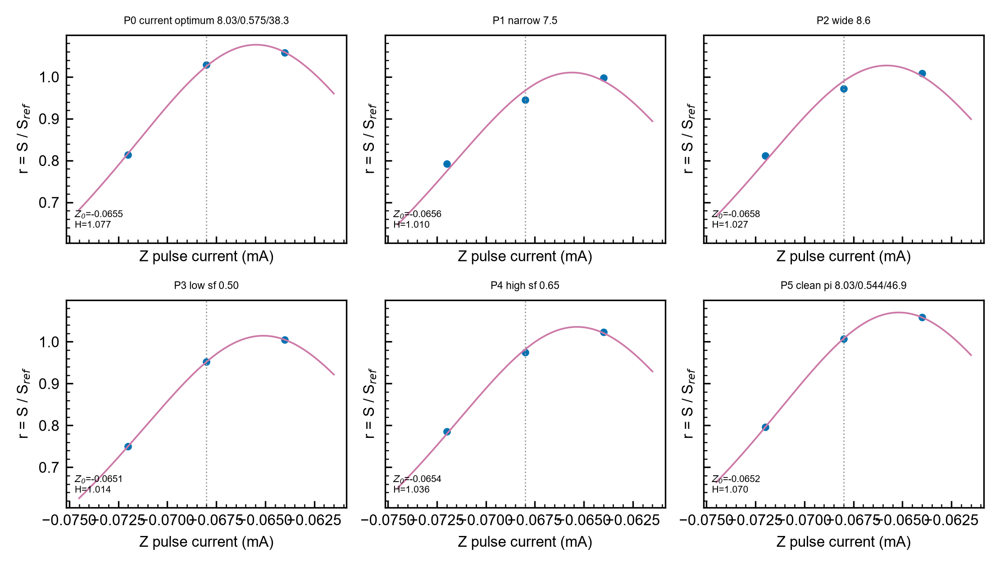
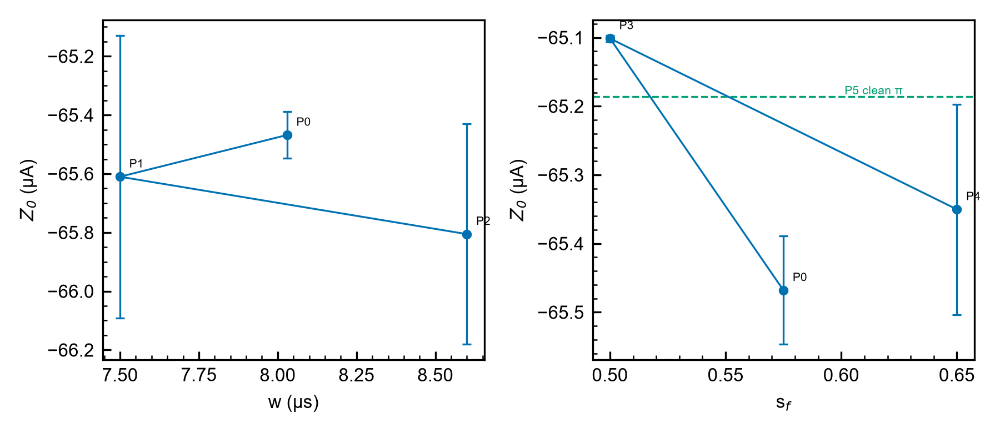
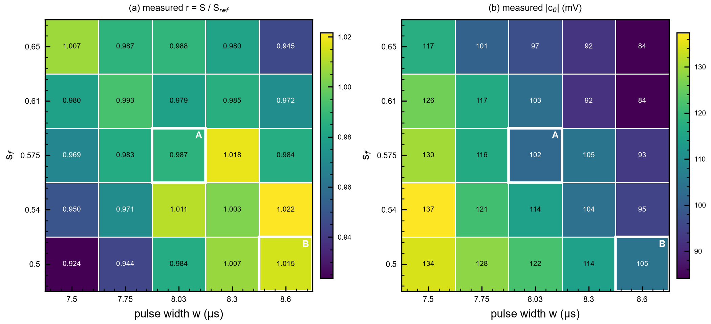
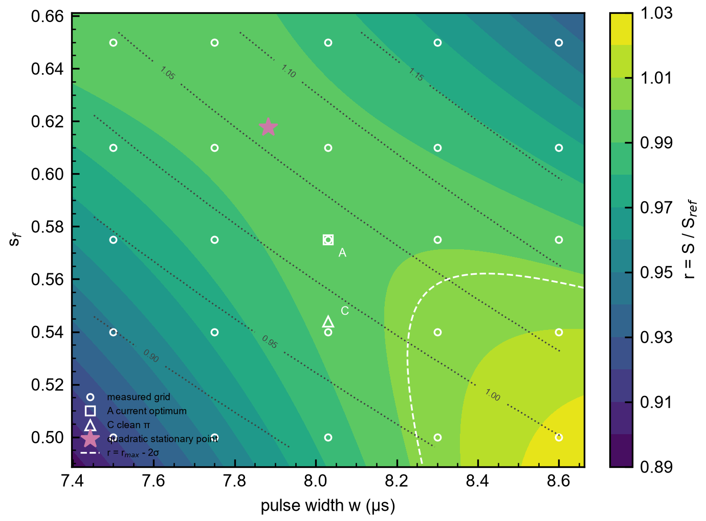
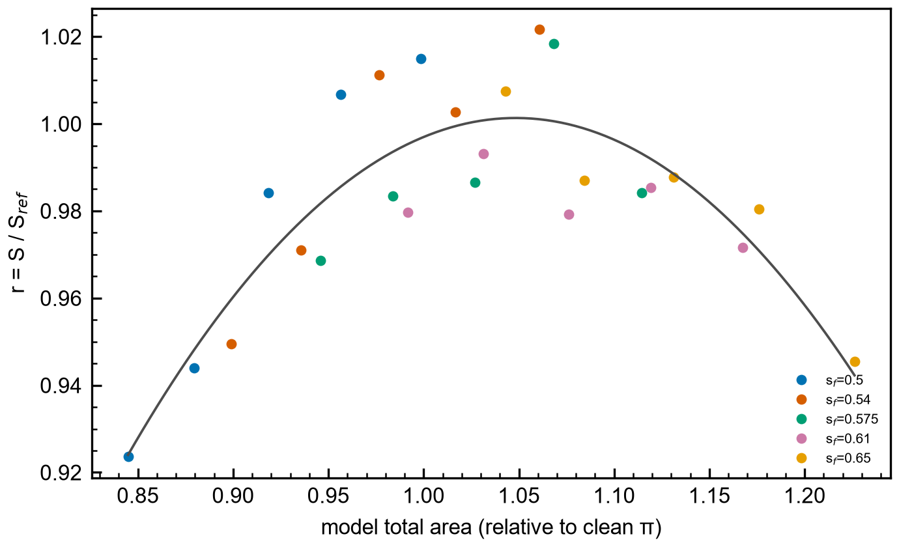
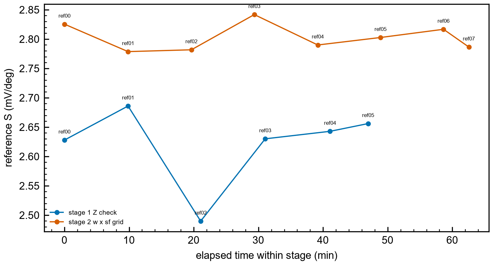
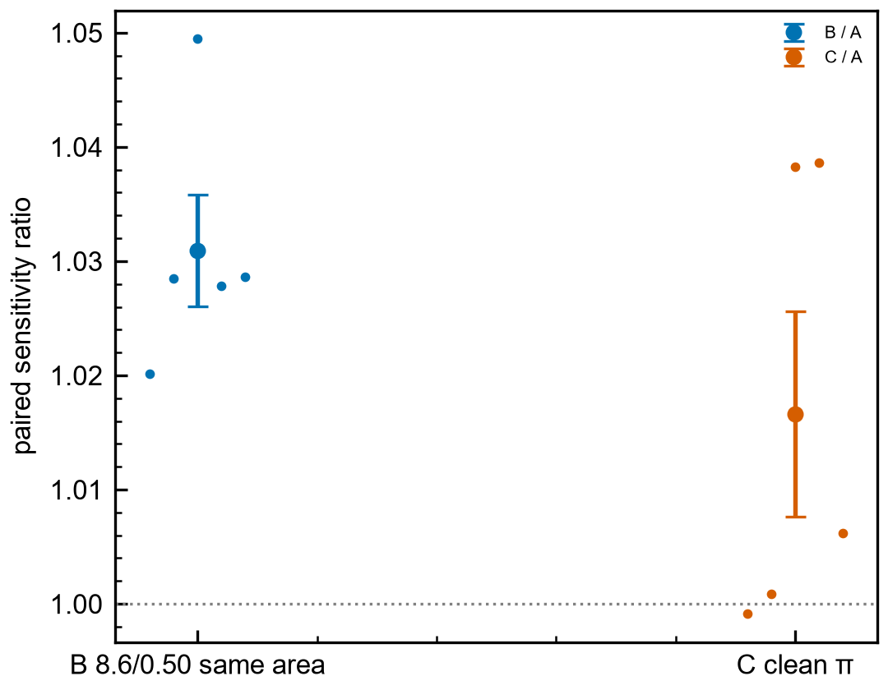

# 实验记录：脉宽 × 拖尾 × Z 耦合验证（2026-11-20）

按 `交接方案.md` 执行。阶段 1、2 已上机完成，阶段 3 未获授权、未运行。结论与判据见 `结论.md`，本文件只记"每个阶段做了什么、得到什么"。

所有真实运行都在运行目录 GUI（`127.0.0.1:8000`）的硬件队列里执行，代理只经 `tools/lab_client.py` 提交，不另起进程连仪器。

## 0. 上机前的准备（11:48–12:25）

| 项 | 做法 | 结果 |
|---|---|---|
| GUI 状态 | `python -m tools.lab_client status` | 空闲：`hardware_busy=false`、无进行中任务、无排队硬件任务 |
| 参数核对 | `python -m tools.lab_client show rf-phase-response` | 默认值与 `1119_204116_final2/experiment_config.yaml` 逐项一致，只有 `N_REPEAT` 是 1（本批本来就要 1） |
| 设备连通性 | 运行目录 `agent_exp_env\Scripts\python.exe tools\check_devices.py` | 22 台中 21 台正常；`Heat_Control`、`Temp_Switch` 各 0.1 s 通过（11-19 曾报 `VI_ERROR_CONN_LOST`）；`temperature`（`tec103_com3`，COM13）打不开，本实验把 TEC 当可选设备、raw 里没有温度列，不影响测量 |
| 离线分析可信性 | 复制 `1119_204116_final2` 到 `.cache/coupling_check/verify_final2`，用同一份 B01 分析代码重算 | S=0.0028685887611823407 V/deg、\|c0\|=0.10548826639538346 V，与历史摘要**逐位一致**，确认逐点离线分析与 GUI 分析同源 |
| 分析脚本自检 | `.cache/coupling_check/test_analysis.py`、`test_analysis23.py`（合成数据） | 峰位/线性模型、曲面/Hessian/塌缩、ABC 配对比值都能从合成数据中复原，图正常输出 |
| 备份 | 两个目录整目录复制 | `.cache/agent-tasks/research-scripts-tier/data_backup/rf_phase_scan_20261119/` |

采集驱动：`scripts/run_stage.py`。逐点读清单 → 调 `lab_client run` → 校验退出码、任务状态、`raw/phase_response.csv` 行数 → 离线分析 → 追加一行 JSONL；任一点失败立即停、不重试。

## 1. 阶段 1：Z 耦合检查（24 次，12:25:42–13:14:50）

### 做了什么

- 清单 `runlists/stage1.csv`，按 `order` 顺序（有意打乱，使漂移与参数不相关）：6 个位置 P0–P5，每个测 Z=−0.072 / −0.068 / −0.064 mA 三个点，另插 6 次参考点 R（8.03/0.575/38.3，Z=−0.068）。
- 每点显式传 `MAIN_FIELD_CURRENT_MA`、`Z_PULSE_WIDTH_US`、`Z_TAIL_S_F`、`Z_TAIL_TAU_E_US`、`RUN_TAG`、`N_REPEAT=1`，每个都配 `--allow-param`（Z∈[−0.072,−0.064]、w∈[7.5,8.6]、s_f∈[0.5,0.65]、τe∈[38.3,46.9]、RUN_TAG 限定 24 个标签）。
- 每点约 2 分钟（实测 114–133 s），单点超时 600 s。

位置与波形：

| 位置 | w (µs) | s_f | τe (µs) | 模型总转角 |
|---|---|---|---|---|
| P0 当前最优 | 8.03 | 0.575 | 38.3 | 1.027 |
| P1 窄 | 7.5 | 0.575 | 38.3 | 0.946 |
| P2 宽 | 8.6 | 0.575 | 38.3 | 1.115 |
| P3 低 s_f | 8.03 | 0.50 | 38.3 | 0.919 |
| P4 高 s_f | 8.03 | 0.65 | 38.3 | 1.131 |
| P5 干净 π | 8.03 | 0.544 | 46.9 | 1.000 |

### 分析与产物

`analyze_stage1.py` + `analyze_drift.py`：用运行目录名的时间戳在前后参考点之间线性插值出 S_ref(t)，得 r=S/S_ref；对每个位置用固定形状洛伦兹（g=0.01037 mA、β=0.151）只放开 H 与 Z₀；再用 P0–P4 拟合 Z₀=Z_c+a_w(w−8.03)+a_s(s_f−0.575)。

| 产物 | 内容 |
|---|---|
| `tables/stage1.csv` | 24 行：tag、运行目录、Z、w、s_f、τe、S、\|c0\|、S_ref、r、area_total |
| `tables/stage1_fit.json` | 6 个位置的 H/Z₀/残差、线性模型系数与不确定度、Q1 判定、参考点漂移明细 |
| `_studies/…/stage1_runs.jsonl` | 逐点采集记录（驱动写入） |
| `_studies/…/logs/stage1.log` | 逐点日志：参数、用时、S 与 \|c0\|、失败即停点 |

### 图



`figures/z_peaks_by_position.png`（+ pdf）：6 个位置各一格，蓝点是漂移归一后的 r(Z)，红线是固定形状洛伦兹拟合，竖直点线是 −0.068 mA 参考位置；每格标出拟合的 Z₀ 与 H。它回答"每个波形的 Z 峰在哪、峰有多高"。



`figures/z0_vs_params.png`（+ pdf）：左图 Z₀ 随脉宽 w（P0/P1/P2），右图 Z₀ 随拖尾比例 s_f（P0/P3/P4），误差棒来自拟合；右图绿色虚线是 P5 干净 π 的峰位。它回答 Q1——峰位是否随参数移动：三点基本水平，最大偏移 0.37 µA。

### 异常与偏差

- 参考点 S 在 ref01→ref02 掉 7.3%（2.686→2.490 mV/deg），ref02→ref03 又升 5.6%，是当天唯一超 5% 的相邻变化；其余区间在 3% 以内，r 的插值按此线性趋势做。
- 当天 Z 峰在 −0.0655 mA，而 11-19 的最优点在 −0.068 mA（见 `结论.md` §7 待查项 1）。

## 2. 阶段 2：w × s_f 网格、Z 跟随（33 次，13:28:27–14:32:54）

### 做了什么

- Q1 判定不耦合，所有网格点用 Z=Z₀(P0)。按用户 13:27 指示，**参考点也改到 Z=−0.0655 mA**（交接方案原写 −0.068），由 `make_stage2_filled.py` 填出 `runlists/stage2_filled.csv`。
- 5×5 网格：w∈{7.5, 7.75, 8.03, 8.3, 8.6} × s_f∈{0.50, 0.54, 0.575, 0.61, 0.65}，τe=38.3 固定，另插 8 次参考点，共 33 点，按 `order` 顺序执行。
- 每点约 2 分钟（实测 114–117 s）。

### 分析与产物

`analyze_stage2.py`：自变量归一化到 [−1,1] 后拟合二次曲面 r(u,v)=c0+c1u+c2v+c3u²+c4uv+c5v²，给驻点、Hessian 本征值/方向、参数自助法（2000 次）置信区间；再用 `model_area.relative_area` 给每个点算总转角，做一维二次拟合与 F 检验比较"转角塌缩"。

| 产物 | 内容 |
|---|---|
| `tables/stage2.csv` | 33 行，列同阶段 1 |
| `tables/stage2_fit.json` | 曲面系数、σ、驻点、Hessian、自助法区间、塌缩检验、参考点漂移 |
| `_studies/…/stage2_runs.jsonl` | 逐点采集记录 |
| `_studies/…/logs/stage2.log` | 逐点日志 |
| `tables/drift_summary.json` | 阶段 1、2 参考点变化与超 5% 标记 |

### 图



`figures/grid_maps.png`（+ pdf，`plot_grid_maps.py`）：**不做任何拟合**，25 个格子就是 25 个实测值，格内标数值，(a) 是 r、(b) 是 |c₀|，白框标出 A（8.03/0.575）与 B（8.60/0.50）。它是最直接的一张图：(a) 里左边一列随 w 变短会掉到 0.92–0.95，右上角（长脉宽+强拖尾，转角 1.23）掉到 0.945，中间 0.98–1.02 是一大片平台；(b) 里 |c₀| 随转角单调下降，从 (7.50,0.54) 的 137 mV 降到 (8.60,0.65) 的 84 mV，与 r 的走向相反。



`figures/grid_contour.png`（+ pdf）：底色是**拟合曲面**的 r，白圈是 25 个实测网格点，粉色星是二次曲面驻点 (7.88 µs, 0.618)，白色虚线是近最优边界 r_max−2σ=1.0025，黑色点线是 `model_area` 算的等转角线（标了 0.90/0.95/1.00/1.05/1.10/1.15），方块 A 与三角 C 是后面对比用的两个波形。它回答 Q2——实心峰还是脊：颜色过渡与等转角线大致同向（弱本征方向差 14.2°，不是严格平行），脊的方向接近但不等于等转角方向。

> 为什么还要拟合：Hessian 本征值/方向、驻点、近最优区这些判据量只有在可微曲面上才有定义，25 个孤立方格算不出来。拟合不增加信息，只是把 25 个数压成 6 个参数；底色在网格四角是外推，读图时应以白圈（实测）为准，驻点沿脊的位置本身不可定（w* 的 95% 区间 6.63–8.59 µs，越出网格）。



`figures/r_vs_area.png`（+ pdf）：横轴是脉冲总转角（相对干净 π），纵轴 r，按 s_f 着色，灰线是一维二次拟合（顶点 1.048）。它看"塌缩"——所有点是否只由总转角决定：主要趋势确实沿这条抛物线，同转角不同 s_f 的点还散着 ±1–2%。



`figures/drift.png`（+ pdf）：阶段 1、2 的参考点 S 随时间（各阶段内相对分钟数），点上标参考点编号。它是判断"漂移归一做得对不对"的依据：阶段 2 最大相邻变化 2.16%，阶段 1 是 7.3%。

### 异常与偏差

- 参考点 Z 由交接方案的 −0.068 改为 −0.0655（用户指示），跨阶段绝对 S 不能直接比，只能用 r 比。
- 网格实测最大在 (8.60, 0.54) 的边界上，拟合曲面在网格内的最大在角点 (8.60, 0.50)，说明脊向网格外延伸，真正的极值点没有测到（`结论.md` §7 待查项 2）。

## 3. 阶段 3：三点对比（15 次，15:23:12–15:52:58）

### 做了什么

- 清单 `runlists/stage3.csv`（ABC 交替 5 轮，15 次）：A=8.03/0.575/38.3、Z=−0.0655；B=8.60/0.50/38.3、Z=−0.0655；C=8.03/0.544/46.9、Z=−0.0650。
- B 由实测最大网格点 8.60/0.54 改为 8.60/0.50（用户 15:20 决定）：8.60/0.54 是 25 个噪声约 1% 的点中的最大值，单次 +2% 可能只是挑选偏差；8.60/0.50 的模型转角 0.999，与 C（1.000）相同，B/C 直接检验“同一转角下长脉宽还是拖尾补偿更好”。轮数由 3 改为 5，配对比值标准误约 0.5%。生成命令：`make_stage3_list.py --b-w 8.6 --b-sf 0.50 --rounds 5`。
- 开跑前核查：GUI 空闲；设备自检 21/22（`temperature` COM13 仍缺，本实验不用）。第一次启动因开发目录缺 `LAB_DATA_ROOT` 在 import 阶段报 `DataRootNotConfigured`，退出码 1、实验未启动；补上环境变量后重跑，并把用法写进驱动 docstring。

### 结果

| 波形 | 绝对 S (mV/deg) | 5 轮 |
|---|---|---|
| A 当前最优 | 2.809 ± 0.022 | 2.855、2.832、2.729、2.804、2.826 |
| B 网格最优 | 2.896 ± 0.010 | 2.913、2.912、2.864、2.882、2.907 |
| C 干净 π | 2.855 ± 0.015 | 2.853、2.834、2.833、2.913、2.844 |

| 比值 | 均值 ± 标准误 | 显著性（2σ 判据） |
|---|---|---|
| B/A | **1.0309 ± 0.0049** | 显著（t=6.31，p=0.003） |
| C/A | 1.0166 ± 0.0090 | 不显著（p=0.14） |
| B/C | 1.0143 ± 0.0067 | 不显著（p=0.10） |

### 图



`figures/stage3_pairs.png`（+ pdf）：横轴两组配对比值，点是大圆点（5 轮均值）加误差棒（标准误），小点是每一轮的值，虚线是比值 1。它回答 Q3——B/A 明显在 1 上方且误差棒很短，C/A 的中心略高于 1 但误差棒跨过 1。

### 异常与偏差

- 15 次运行全部 completed、`raw/phase_response.csv` 均 37 行、拟合质量全为 good、safety_shutdown 全 true。
- **A 每一轮都低于该轮三点均值**（0.994、0.990、0.972、0.978、0.989），而 A 固定排在每轮第一个测。这可能是 A 波形本身偏低，也可能是“每轮第一点”的顺序效应，本次固定 ABC 顺序无法区分（见 `结论.md` §7 待查 6）。
- 第 3 轮 A 单点 2.729 比 A 的均值低 2.9%，但该点 `raw` 完整、拟合 good、`|c0|`=103.8 mV 与其它轮一致，没有剔除依据；配对比值因此保留。A 的轮间标准差（0.049）本来就大于 B（0.022）和 C（0.033）。
- 阶段 3 没有独立参考点，`analyze_drift.py` 对其跳过漂移归一（轮内配对，A 即该轮参考）。

### 默认参数已更新为 B（2026-11-20 16:37）

与用户确认后，把网格最优 B 波形写成 `rf-phase-response` 的默认值：

| 参数 | 旧值 | 新值 |
|---|---|---|
| `Z_PULSE_WIDTH_US` | 8.03 | 8.6 |
| `Z_TAIL_S_F` | 0.544 | 0.5 |
| `Z_TAIL_TAU_E_US` | 46.9 | 38.3 |
| `MAIN_FIELD_CURRENT_MA` | 0.0 | −0.0655 |

写入路径：在运行目录调 `RfPhaseResponseAdapter.save_defaults()`（与 GUI 保存同一条代码路径，含预检），由 `tools/release_to_lab.ps1` 回存成开发目录 master 的提交 `68e9681 运行参数回存 2026-11-20`，推送 origin 后发布 `lab-20261120-1`；GUI 重启后 `show rf-phase-response` 已读到新值，其余参数未动。

两点保留意见：B 的 +3.1% 仍受“A 固定在每轮第一位”的顺序效应影响，未做顺序轮换；`MAIN_FIELD_CURRENT_MA=−0.0655` 是 11-20 当天的 Z 峰，隔天会漂（11-19 是 −0.068）。

## 4. 产物清单与重跑命令

```
coupling_check\                     （本目录，进 git）
  tables\       stage1/2/3.csv、stage1/2_fit.json、stage3_pairs.json、drift_summary.json
  figures\      grid_maps、z_peaks_by_position、z0_vs_params、grid_contour、r_vs_area、drift、stage3_pairs
  runlists\     stage1.csv、stage2.csv、stage2_filled.csv、stage3.csv
  scripts\      run_stage.py（采集驱动）+ cc_common、analyze_*、make_*、plot_grid_maps
  交接方案.md  结论.md  实验记录.md

<运行目录>\data\rf_phase_response\_studies\20261119_rf_phase_scan\   （过程文件，不进 git）
  README.md
  coupling_check\
    stage1_runs.jsonl、stage2_runs.jsonl、stage3_runs.jsonl     逐点采集记录
    logs\      stage1.log、stage2.log、stage3.log、dry_run.json
```

```powershell
# 采集（需要逐阶段授权）
agent_exp_env\Scripts\python.exe scripts\rf_phase_response\20261119_rf_phase_scan\coupling_check\scripts\run_stage.py stage1
agent_exp_env\Scripts\python.exe scripts\rf_phase_response\20261119_rf_phase_scan\coupling_check\scripts\run_stage.py stage2 --list stage2_filled
agent_exp_env\Scripts\python.exe scripts\rf_phase_response\20261119_rf_phase_scan\coupling_check\scripts\run_stage.py stage3

# 离线分析（不需要授权）
$env:LAB_DATA_ROOT = "D:\Code\exp_agent_run\data"
agent_exp_env\Scripts\python.exe scripts\rf_phase_response\20261119_rf_phase_scan\coupling_check\scripts\analyze_stage1.py
agent_exp_env\Scripts\python.exe scripts\rf_phase_response\20261119_rf_phase_scan\coupling_check\scripts\analyze_stage2.py
agent_exp_env\Scripts\python.exe scripts\rf_phase_response\20261119_rf_phase_scan\coupling_check\scripts\analyze_stage3.py
agent_exp_env\Scripts\python.exe scripts\rf_phase_response\20261119_rf_phase_scan\coupling_check\scripts\analyze_drift.py
```

## 5. 待补

- 阶段 3 已做完；剩下的问题集中在“顺序效应未排除”和脊的边界，见 `结论.md` §7。
