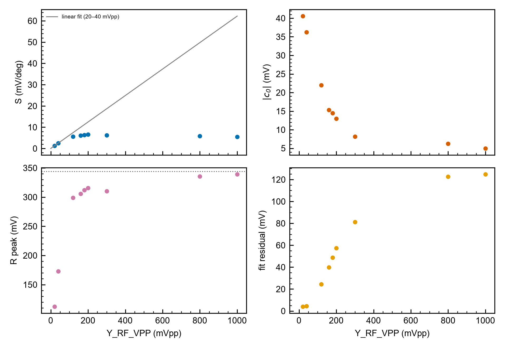
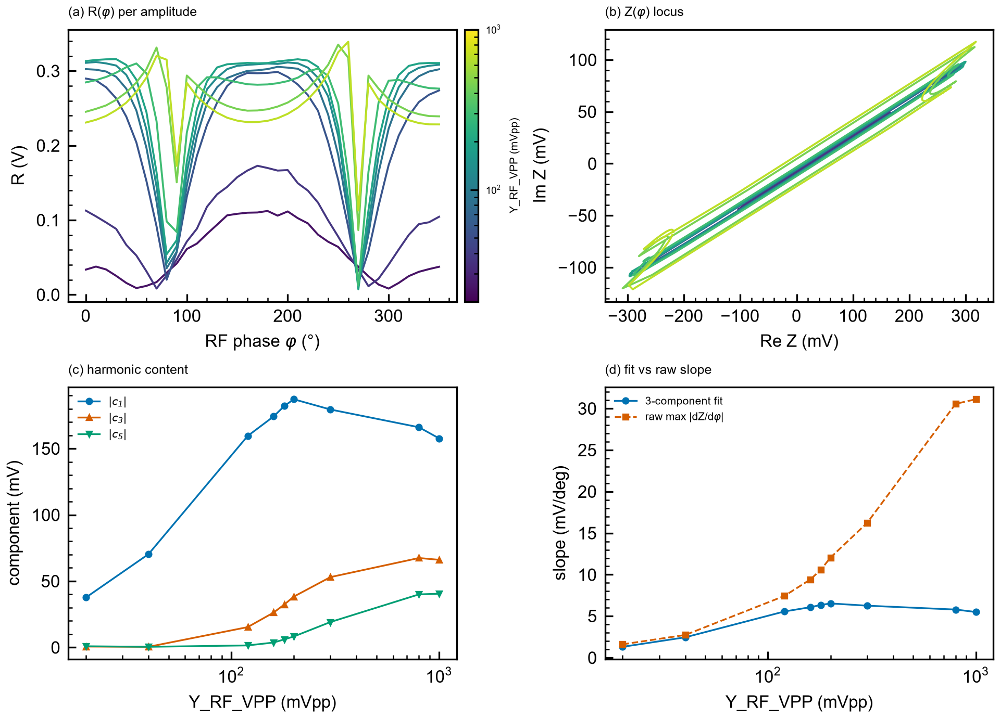

# 射频幅度扫描（Y 方向）

## 问的什么

在 2026-11-20 定下的最优工作点（Z=−0.0655 mA、8.6 µs / s_f 0.5 / τe 38.3 µs、X=0.16 V、Y=0.08 V）上，扫 Y 方向射频幅度 `Y_RF_VPP`，看相位响应 $S$、$|c_0|$ 与读出链路 $R$ 峰随幅度的变化，找可用区间与削顶起点。

## 运行条件

- 幅度网格：20、40、60、80、100、120、140、160、180、200、300、400、500、600、700、800、900、1000 mVpp（18 点）。
- 参考点：`Y_RF_VPP = 0.05`（当前默认），每 4–5 点插一次，共 5 次；顺序按固定种子打乱。
- 冻结参数：`MAIN_FIELD_CURRENT_MA=−0.0655`、`Z_PULSE_WIDTH_US=8.6`、`Z_TAIL_S_F=0.5`、`Z_TAIL_TAU_E_US=38.3`、`X_BIAS_V=0.16`、`Y_BIAS_V=0.08`、`N_REPEAT=1`；每点显式传参并配 `--allow-param`。
- 清单 `runlists/y_sweep.csv`；逐点记录 `_studies/20261120_rf_vpp_scan/y_sweep_runs.jsonl`；日志同目录 `logs/y_sweep.log`。

## 结果（第 1 批 12/23 点，2026-11-20 21:57–22:23）

| Y_RF_VPP (mVpp) | S (mV/deg) | \|c0\| (mV) | R 峰 (V) | 残差 (mV) | 线性比 |
|---|---|---|---|---|---|
| 20 | 1.311 | 40.6 | 0.112 | 3.9 | 1.05 |
| 40 | 2.455 | 36.2 | 0.173 | 4.5 | 0.99 |
| 50（参考×3） | 3.078 / 2.841 / 2.975 | 42.2 / 36.8 / 35.3 | 0.214 / 0.192 / 0.198 | 5.8 / 5.1 / 5.7 | — |
| 120 | 5.567 | 22.0 | 0.299 | 24.4 | 0.75 |
| 160 | 6.081 | 15.3 | 0.306 | 39.8 | 0.61 |
| 180 | 6.355 | 14.5 | 0.312 | 48.8 | 0.57 |
| 200 | 6.534 | 13.0 | 0.316 | 57.3 | 0.52 |
| 300 | 6.264 | 8.2 | 0.310 | 81.2 | 0.34 |
| 800 | 5.797 | 6.3 | 0.335 | 122.6 | 0.12 |
| 1000 | 5.504 | 5.0 | 0.339 | 124.8 | 0.09 |

线性比 = 实测 S /（62.2 mV/deg 每 Vpp × Vpp）；线性增益由 20、40 mVpp 两点零截距拟合得到。



图 V1：四格分别是 $S$、$|c_0|$、R 峰与拟合残差随 `Y_RF_VPP` 的变化；灰线是 20–40 mVpp 的线性拟合，下图虚线是读出链路的 0.344 V 饱和线。

- **线性区 20–40 mVpp**：40 mVpp 仍有 98.6% 线性，50 mVpp 的参考点给出 2.84–3.08（与 2.49 的线性预期比偏高 15–24%，三次参考点本身散差 8%，说明这一段的噪声与漂移比幅度效应还大）。
- **压缩从 ~60–80 mVpp 开始**：120 mVpp 只剩 75% 线性、残差 24 mV。60/80/100 mVpp 三点在本批缺失（见下），起点只能夹在 50–120 mVpp 之间。
- **S 的"峰"是失真造成的**：200 mVpp 的 6.53 之后回落，同时残差从 57 mV 涨到 123 mV、R 峰顶到 0.339 V（饱和线 0.344 V），表观 S 不能当灵敏度用。
- **|c₀| 随幅度单调下降**：40.6 mV（20 mVpp）→ 13.0（200）→ 5.0（1000）。射频越大，等效驱动越强，$c_0$ 被压得越低。

### 逐幅度的相位响应（与 11-20 上午幅度扫描同一口径）



图 V2：(a) 每个幅度一条 $R(\varphi)$，颜色按 `Y_RF_VPP`（对数）编码；(b) 同一批数据的 $Z(\varphi)$ 轨迹；(c) 一次、三次、五次谐波幅值随幅度；(d) 三分量模型斜率与"原始最大 $|dZ/d\varphi|$"的对比。

| mVpp | S_model | S_raw | \|c₀\| | \|c₁\| | \|c₃\| | \|c₅\| | R 峰 (V) | 谐波残差 (mV) |
|---|---|---|---|---|---|---|---|---|
| 20 | 1.31 | 1.61 | 39.9 | 37.6 | 0.7 | 0.9 | 0.112 | 2.0 |
| 40 | 2.46 | 2.74 | 36.0 | 70.3 | 0.5 | 0.5 | 0.173 | 2.5 |
| 120 | 5.57 | 7.44 | 21.8 | 159.5 | 15.3 | 1.5 | 0.299 | 2.0 |
| 160 | 6.08 | 9.42 | 15.2 | 174.2 | 26.3 | 3.7 | 0.306 | 1.0 |
| 180 | 6.35 | 10.61 | 14.3 | 182.1 | 32.3 | 6.1 | 0.312 | 2.2 |
| 200 | 6.53 | 12.06 | 12.8 | 187.2 | 38.3 | 8.2 | 0.316 | 2.9 |
| 300 | 6.26 | 16.22 | 8.0 | 179.5 | 53.0 | 19.1 | 0.310 | 10.8 |
| 800 | 5.80 | 30.56 | 6.3 | 166.1 | 67.4 | 40.0 | 0.335 | 52.2 |
| 1000 | 5.50 | 31.11 | 4.9 | 157.7 | 66.1 | 40.5 | 0.339 | 59.5 |

S_model = $(|c_{+1}|+|c_{-1}|)\pi/180$，S_raw = $\max|dZ/d\varphi|\cdot\pi/180$；谐波残差是 ±1…±5 次模型没解释掉的 RMS。

- **(a) 波形随幅度先变鼓、后变平顶**：20 mVpp 是一条光滑的两谷曲线（谷在 85° 与 270°）；到 200 mVpp 峰顶已压到 0.30–0.32 并出现台阶；800–1000 mVpp 顶上完全平掉、谷变成窄刺——这是读出链路削顶的直接样子。
- **谐波一步步长出来**：|c₃| 从 0.7 mV（20）涨到 38 mV（200）、67 mV（800），|c₅| 同步涨到 40 mV。三分量模型（只有 ±1 次）在 800 mVpp 时残差 52 mV，已经描述不了波形。
- **(d) 两种斜率的分离就是判据**：S_model 在 200 mVpp 后回落，而 S_raw 一直涨到 31 mV/deg——原始最大斜率被平顶处的陡边放大，是伪信号。真正可用的灵敏度必须看 S_model，且只在谐波没长起来之前（≤50–60 mVpp）可信。

## 中断记录

第 13 点（`y_vpp_0140`）在 22:23 失败：`bind()` 报 10055（系统缓冲区不足/队列已满，Windows 套接字数耗尽），A03 中止、A04 安全收尾完成、`safety_shutdown.completed=true`，之后 `lab_client status` 显示硬件空闲、无排队任务。失败目录 `1120_222151_y_vpp_0140` 保留。驱动按设计停止，没有自动重试。

余下 11 点（60/80/100/140、400/500/600/700/900、ref03/ref04）可用 `--start-order 13` 续跑；续跑前建议先重启运行目录 GUI，让操作系统回收套接字。

## 已知限制

- 读出链路在 **R = 0.344 V** 处饱和。当前工作点在 50 mVpp 时 R 峰约 0.21 V，按线性外推约 **85–90 mVpp 开始削顶**；1000 mVpp 段只能用来描绘饱和与失真，不能当灵敏度。
- 射频叠加在所在通道的静态偏置上（`y_bias ± vpp/2`），Vpp = 1.0 时该通道峰值约 0.58 V，远低于 ±20 V 限值。

## 产物与复现

- 数值表 `tables/ysweep_vpp.csv`、拟合 `tables/ysweep_vpp_fit.json`、四联图 `figures/ysweep_vpp.png`。
- 逐幅度相位响应：`tables/vpp_harmonics.csv` / `.json`（每幅度一行，列为 S_model、S_raw、c0、c1、c3、c5、R 峰谷、谐波残差）、图 `figures/vpp_phase_family.png`。
- 清单生成 `scripts/make_runlist.py`；采集驱动 `scripts/run_vpp_sweep.py`；分析 `scripts/analyze_vpp_sweep.py`（含逐幅度谐波分解）。

```powershell
$env:LAB_DATA_ROOT = "D:\Code\exp_agent_run\data"
agent_exp_env\Scripts\python.exe scripts\rf_phase_response\20261120_rf_vpp_scan\scripts\run_vpp_sweep.py --runlist y_sweep
```

## 待补

- X 方向射频需要先完成 `RF_DIRECTION` 的代码改动并做真机起振确认，本目录的 `x_sweep.csv` 尚未生成。
- 续跑余下 11 点后补：60–100 mVpp 段的压缩起点、400–900 mVpp 段、ref03/ref04；以及与 11-20 上午那批（50–500 mVpp，旧工作点）的对比。
- 本批 3 次参考点跨 3.078–2.841（8%），比幅度效应在低段还大，低段（≤50 mVpp）的 S 不宜单独引用。
