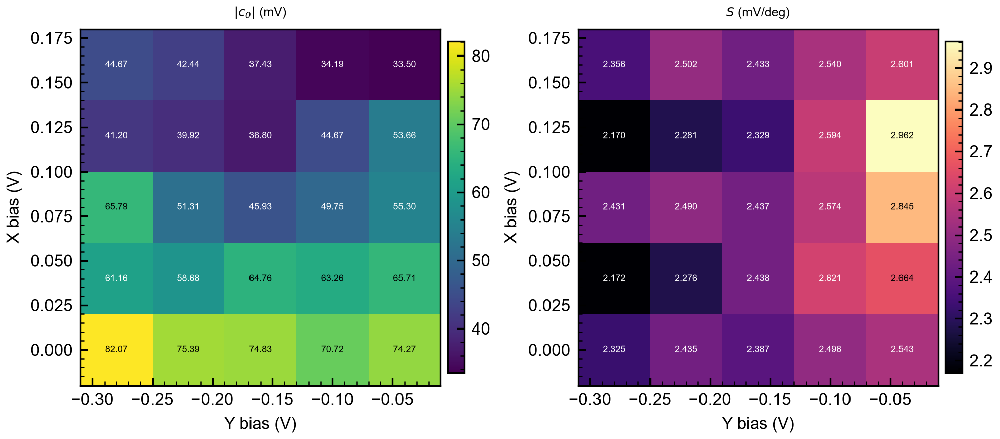
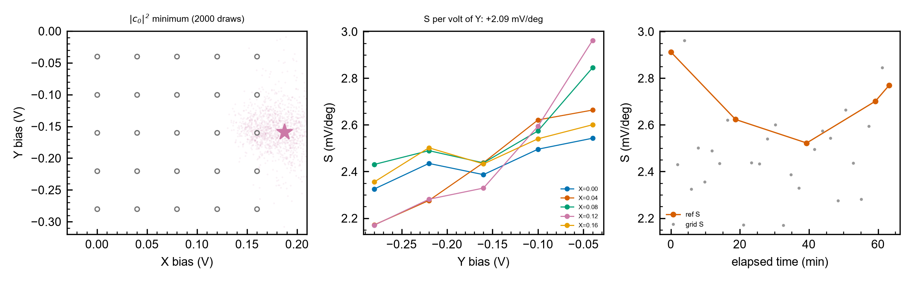
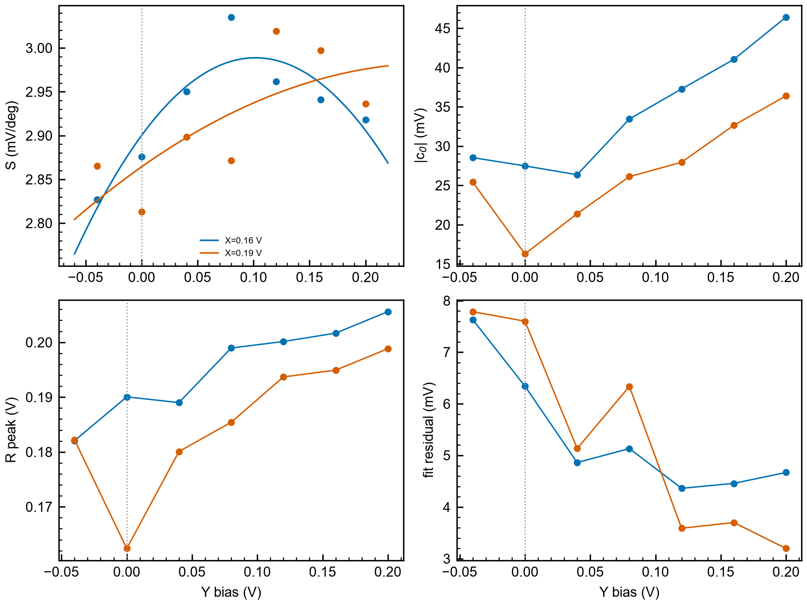

# XY 偏置扫描：c0 零点与 S 的极大

## 问的什么

在刚定下的最优 Z 脉冲（`8.6 / 0.5 / 38.3 / −0.0655 mA`）上调整 X、Y 两个横向偏置，两轮：

1. **第 1 轮**（5×5 网格）：找 $|c_0|$ 最小的点，并看 $S$ 是否跟着变；
2. **第 2 轮**（Y 方向 2×7）：把 Y 推到 +0.20 V，找 $S$ 的极大点，并判断它与 c0 零点是不是同一处。

## 第 1 轮：5×5 网格找 c0 零点

### 运行条件

- 时间窗 2026-11-20 17:09:52–18:13:02，30 次 `rf-phase-response`，全部 completed、`raw/phase_response.csv` 37 行、拟合 good、`safety_shutdown` 完成。
- 网格 X ∈ {0, 0.04, 0.08, 0.12, 0.16} V × Y ∈ {−0.28, −0.22, −0.16, −0.10, −0.04} V，共 25 点；中心对准 11-19 外推的零点 (0.077, −0.158)。
- 另插 5 次参考点 (X, Y) = (−0.0409, −0.0069)，每 8 点一次，用于漂移归一；顺序按固定种子打乱。
- 冻结参数：`MAIN_FIELD_CURRENT_MA=−0.0655`、`Z_PULSE_WIDTH_US=8.6`、`Z_TAIL_S_F=0.5`、`Z_TAIL_TAU_E_US=38.3`、`Y_RF_VPP=0.05`、`Z_PEAK_CURRENT_MA=190`、`N_REPEAT=1`；X/Y 偏置在每点显式传入。
- 清单 `runlists/xy_scan.csv`；逐点记录 `_studies/20261120_xy_bias_scan/xy_scan_runs.jsonl`、`ysweep_runs.jsonl`；日志同目录 `logs/`。

## 结果

| 量 | 数值 |
|---|---|
| 网格内最低 \|c0\| | **33.5 mV**（X=0.16, Y=−0.04，网格角点）；(0.16, −0.10) 处 34.2、(−0.04) 与 −0.16 两侧都更低 |
| \|c0\|² 二次拟合极小 | (X, Y) = (**0.187, −0.159**) V，落在 X 网格外（自助法 68%：X 0.16–0.21、Y −0.20…−0.10） |
| c0 的偏置灵敏度 | X：259 mV/V；Y：9.5 mV/V（复向量夹角 42°，线性拟合条件数 41） |
| S 范围 | 2.17–2.96 mV/deg |
| S 的偏置斜率 | Y：**+2.09 ± 0.25** mV/deg 每伏（\|t\|=8.4）；X：+0.22 ± 0.33（\|t\|=0.7） |
| 参考点漂移 | 2.913 → 2.623 → 2.522 → 2.702 → 2.769 mV/deg，最大相邻变化 **7.1%** |



图 X1：左格每点是实测 $|c_0|$（mV），右格是实测斜率 $S$ 的绝对值（mV/deg），格内标数值。它回答"哪儿 c0 小、斜率是否跟着变"：$|c_0|$ 主要沿 X 下降（82→33 mV），沿 Y 只弱降；$S$ 则主要沿 Y 上升（2.17→2.96 mV/deg），沿 X 基本不动。漂移归一后的 $r=S/S_{ref}$ 在 `tables/xy_scan.csv` 的 `r` 列（与绝对值的差别最大 7%）。



图 X2：左格是 $|c_0|^2$ 二次曲面的极小点（星号）与 2000 次自助法的位置云，空心圈是网格点、方块是参考点；中格是五个 X 切片上的 S 随 Y 变化；右格是参考点（橙）与网格点（灰）的 S 随时间变化。它回答"零点在哪、S 的变化是不是漂移造成的"。

### 怎么看这几条

1. **c0 的零点在这段网格之外（X 方向）**。网格内最低是角点，二次曲面把极小放在 X=0.187 V，比网格上界高 0.027 V。要真正归零，得补 X=0.18、0.20 两列（尚未测）。
2. **c0 几乎只跟 X 走**。复平面线性拟合给出 X 方向 259 mV/V、Y 方向 9.5 mV/V——Y 的零点位置因此没有约束力（线性拟合的零点 Y 分量不确定度 ±30 V，没有物理意义）。这与 11-19 场扫描的结论（X +31.5 mV/V、Y −143 mV/V，即"Y 敏感、X 弱"）方向相反。最可能的原因：11-19 那批在 **Z=0** 测（$|c_0|$ 只有 12 mV），这次在 **Z 峰**上测（$|c_0|$ 110 mV），工作点不同，c0 对外场的响应方向跟着变。**11-19 的 XY 零点外推不能直接用**。
3. **S 不是完全平坦**：沿 Y 从 −0.28 到 −0.04 V，S 从 2.2–2.4 升到 2.55–2.95（约 20%），五条 X 切片全都单调上升；沿 X 没有可见系统变化。第 X=0.12 那一行虽然时间顺序与 Y 相反（r=−0.40）仍有同样趋势，说明不是单纯漂移。这个效应和 $|c_0|$ 大小无关（25 点上 $\mathrm{corr}(S, |c_0|)=0.00$），机制待查（Y 是射频驱动方向，直流偏置可能改变有效驱动条件）。

## 第 2 轮：Y 方向找 S 极大（17 点）

时间窗 21:52–21:22（2026-11-20 20:52:19–21:22:09），17 次运行（14 网格 + 3 参考点），全部 completed、raw 37 行、拟合 good。X 取两列 {0.16, 0.19} V，Y ∈ {−0.04, 0, 0.04, 0.08, 0.12, 0.16, 0.20} V；冻结参数同第 1 轮。参考点最大相邻变化 3.3%。

| X (V) | Y=−0.04 | 0.00 | 0.04 | 0.08 | 0.12 | 0.16 | 0.20 | 一维顶点 |
|---|---|---|---|---|---|---|---|---|
| 0.16 S (mV/deg) | 2.827 | 2.876 | 2.950 | **3.035** | 2.962 | 2.941 | 2.918 | y=+0.10，峰 2.99 |
| 0.19 S (mV/deg) | 2.866 | 2.813 | 2.898 | 2.871 | 3.019 | 2.997 | 2.936 | y=+0.26（出界） |

漂移归一后 $r=S/S_{ref}$ 的变化范围是 0.980–1.047，即**整条 Y 扫描上 S 只变 3.5%**（第 1 轮在更宽的 Y 范围内看到 20%，是因为那批跨了 −0.28…−0.04 V，远离工作点）。



图 X3：左上为 $S$ 与 Y（点=实测，线=各行二次拟合）；右上为 $|c_0|$；左下为 R 峰；右下为三分量拟合残差。它回答"S 有没有真峰、峰在哪、和 c0 是不是同一处"。

### 怎么看这几条

1. **S 有一个很浅的极大，但不是尖峰**：X=0.16 行的二次顶点在 y=+0.10 V、峰高 2.99，行内散差 1.1%（3σ 约 3%）；实测最高的 (0.16, 0.08)=3.035 比该行拟合高 1.5σ，**单点最高不能当成峰位**。
2. **两行不一致**：X=0.19 那行的顶点跑到 +0.26 V（出界），散差 1.7%，说明这列数据不足以定位峰位。所以"S 的极大在 y≈+0.10"只是 X=0.16 单行的结论。
3. **S 极大点不是 c0 零点**：(0.19, 0.00) 的 |c0| 只有 **16.3 mV**，但那里 $r=0.98$（比最高点低 6.5%），R 峰也最低（0.162 V）。这是一个真实的取舍——c0 归零带来最多动态范围，代价是斜率降 6.5%。
4. **S 的变化跟着工作点走，不是响应变好**：$S$ 与拟合残差相关 −0.81、与 R 峰 +0.70、与 |c0| +0.46，$|c_0|$ 与 R 峰相关 +0.92。Y 直流偏置叠加到射频驱动方向上，等效驱动变强 → 信号与 $|c_1|+|c_{-1}|$ 变大、拟合残差变小。这仍是真实的信号增大，但它与 $Y_{RF}$ 幅度、c0 是同一个自由度的不同侧面，不能当成独立优化旋钮。

## 数据与复现

- 第 1 轮：数值表 `tables/xy_scan.csv`（30 行：X、Y、c0 实/虚/模/相角、c1、c−1、S、S_ref、r）、拟合结果 `tables/xy_fit.json`（线性零点、二次极小、自助法区间、S 回归、参考点漂移）。
- 第 2 轮：数值表 `tables/ysweep.csv`（17 行，含 R 峰与拟合残差）、拟合结果 `tables/ysweep_fit.json`（两行的二次顶点、S 极大点、c0 最小点、相关系数）。
- 分析脚本 `scripts/analyze_xy_scan.py`（网格）、`scripts/analyze_ysweep.py`（Y 扫描）；清单生成 `scripts/make_runlist.py --round 1|2`；采集驱动 `scripts/run_xy_scan.py --runlist xy_scan|ysweep`。

```powershell
$env:LAB_DATA_ROOT = "D:\Code\exp_agent_run\data"
# 重新分析（不需要授权）
agent_exp_env\Scripts\python.exe scripts\rf_phase_response\20261120_xy_bias_scan\scripts\analyze_xy_scan.py
agent_exp_env\Scripts\python.exe scripts\rf_phase_response\20261120_xy_bias_scan\scripts\analyze_ysweep.py
# 重新采集（需要逐次授权）
agent_exp_env\Scripts\python.exe scripts\rf_phase_response\20261120_xy_bias_scan\scripts\run_xy_scan.py --runlist xy_scan
agent_exp_env\Scripts\python.exe scripts\rf_phase_response\20261120_xy_bias_scan\scripts\run_xy_scan.py --runlist ysweep
```

## 默认参数已更新为 S 最大点的偏置（2026-11-20 21:39）

与用户确认后，把第 2 轮实测斜率最高点 (X, Y) = (0.16, 0.08) V 写成 `rf-phase-response` 的默认偏置：

| 参数 | 旧值 | 新值 |
|---|---|---|
| `X_BIAS_V` | −0.0409 | 0.16 |
| `Y_BIAS_V` | −0.0069 | 0.08 |

写入路径：运行目录调 `RfPhaseResponseAdapter.save_defaults()`（带 preflight，只改这两行），由 `tools/release_to_lab.ps1` 回存成 master 提交 `66bc482 运行参数回存 2026-11-20`，推送后发布 `lab-20261120-2`；GUI 重启后 `show rf-phase-response` 读到新值。

保留意见：这组偏置的 $|c_0|$ = 33.5 mV、R 峰 0.199 V；若要按 11-19 的计划把 `Y_RF_VPP` 提到 100–120 mVpp，$(0.19, 0.00)$ 的余量更大（$|c_0|$=16.3 mV、R 峰 0.162 V，代价是 S 低 6.5%）。两者都没有做过多轮配对确认。

## 注意与待查

- **零点未到网格内**：X 上还有 0.027 V 缺口，Y 方向几乎无约束；补点前不宜把这个结果当作"已归零"。
- **本批漂移偏大**：参考点最大相邻变化 7.1%（阶段 2 是 2.2%），S 的绝对水平不要与 11-19/阶段 3 直接比，比 $r$ 更稳。
- **Y 方向的 S 变化**：五条切片一致，但各切片内的测量时间与 Y 部分相关（三行 r>0.9），虽然回归已控制时间项、且 X=0.12 那一行反向仍成立，最好再用反向顺序复测一小批确认。
- 偏置最大 0.16 / −0.28 V，远低于 ±20 V 安全限值；本批没有触发任何限值或温控门控拒绝。
