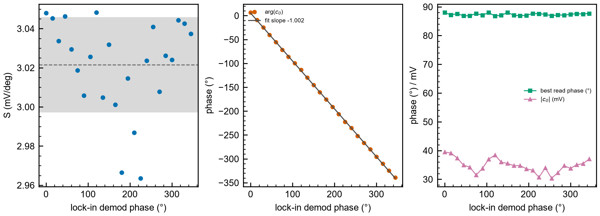
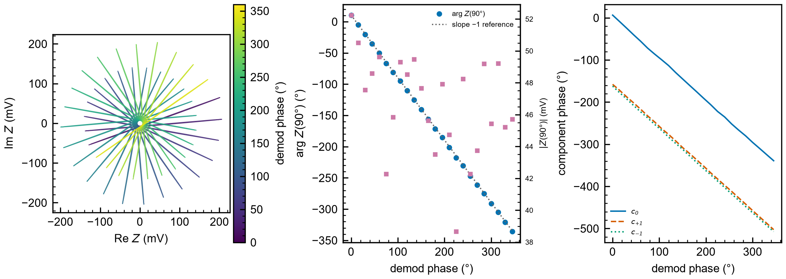

# 锁相解调相位扫描

## 问的什么

Y 方向射频不变，只改 MFLI 第 0 路解调器的 `phaseshift`（`DEMOD0_PHASE_DEG`），看相位响应怎么变——是"模量与斜率不变、只有相位读数整体旋转"，还是斜率也随解调相位走。若斜率随相位变化，之前所有 S 都要按读出相位打折。

## 运行条件

- 时间窗 2026-11-21 11:02:35–11:53:31，26 次 `rf-phase-response`，全部 completed、`raw/phase_response.csv` 37 行、拟合 good、`safety_shutdown` 完成。
- 解调相位 0–345°、步进 15°，共 24 点；另在首尾各插一次 0° 参考点（`demod_ref00`、`demod_ref01`）测重复性。
- 冻结参数：`RF_DIRECTION=Y`、`Y_RF_VPP=0.05`、`MAIN_FIELD_CURRENT_MA=−0.0655`、`Z_PULSE_WIDTH_US=8.6`、`Z_TAIL_S_F=0.5`、`Z_TAIL_TAU_E_US=38.3`、`X_BIAS_V=0.16`、`Y_BIAS_V=0.08`、`N_REPEAT=1`。
- 每点显式传参并配 `--allow-param`；`configure_lockin` 写完回读，与设定差 >0.5° 即停止。
- 清单 `runlists/phase_scan.csv`；逐点记录 `_studies/20261121_locking_phase_scan/phase_scan_runs.jsonl`。

## 结果

| 量 | 随解调相位的斜率 | 截距 | 残差 | 判读 |
|---|---|---|---|---|
| arg(c₀) | **−1.0023 ± 0.0020** | 5.13° | 1.02° | 整体旋转，1:1 |
| arg(c₊₁) | **−1.0002 ± 0.0007** | −157.30° | 0.37° | 整体旋转，1:1 |
| 最佳读相位 | 6e-5 ± 8e-4 | 87.34 ± 0.16° | 0.39° | **不动** |
| S | −3e-5 ± 5e-5 (mV/deg 每度) | 3.027 | 0.024 | **不动** |
| \|c₀\| | −0.0092 ± 0.0044 (mV 每度) | 36.5 | 2.26 | 与时间漂移共线，见下 |

- **S**：均值 3.022 mV/deg，24 点范围 2.964–3.048，相对散差 2.8%；斜率 −3e-5，即整 345° 内预计变化不到 0.04 mV/deg，远小于重复性。
- **\|c₀\|**：均值 34.9 mV、范围 30.4–39.5（散差 7%），比 S 大得多；它随测量顺序的斜率是 −0.138 ± 0.067 mV/次（corr −0.40），与随相位的 −0.0092 mV/度 合计在整批里都约 −3 mV。**相位与时间在这批里共线，无法区分**，只能说 \|c₀\| 在这 51 分钟里降了 3–4 mV。
- **参考点**：首尾两次 0° 给出 S=3.048 / 3.038（差 0.044 mV/deg，1.5%），arg(c₀)=6.4° / 5.9°，与整批残差一致。



图 P1：(左) S 随解调相位，虚线是均值；(中) arg(c₀) 与斜率 −1.00 的拟合线；(右) 最佳读相位（左轴，几乎水平）与 \|c₀\|（右轴，缓慢下降）。

### 结论

1. **解调相位是一个纯旋转**：它把测量坐标系整体转过 δ，`arg(c0)`、`arg(c±1)` 全部以斜率 −1 跟随，`|c0|`、`|c±1|`、S 不变。
2. **最佳读相位不变不是意外**：它回答的是"扫哪个射频相位 φ 时 |dZ/dφ| 最大"，是曲线自身的几何量；整体旋转不改变 φ 的值。此前我在参数说明里写成"最佳读相位平移"，是错误的，已改正。
3. **历史 S 不需要按读出相位打折**：斜率对解调相位的响应在 5σ 上界只有 1e-4 mV/deg 每度。

## 数据与复现

- 表 `tables/phase_scan.csv`（26 行）、拟合 `tables/phase_scan_fit.json`、图 `figures/phase_scan.png`。
- 清单生成 `scripts/make_runlist.py`；采集驱动 `scripts/run_phase_scan.py`；分析 `scripts/analyze_phase_scan.py`。

```powershell
$env:LAB_DATA_ROOT = "D:\Code\exp_agent_run\data"
agent_exp_env\Scripts\python.exe scripts\rf_phase_response\20261121_locking_phase_scan\scripts\analyze_phase_scan.py
```

## 50 mVpp 下的相量变化（图 V4）



图 V4：(a) 24 个解调相位各自的 $Z(\varphi)$ 轨迹，颜色按解调相位；(b) 固定 $\varphi=90^\circ$ 处 $\arg Z$ 随解调相位（右轴为 $|Z|$）；(c) 三个分量 $c_0$、$c_{+1}$、$c_{-1}$ 的相位随解调相位。

- **(a) 轨迹是直线不是椭圆**：$|c_{+1}|=84.0$ mV 与 $|c_{-1}|=82.9$ mV 几乎相等，两个反向旋转项互相抵消，$Z(\varphi)$ 塌缩成过 $c_0$ 的一条线段；解调相位每加 $\delta$，这条线整体转 $-\delta$。这也是"椭圆几乎不闭合"的直接证据——响应基本上是纯线性调制。
- **(b) 刚性旋转**：$\arg Z(90^\circ)$ 对解调相位的斜率 $-1.0026$，$|Z|$ 在 43–51 mV 间（散差 13.6 mV，主要是各点噪声与漂移，不是系统单调趋势）。
- **(c) 三个分量同向旋转**：$c_0$、$c_{+1}$、$c_{-1}$ 的相位三条线平行、斜率都是 −1（拟合斜率 $c_0$: $-1.0023$、$c_{+1}$: $-1.0002$），整组相量像刚体一样转，相对夹角不变。

数据表 `tables/phasor_rotation.csv`（每个解调相位的 $|Z(90^\circ)|$、$\arg Z(90^\circ)$、$|c_0|$、$\arg c_0$），绘图脚本 `scripts/plot_phasors.py`，只读 `results/phase_response_summary.json`。

## 注意与待查

- **\|c₀\| 的 7% 散差没有定论**：相位与时间共线，需要"同一相位、打乱时间顺序"的重复测量才能分清是相位效应还是漂移。
- 本轮只做 Y 方向、只做 0.05 Vpp；X 方向或高幅度下解调相位是否同样只是旋转，未测。
- 解调相位设定加了 0.5° 的回读容差，实际容差余量（MFLI 分辨率 0.001°）没有单独测过。
