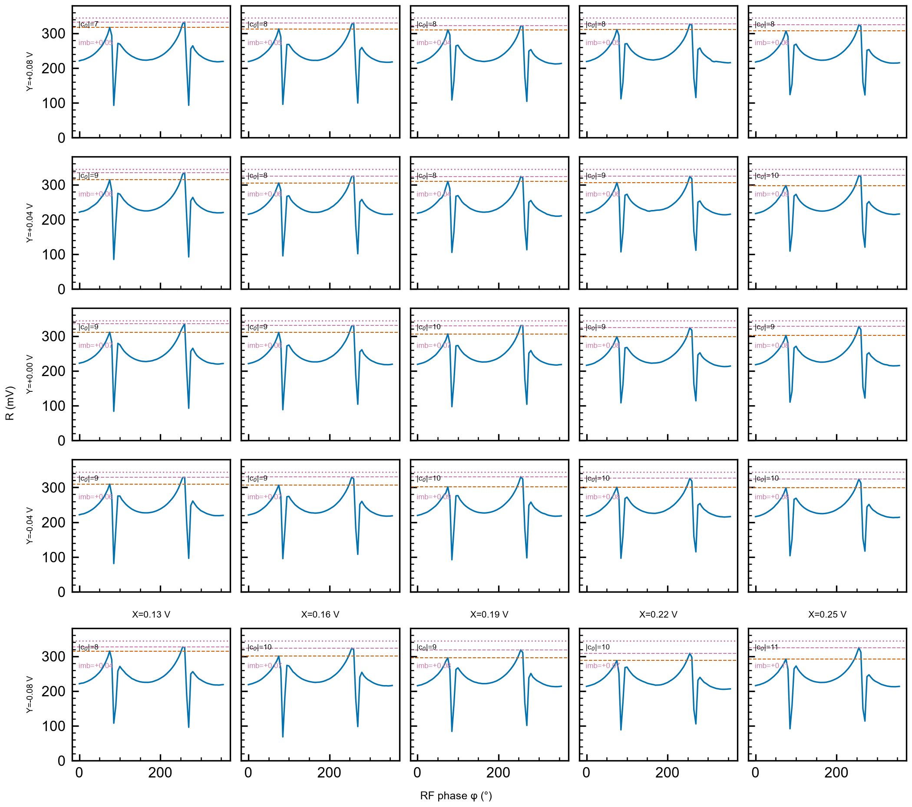
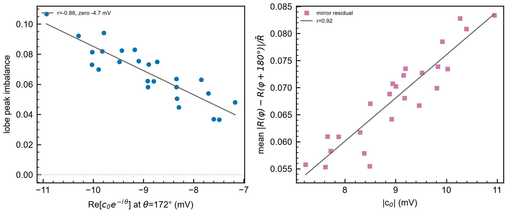
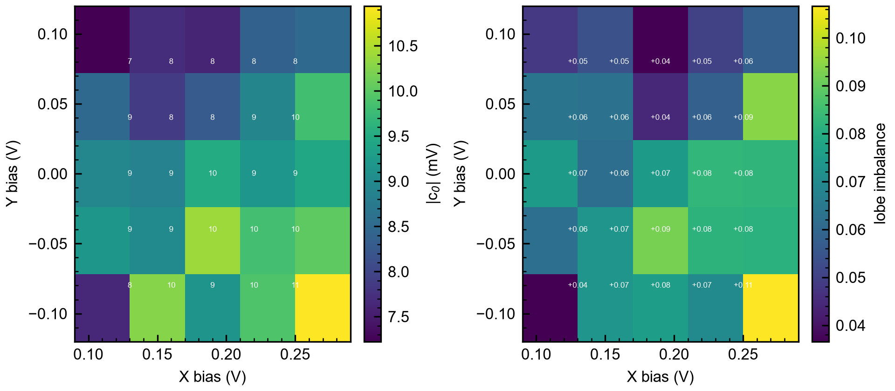
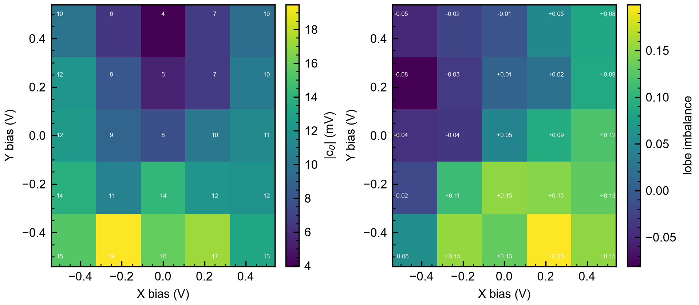
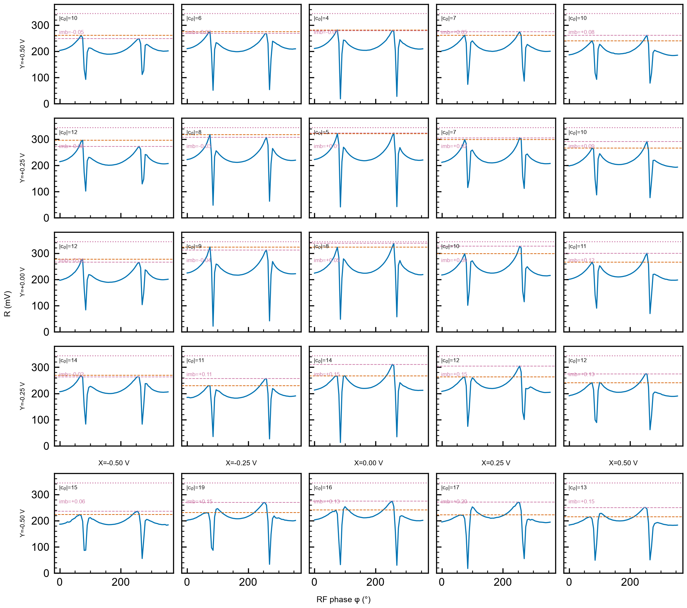
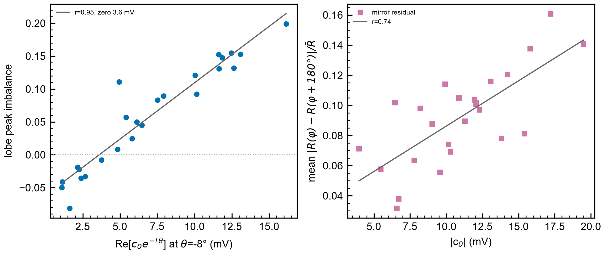

# 1 Vpp 下的 XY 平衡方格扫描

## 问的什么

按用户的模拟预期：射频场较强时，如果 XY 静态场平衡得好，相位响应会变得对称；所以用 1 Vpp 射频、加密相位（5°）、扫一片 XY 偏置，从"响应对称性"的角度检查平衡。

## 运行条件

- 时间窗 2026-11-22 20:42–22:11，28 次 `rf-phase-response` 全部 completed、`raw/phase_response.csv` 73 行（72 相位 + 表头）、`safety_shutdown` 完成。
- `Y_RF_VPP=1.0`、射频方向 Y、相位 0–360°/5°（72 点）、`N_REPEAT=1`；Z 脉冲固定 `−0.0655 mA、8.6 µs、s_f 0.5、τe 38.3 µs`。
- 网格 X ∈ {0.13, 0.16, 0.19, 0.22, 0.25} × Y ∈ {−0.08, −0.04, 0.00, 0.04, 0.08}，25 点；参考点 (0.19, 0.00) 首、中、尾各一次。
- 单点约 217 s（相位翻倍），清单 `runlists/balance_scan.csv`。

## 判据

用户口径的对称性是 **R(φ) 两个瓣的峰高相等**（φ 与 φ+180° 两个峰，分别记 P_A、P_B）：

- 不平衡度 = (P_A − P_B) / 均值；平衡时两瓣等高、不平衡度 → 0。
- 镜像残差 = mean|R(φ) − R(φ+180°)| / 均值 R，是同一件事的连续版本。
- 辅助量：`|c₂|/|c₁|`（偶次谐波，削顶不对称时长大）、`|c₃|/|c₁|` 与 `R 峰`（削顶判据）。

## 结果

| 量 | 范围 | 中位 |
|---|---|---|
| \|c₀\| | 7.2–10.9 mV | 9.0 mV |
| \|c₁\| | 150.4–158.6 mV | 156.0 mV |
| \|c₂\|/\|c₁\| | 1.29%–3.01% | 2.05% |
| \|c₃\|/\|c₁\| | 38.9%–39.8% | 39.4% |
| S_model | 5.04–5.31 mV/deg | 5.22 |
| R 峰 | 309–335 mV | 327 mV |
| 距 0.344 V 余量 | 9–35 mV | 17 mV |
| **两瓣峰高 P_A / P_B** | 327/308 … 335/314 mV | 差 19–21 mV |
| **不平衡度** | **3.7%–10.7%** | 7.0% |

参考点（同一偏置三次）：\|c₀\| 10.9/9.3/9.4 mV、\|c₁\| 157.3/157.2/155.8 mV、R 峰 327.5/328.9/326.1 mV——重复性约 1%，所以上表的点间差异基本都在噪声量级。

图 B1：5×5 小格，每格一个偏置点的 R(φ)，红点线是 0.344 V 饱和线，格内标该点的 \|c₀\|。25 条曲线形状几乎一致，都是"双谷 + 顶部平台"的削顶形状。

图 B2：左格 \|c₂\|/\|c₁\| 对 \|c₀\|（直线是线性拟合，r=0.13）；右格 R 峰对 \|c₀\|，虚线是饱和线。两幅都没有系统趋势——\ |c₀\| 变化 50% 时，不对称度并没有跟着变。

图 B3：\left\|c₀\right| 与 R 峰在 (X, Y) 平面的分布，格内标数值。两张图都是平的，说明**整个网格都处于平衡状态**。

## 宽网格：X、Y 各 −0.50…+0.50 V（2026-11-22 22:40–00:11）

按用户要求把范围放大到 X、Y 各 −0.5…+0.5 V（5×5），射频仍 1 Vpp、相位 5°，28 次全部 completed（raw 73 行 = 72 相位 + 表头；`N_REPEAT=1`，safety_shutdown 全 true）。单点 195 s。

| 量 | 窄网格（X 0.13–0.25、Y ±0.08） | 宽网格（X、Y ±0.50） |
|---|---|---|
| \|c₀\| 范围 | 7.2–10.9 mV | **4.0–19.5 mV** |
| 两瓣不平衡度 | +3.7% … +10.7% | **−8.1% … +19.9%**（中位 +5.7%） |
| 不平衡 vs \|c₀\| | r=0.87 | r=0.55（\|c₀\| 单独解释不了） |
| **不平衡 vs c₀ 投影** | θ=172°，**r=−0.88** | **θ=−8°，r=0.954** |
| 投影斜率 | 0.0160 ± 0.0018 每 mV | **0.0171 ± 0.0011 每 mV** |
| 截距（\|c₀\|→0 时的不平衡） | −7.5% | **−6.2%** |
| 两瓣等高的零点 | 投影 −4.7 mV | 投影 **+3.6 mV** |
| 削顶点数（R 峰 >0.98×344 mV） | 0 | 1 |

图 B4–B6：宽网格的 \|c₀\|/不平衡度分布、25 条 R(φ)（红色虚线是两瓣峰高、点线是饱和线）、以及不平衡度对 c₀ 最优投影的线性关系。

### 宽网格的结论

1. **两瓣峰高的不平衡正比于 c₀ 在某一方向上的投影**，而不是它的模：用 \|c₀\| 只得到 r=0.55，改成沿 θ=−8° 的投影后 **r=0.954**，斜率 0.0171±0.0011 每 mV。窄网格独立给出 θ=172°（与 −8° 同一条线、符号相反）、r=0.88、斜率 0.0160，两批在同一个方向上一致。
2. **平衡到位时两瓣确实等高，但要"过量"一点**：截距 −6.2%（窄网格 −7.5%）说明即使 c₀ 的投影为零，两瓣仍差 6–7%——这是与偏置无关的仪器性不对称（两个瓣对应 Z 周期的 +π 与 −π 脉冲）。要让两瓣真正等高，需要 c₀ 在 θ=−8° 方向上有约 **+3.6 mV** 的投影去抵掉这 6% 的底，而不是把 c₀ 调到零。
3. **1 Vpp 下平衡区很宽**：X、Y 各 ±0.5 V 共 25 点里 \|c₀\| 只有 4–20 mV（相对 \|c₁\|≈157 mV 是 3–12%），说明强射频本身把 c₀ 压小，这片区域整体都接近平衡；只有 1 个点 R 峰顶到饱和线附近。
4. **你的模拟方向成立**：c₀ → 0 时两瓣趋于等高的斜率项就是上面这条 0.017/mV；但"完全等高"需要同时抵消 −6% 的仪器底，这是模拟里没有的自由度。

### 待查

- θ=−8° 这个方向的物理含义：它应当对应椭圆主轴方向（c₁ 的相位是 −157°），实测差约 30°，需要再确认是拟合习惯（符号/共轭）还是真有额外相移。
- −6% 的仪器性不对称来源：Z 周期里 +π 与 −π 两个脉冲的波形反对称误差（`pulse_wave` 记录里有 `antisymmetry_error`）可以直接查。
- 若要把"两瓣等高"当成一个可调工作点，应把 c₀ 的投影而非 \|c₀\| 作为目标量。

## 结论

1. **两瓣峰高的不平衡与本征偏置 c₀ 强相关**：不平衡度 3.7%–10.7%，对 |c₀| 的斜率为 0.0160 ± 0.0019 每 mV（r=0.87），|c₀| 越小两瓣越接近等高。注意这是弱信号段——|c₀| 只从 7.2 变到 10.9 mV（1 Vpp 的强射频本身把 c₀ 压小了），所以截距处还留着一个 **−7.6% 的固定失衡**，那是与偏置无关的仪器性不对称（两瓣对应 Z 脉冲周期里的 +π 与 −π 两个脉冲，波形不完全反对称就会留这个底）。
2. **1 Vpp 的主导失真不是平衡，是削顶**：|c₃|/|c₁| 全网格都是 39%，R 峰 309–335 mV，距 0.344 V 饱和线只剩 9–35 mV，其中 (0.13, 0.04) 与 (0.16, 0.08) 两点余量不足 10 mV。也就是说 1 Vpp 恰好骑在削顶边缘，此时"是否对称"更多由削顶决定，而不是由偏置平衡决定。
3. **强射频把 \|c₀\| 本身压小了**：同一片区域在 50 mVpp 时 |c₀| 是 30–45 mV，1 Vpp 时只剩 7–11 mV；偏置对 c₀ 的灵敏度也从约 259 mV/V 降到约 30 mV/V。所以在这个幅度下靠偏置扫不出不平衡。

## 下一步（都需要另行授权）

1. **宽网格试点**：X ∈ {0, 0.3, 0.6, 0.9, 1.2}、Y ∈ {−0.3, 0, 0.3}，1 Vpp、36 相位（省时版），先看 |c₀| 是否被推到 30 mV 以上——只有 c₀ 与 c₁ 可比时，不对称才能显现。
2. **改在中低幅度做平衡研究**：50–100 mVpp 时 |c₀|≈40 mV、|c₁|≈84 mV，椭圆明显偏移且远离饱和，用 R_max/R_min 的不对称度直接量，不受削顶干扰。
3. 若坚持 1 Vpp，可把射频降到 0.8 Vpp 复测同一网格，验证"39% 三次谐波"确实来自峰值逼近饱和。

## 产物

- 数值表 `tables/balance_scan.csv`（每点一行：|c₀|、arg c₀、|c₁|、|c₂|、|c₃|、两个比值、S、R 峰、余量、谐波残差）；拟合汇总 `tables/balance_fit.json`。
- 脚本 `scripts/harmonics.py`（谐波分解）、`scripts/make_runlist.py`、`scripts/run_balance_scan.py`、`scripts/analyze_balance_scan.py`。
- 逐点记录 `_studies/20261122_xy_balance_scan/balance_scan_runs.jsonl`，日志同目录 `logs/`。
