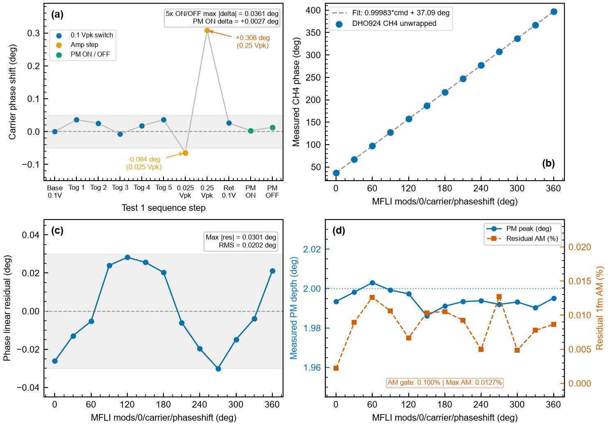
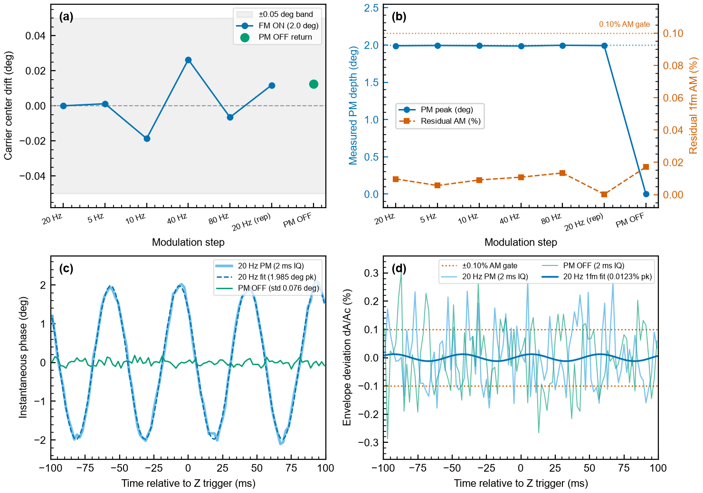
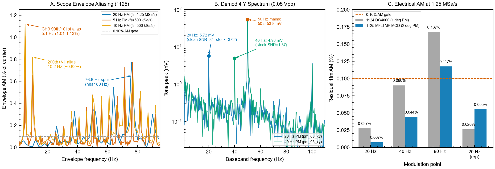
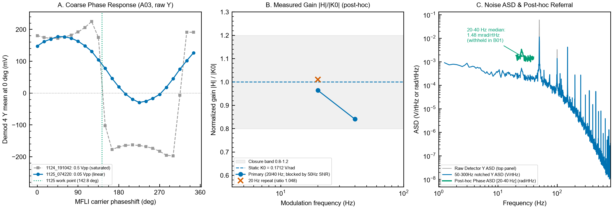

# MFLI `MF-MOD` 实机验证、手动指南与 `1125_074220` 诊断档案

本目录汇总 `rf-phase-sensitivity`（射频相位灵敏度）由 DG4000 迁移到 **MFLI (`dev30661`) `Signal Output 1` + `MF-MOD` + `Demod 4` 独立解调** 的全部实机验证数据、可视化结论、LabOne UI 手动设置指南，以及对完整实机运行 `1125_074220_phase_sensitivity` 为何在 `B01` 仍报 `partial`、`phase_noise.png` 为何只显示上图的通俗定量解析。

- 独立图文操作手册：**[LabOne UI 手动设置 MF-MOD 操作指南](labone_ui_mfmod_guide.md)**
- 可重跑离线分析与绘图脚本：[analyze_mfmod_and_live_runs.py](analyze_mfmod_and_live_runs.py)（纯离线读取运行目录 `.npz` 与 `yaml`，图注用英文，输出图在 `figures/`）

---

## 先回答最关心的问题：前面到底测出来没有？为什么 `phase_noise.png` 只有上图？

**一句话结论：前面每一步的物理信号其实都采到了、也算出来了，并不是“前面没测出来”；而是 `B01` 质检门控把 `A05` 的 6 个频点全部拦在了门外（合格频点数 = 0），导致程序“有谱不敢除”，只画了电压噪声谱（上图），自动扣留了下面的等效相位噪声折算曲线。**

按 [analysis_steps.py](../../../lab_workflows/experiment_modules/rf_phase_sensitivity/analysis_steps.py#L468-L485) 的绘图与换算规则，两条图层的依赖链如下：

1. **`phase_noise.png` 的上图（探测器 Y 电压噪声谱 $\mathrm{ASD}_V(f)$，单位 $\mathrm{V}/\sqrt{\mathrm{Hz}}$）**：  
   只依赖 `A06` 录到的 `24 s` 无调制噪声帧（`noise_xy.npz`）。这步已完整合格，所以**上图正常算出并画出来了**（可以清晰看到 50 Hz 及其倍频尖峰，以及 `1–40 Hz` 约 $2\text{–}9\times 10^{-4}\ \mathrm{V}/\sqrt{\mathrm{Hz}}$ 的电压本底）。
2. **`phase_noise.png` 的下图（等效输入相位噪声谱 $\mathrm{ASD}_\varphi(f)$，单位 $\mathrm{rad}/\sqrt{\mathrm{Hz}}$）**：  
   必须用上面的电压噪声谱 **除以** `A05` 测出的频响曲线 $|H(f)|$，即：
   $$\mathrm{ASD}_\varphi(f) = \frac{\mathrm{ASD}_V(f)}{|H(f)|}$$
   并且程序硬性规定：只有在相邻两个**通过全部电学与 SNR 质检的主测频点**之间才允许对数插值出 $|H(f)|$。
3. **为什么最后算成 0 个合格频点（`B01` 判为 `partial`）？**  
   - **静态标定（`A03–A04`）完全合格**：已稳稳测出工作点 `142.789°`、静态斜率 `K0 = 0.17120 ± 0.00397 V/rad`。
   - **`20 Hz`、`40 Hz`、`20 Hz` 复测其实都采集到了原子信号**：物理响应算出来分别为 `0.1651 / 0.1440 / 0.1730 V/rad`（占静态 `K0` 的 `96.4% / 84.1% / 101.0%`，非常合理）。但因为现场 `50 Hz` 磁干扰高达 `50.5–53.8 mV`（而 `0.05 Vpp` 下 `2°` 调制信号只有 `5.0–5.9 mV`），`fit_tone()` 没扣除 `50 Hz` 谐波，导致标准误估算偏大、`y_snr` 只报出 `3.02 / 1.37 / 2.95`，被 **`y_snr >= 5.0`** 门槛淘汰。
   - **`5 Hz`、`10 Hz`、`80 Hz` 在 `A05` 当场被示波器包络质检拦住**：它们连 `XY` 帧都没有进采集（具体原因见第三节——是示波器降采样率的参考方波谐波混叠，DG4000 旧基线 `1124_115154` 同样出现）。
   - **最终连锁反应**：`A05` 合格主测点数 = **`0`** → `phase_transfer.png` 两格只能显示无合格估计 → 无法插值 $|H(f)|$ → `phase_noise.png` 下图被迫显示 `"Phase referral withheld; see summary"`（仅保留上图）。

---

## 一、Stage 2：`MF-MOD` 独立电学实机验证结果

数据源：`rf_phase_sensitivity/_mfli_mod_verification`（`dev30661`，外部 10 MHz 参考 `extclk=True`，`MOD 1` `FM` 调制指数 `2° = 0.03491 rad`，`Out 1` 设 `0.1 Vpk` 对应 Y 监测 `0.06649 Vpk`，零直流偏置）。





| 验证项目 | 关键测试序列 / 条件 | 实测关键指标 |
| --- | --- | --- |
| **开关出力相位稳定性 (Test 1)** | `0.1 Vpk` 连续 5 次开关 `sigouts/0/on` | 基线 `37.0273°`，5 次开关相对偏移 **`-0.0079° ~ +0.0361°`** |
| **开/关 2° PM 相位跳变 (Test 1)** | 保持载波输出，开关两侧 `sidebands/0,1` | 打开 PM 中心漂移 **`+0.0027°`**（实测 PM `1.9958°`，AM `0.0096%`）；关 PM 回到 `+0.0129°` |
| **输出幅值切档效应 (Test 1)** | `0.1 → 0.025 → 0.25 → 0.1 Vpk` | 切至 `0.025 / 0.25 Vpk` 时静相偏 `-0.0641° / +0.3077°`，切回 `0.1 Vpk` 复归 `+0.0258°`（故正式实验固定量程不中途换档） |
| **`0–360°` 连续移相线性度 (Test 2)** | `mods/0/carrier/phaseshift` 按 `30°` 步进（`2° PM @ 20 Hz`） | 拟合斜率 **`0.99983`**，最大线性残差 **`0.0301°`**（RMS `0.0202°`）；PM 深稳于 `1.9862°–2.0030°`，最大 1fm AM **`0.0127%`** |
| **调制频点切换稳相 (Test 3–4)** | `[20, 5, 10, 40, 80, 20 rep] Hz` → 关调制复归 | 相对锚点漂移仅 **`-0.0187° ~ +0.0264°`**，PM 深 `1.9871°–1.9971°`，1fm AM **`0.0002%–0.0134%`**，关调制复归差 `+0.0124°` |
| **`Demod 4` 独立解调验证 (Test 4)** | `MOD 1` 运行（`carrier/phaseshift=0.0°`） | `demods/3` 单独设为 `-42.5°`、`oscselect=1`、`adcselect=0`，`daq` 以 `1674.11 Sa/s` 正常采集 |

---

## 二、Stage 3：正式实验分步实机运行汇总（1124–1125）

| 运行目录 | `Y_RF_VPP` | 执行范围 | 核心状态与标定结论 | 安全收尾 |
| --- | --- | --- | --- | --- |
| `rf_phase_sensitivity/1124_191042_phase_sensitivity` | `0.5` | `A01–A04` | **在 `A03` 失败**：原子信号过饱和为 `±0.28 V` 方波（3 次谐波 `~61.8 mV`，模型残差 `0.1075 V`），未找到有效工作点 | 正常（无报错） |
| `rf_phase_sensitivity/1124_191353_phase_sensitivity` | `0.05` | `A01–A04` | **成功**：工作点 `140.020°`，`Demod 4` `132.128°`，`K0 = 0.15953 ± 0.00358 V/rad` | 正常（无报错） |
| `rf_phase_sensitivity/1125_074220_phase_sensitivity` | `0.05` | **`A01–B01` 全流程** | **`A01–A07` 全部完成，`B01` 判为 `partial`**：`K0 = 0.17120 ± 0.00397 V/rad`，`pm_alignment` `attempts=0`，20/40 Hz 电学通过且 AM 低至 `0.0073%` | 正常（无报错） |
| `rf_phase_sensitivity/1124_115154_phase_sensitivity`（基线） | `0.05` | 改前 DG4000 全流程 | 改前同样在 `5/10/80 Hz` 示波器 AM 超限，同样在 `20/40 Hz` 受 `50 Hz` 干扰致 `y_snr < 5`（`1.71 / 0.62 / 1.49`） | — |

### `1125_074220` 与 `1124_115154`（DG4000）各频点定量对比

| 频点 | `1125_074220` (`MF-MOD`, 2° PM) 实测与判定 | `1124_115154` (`DG4000`, 1° PM) 对比 |
| --- | --- | --- |
| **`20 Hz` (主测)** | 电学 **PASS** (`AM = 0.0073%`, 中心偏 `+0.0103°`)；`Y_pk = 5.716 mV`，官方 `y_snr = 3.02` (<5 拒)；扣工频后真实 `SNR = 84.0` | 电学 PASS (`AM = 0.0274%`)；官方 `y_snr = 1.71` (<5 拒) |
| **`5 Hz`** | 电学 **FAIL** (`AM = 1.010%`, `PM = 0.0319 rad`)：`500 kSa/s` 下 `CH3` 99/101 次谐波混叠成 `5.10 Hz` (`1.08%`) 假拍频 | 同现 **FAIL** (`AM = 1.090%`, `5.14 Hz` 混叠 `1.22%`) |
| **`10 Hz`** | 电学 **FAIL** (`AM = 0.820%`)：`500 kSa/s` 下混叠出 `5.06 Hz` (`1.13%`) 与 `10.24 Hz` (`0.90%`) 假 AM 拍频 | 同现 **FAIL** (`AM = 0.855%`, `5.14 / 10.28 Hz` `1.18% / 0.97%`) |
| **`40 Hz`** | 电学 **PASS** (`AM = 0.0439%`, 中心偏 `+0.0018°`)；`Y_pk = 4.975 mV`，官方 `y_snr = 1.37` (<5 拒)；扣工频后 `SNR = 49.7` | 电学 PASS (`AM = 0.0900%`)；官方 `y_snr = 0.62` (<5 拒) |
| **`80 Hz`** | 电学 **FAIL** (`AM = 0.1174%`)：全帧共存的 `76.6 Hz` (`~0.8–0.9%`) 杂散在 `0.5 s` 窗下泄漏超 `0.1%` 门限 | 同现 **FAIL** (`AM = 0.1673%`) |
| **`20 Hz` (复测)** | 电学 **PASS** (`AM = 0.0551%`, 中心偏 `-0.0266°`)；`Y_pk = 5.933 mV`，官方 `y_snr = 2.95` (<5 拒)；扣工频后 `SNR = 75.7` | 电学 PASS (`AM = 0.0262%`)；官方 `y_snr = 1.49` (<5 拒) |

---

## 三、`B01` 部分合格的两大物理/测量成因与可恢复信号展示





1. **示波器降速引发 `CH3` 参考方波谐波串扰混叠（`5 / 10 / 80 Hz`）**  
   DHO924 自身时基相对实验室 10 MHz 参考偏了约 `+10.2 ppm`（将 5 kHz 载波测作 `5000.051 Hz`）。当测量 `5 Hz`（2 s 窗）与 `10 Hz`（1 s 窗）时，示波器自动存储深度将采样率从 `1.25 MSa/s` 降为 **`500 kSa/s`**。此时 `CH3` 5 kHz 方波（`4.5 Vpk`）在第 99/101 次（`495.005 / 505.005 kHz`）及第 199/201 次谐波处向 `CH4`（`16.8 mVpk` 载波）耦合约 `0.09 mV` 的串扰，被 `500 kSa/s` 采样率正好混叠到 `|100 × 5000.051 - 500000| ≈ 5.1 Hz` 与 `10.2 Hz` 上，形成超过 `0.1%` 门限的虚假包络调幅；`80 Hz` 则是各帧共有的 `76.6 Hz` 杂散泄漏所致。由于在相同 `1.25 MSa/s` 采样率下 `MF-MOD` 的 AM 比旧 DG4000 还低 `2–3.7×`（`0.0073%` vs `0.0274%`），**证实该异常并非新 `MF-MOD` 引入**。

2. **`50 Hz` 实验室磁干扰阻塞 `fit_tone()` 信噪比判据（`20 / 40 Hz`）**  
   如上图 Panel A（`diag_1125_posthoc_physical_response.png`）所示，`0.5 Vpp` 会把原子打进方波饱和区，而 `0.05 Vpp` 落在平滑线性区。但由于 `Demod 4 Y` 上伴随约 `50.5–53.8 mV` 的 `50 Hz` 环境磁干扰（与改前 DG4000 基线实测的 `54–55 mV` 相同），未扣除工频的 `fit_tone()` 把全部 `50 Hz` 能量算入残差并经 Bartlett 自相关放大误差（尤其 `40 Hz` 与 `50 Hz` 形成 `10 Hz` 差拍），把原本干净的信号判成 `SNR = 1.37–3.02 < 5`。  
   - **物理恢复验证（非官方探索计算，见上图 Panel B/C）**：同步拟合剔除 `50 / 100 / 150 Hz` 后，残差 RMS 从 `36.2 mV` 降到 `2.78 mV`，`20 / 40 / 20(rep) Hz` 的等效 `SNR` 达 `84.0 / 49.7 / 75.7`，测得归一化灵敏度 `|H|/|K0|` 为 **`0.964 / 0.841 / 1.010`**（锚点首末漂移仅 `4.8%`，全部落在 `0.8–1.2` 合理区内）；若用此 `20–40 Hz` 增益对剔除工频倍频后的 `noise_xy` 做非官方折算，`[20, 40] Hz` 区间等效相位噪声中位约 **`1.483 mrad/√Hz`**（`30 Hz` 处约 `1.630 mrad/√Hz`）。

---

## 四、后续待查与改进方向（待确认）

1. **优化 `Y_RF_VPP` 默认值**：当前 `rf-phase-sensitivity.yaml` 默认仍为会饱和的 `0.5 Vpp`；建议测试 `0.06–0.15 Vpp` 区间，在线性度允许下提高 `CH4` 载波幅值以压低串扰比例并确定新的默认值。
2. **治理示波器混叠与 `50 Hz` 干扰阻塞**：评估通过提高 DHO924 固定存储深度维持 `≥1.25 MSa/s`（消除 `5/10 Hz` 下采样混叠）以及确认是否要在 `fit_tone()` 中显式联合剔除 `50 Hz` 谐波或加强现场 50 Hz 磁屏蔽。

## 五、复现方式

```powershell
$env:LAB_DATA_ROOT = "D:\Code\exp_agent_run\data"
agent_exp_env\Scripts\python.exe scripts\rf_phase_sensitivity\20261125_mfmod_live_verification\analyze_mfmod_and_live_runs.py
```
